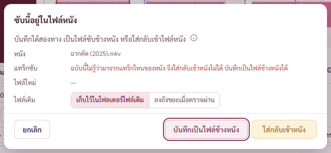

# รายงาน 14 พ.ย. 2569 · ผู้ช่วยตรวจทานระบบซับ 2 ตัว แล้วแก้ตามผล

พี่กันสั่ง *"ทำต่อเลย จนเสร็จตามแผน commit ทุกชั้น เเละตอนเสร็จเราให้รันเอเจ้น 2 ตัวตรวจทานระบบซับอีกรอบ"* · ผู้ช่วยสองตัวอ่านโค้ดของแผนหน้าแก้ซับทั้งหมด ไม่รัน ไม่แก้โค้ด
- ฝั่ง Rust (ตัวอ่านเขียนไฟล์ บันทึก ใส่กลับเข้าหนัง) 14 ข้อ ผลที่ [review/ตรวจทาน-2026-11-14/ระบบซับ-ฝั่ง-Rust.md](review/ตรวจทาน-2026-11-14/ระบบซับ-ฝั่ง-Rust.md)
- ฝั่งหน้าจอ 25 ข้อ ผลที่ [review/ตรวจทาน-2026-11-14/ระบบซับ-หน้าจอ.md](review/ตรวจทาน-2026-11-14/ระบบซับ-หน้าจอ.md)

แคลร์เปิดโค้ดจริงยืนยันทุกข้อก่อนแก้ แล้วทำตัวตรวจที่แดงกับโค้ดเก่า เขียวกับโค้ดที่แก้ (พิสูจน์ด้วยการคืนโค้ดเก่าชั่วคราวทุกข้อที่มีตัวตรวจ)

## 1. สรุป

| ระดับ | ผู้ช่วยเจอ | จริง | แก้ครบ | แก้บางส่วน | ยังไม่แก้ |
|---|---|---|---|---|---|
| ร้ายแรง | 7 | 7 | 7 | 0 | 0 |
| ปานกลาง | 19 | 19 | 17 | 0 | 2 (R6 R7) |
| เล็ก | 13 | 13 | 8 | 3 (R11 R14 F21) | 2 (R9 F23) |
| รวม | 39 | 39 | 32 | 3 | 4 |

ไม่มีข้อไหนที่ผู้ช่วยเข้าใจผิด · ข้อ "น่าสงสัย ยังไม่ยืนยัน" ทั้งหมดยืนยันจากโค้ดได้ว่าเกิดจริง

ผลตรวจหลังแก้ ตัวตรวจรอบแก้ผลผู้ช่วย `check-review-fixes.mjs` ผ่าน 34 จาก 34 ข้อ (โค้ดเก่าแดง 19 ข้อ) · cargo test 209 จาก 209 ข้อ (เทสใหม่ 4 ตัว คืนโค้ดเก่าแล้วแดงทุกตัว)

## 2. ข้อร้ายแรง (แก้ครบ)

**R5 · ไฟล์ซับที่บรรทัดสุดท้ายไม่มีตัวขึ้นบรรทัด เพิ่มบรรทัดแล้วบรรทัดใหม่ไปติดบรรทัดเดิม** · ใส่ตัวขึ้นบรรทัดตามแบบของไฟล์ก่อนต่อบรรทัดถัดไป ไฟล์ที่ไม่แก้ยังเขียนกลับเหมือนเดิมทุกไบต์ · commit 7e618cb

**F1 · กด Enter ในช่องพิมพ์ เวลาที่ลากไว้บนคลื่นเสียงหายเงียบ** · Enter ยืนยันเวลาที่ลากค้างก่อนไปบรรทัดถัดไป แบบ grid/line/next/create ของ Aegisub

**F3 · เลิกทำหลังบันทึก ที่มาของไฟล์ย้อนไปด้วย** · เลิกทำและทำซ้ำไม่ย้อนที่มาของไฟล์ รหัสอักษร และสถานะเข้ารหัส · เดิมบันทึกเป็น b.ass แล้วเลิกทำ กดบันทึกไปเขียนทับ a.ass

**F4 · พิมพ์ต่อระหว่างกำลังบันทึก ตัวที่พิมพ์ถูกนับว่าบันทึกแล้ว** · นับว่าบันทึกเฉพาะเอกสารที่เขียนลงไฟล์จริง ที่แก้ระหว่างรอยังนับว่ายังไม่บันทึก

**F5 · แบบ notepad กดบันทึกตรงจังหวะแปลงกลับ ที่พิมพ์หายทั้งหมด** · ปุ่มบันทึกรองานแปลงกลับที่กำลังทำ · ปุ่มบันทึกกดได้เมื่อมีที่พิมพ์ค้าง · หลังบันทึกไม่วาดข้อความทับที่กำลังพิมพ์

**F6 · กดเปลี่ยนแทร็กเร็ว ๆ ซับของแทร็กที่กดก่อนมาแสดงแทน** · คำขอเปิดที่ถูกแทนแล้ว ผลมาทีหลังไม่ทับ ทั้งกดแทร็กใหม่ และกดกลับแทร็กเดิม (R4 ซ้ำกับข้อนี้)

**F18 · เปิดฉบับอัตโนมัติของซับอีกแทร็กแล้วใส่กลับเข้าหนัง แทนแทร็กที่หน้าเลือกอยู่** · ที่มาของซับในหนังจำเลขแทร็ก หน้าต่างใส่กลับใช้หนังกับเลขแทร็กจากที่มาของเอกสาร · ฉบับที่ไม่รู้แทร็ก (ฉบับอัตโนมัติรุ่นก่อน) ใส่กลับไม่ได้ บันทึกเป็นไฟล์ข้างหนังได้ (R1 ซ้ำกับข้อนี้)

## 3. ข้อปานกลาง

| ข้อ | เรื่อง | ผล |
|---|---|---|
| R1 | ฉบับอัตโนมัติของไฟล์ซับที่ถูกลบไปแล้ว ตั้งเป็นซับในหนัง | แก้ ยังเป็นไฟล์ซับ บันทึกแล้วพาไปบันทึกเป็นไฟล์ใหม่ · cargo test |
| R2 | ที่อยู่ไฟล์ยาว ไฟล์เดิมลงถังขยะแล้วย้ายไฟล์ใหม่มาแทนไม่ได้ | แก้ ตัวย้ายไฟล์ใช้ที่อยู่แบบ \\?\ เมื่อยาว · cargo test ที่อยู่ยาวเกิน 260 ตัว |
| R3 | หนังถูกรวมไฟล์ใหม่ระหว่างแก้ แทนผิดแทร็ก | แก้ จดขนาดกับเวลาแก้ของหนังตอนเปิด เปลี่ยนแล้วปุ่มใส่กลับกดไม่ได้พร้อมเหตุผล |
| R4 | สลับแทร็กเร็ว ๆ ผลแทร็กเก่าทับ | ซ้ำกับ F6 แก้แล้ว |
| R6 | ใส่ซับกลับแล้วภาษาแบบละเอียด (zh-Hant) และธงแทร็กหาย | **ยังไม่แก้** ต้องมีไฟล์ทดสอบที่มีภาษาแบบ IETF และแตะงานรวมไฟล์ที่หน้าเสียงและซับใช้ร่วม |
| R7 | คลื่นเสียงกับภาพนับเวลาจากคนละจุด ไฟล์ที่ภาพเริ่มช้ากว่าเสียง | **ยังไม่แก้** ต้องมีไฟล์ทดสอบที่ภาพเริ่มช้ากว่าเสียง แล้วเลื่อนเสียงแบบ Aegisub (FFMS_DELAY_FIRST_VIDEO_TRACK) |
| F2 | บรรทัดสุดท้ายกด Enter บรรทัดใหม่เริ่มที่เวลาจบเดิม | แก้ เริ่มที่เวลาจบที่เพิ่งยืนยัน |
| F7 | ไม่บันทึกหรือเปิดฉบับอัตโนมัติ ทิ้งที่แก้ทั้งที่บันทึกอัตโนมัติล้ม | แก้ บันทึกอัตโนมัติล้มแล้วไม่ทิ้ง บอกเหตุผล ทั้งหน้าซับไตเติล หน้าแก้ซับ และตอนปิดโปรแกรม |
| F8 | ที่พิมพ์ใน notepad ครึ่งวินาทีสุดท้ายไม่ถูกนับ | แก้ ใส่ที่พิมพ์ลงเอกสารก่อนเช็ก และบอกตัวกันปิดทันทีที่พิมพ์ |
| F9 | ใส่ซับกลับเข้าหนัง MP4 ได้ไฟล์ MKV ชื่อใหม่ หน้ายังชี้ไฟล์เดิม | แก้ หน้าซับไตเติลชี้ไฟล์ใหม่ |
| F10 | เล่นเสียงยาวหน่วยความจำโตไม่หยุด | แก้ ก้อนเสียงที่ดังจบแล้วปล่อยคืน |
| F11 | เปิดภาพความถี่แล้วถอดภาพใหม่ทุกเฟรม | แก้ ทำภาพครั้งเดียวต่อข้อมูลชุดหนึ่ง |
| F12 | ไฟล์เสียงแยกติดไปกับซับเรื่องอื่น | แก้ เปิดซับอื่นแล้วกลับไปใช้เสียงของหนัง |
| F13 | Ctrl ลากขอบข้ามบรรทัดข้าง บรรทัดนั้นจบก่อนเริ่ม | แก้ เรียงเวลาทุกบรรทัดตอนยืนยัน |
| F14 | เวลาที่ลากค้างไปลงบรรทัดเดิมทีหลัง | แก้ ทิ้งตอนเปลี่ยนบรรทัดทุกแบบการดู เลิกทำ ทำซ้ำ เปิดปิดเอกสาร |
| F15 | ตัวจริงแป้นไทยกด Ctrl+R หน้ารีเฟรช | แก้ ตัวกันเทียบรหัสปุ่มด้วย (ตรวจได้แค่ในตัวจริง ยังไม่ได้ตรวจ) |
| F16 | แก้ notepad ตัวเดียว ทุกบรรทัดขึ้นว่าแก้ | แก้ บรรทัดที่ไม่เปลี่ยนใช้ตัวเดิม |
| F19 | Shift เลือกช่วงได้ทีละสองบรรทัด | แก้ จำจุดตั้งต้นแบบ Aegisub |
| F25 | ลากไฟล์มาวางระหว่างใส่ซับกลับ ผลไปลงเอกสารใหม่ | แก้ ไม่รับไฟล์ที่ลากมาตอนมีหน้าต่างซ้อน และผลที่ไม่ใช่ของเอกสารที่เปิดอยู่ไม่นับว่าบันทึก |

## 4. ข้อเล็ก

| ข้อ | เรื่อง | ผล |
|---|---|---|
| R8 | ลบบรรทัดแล้วบรรทัดที่อ่านไม่ออกหายไปด้วย · Marked=0 อ่านไม่ออก | แก้ทั้งสองส่วน · cargo test Marked=0 |
| R9 | ไฟล์ที่มี [Events] สองส่วน | **ยังไม่แก้** เจอเฉพาะไฟล์ที่เอาสองไฟล์มาต่อกัน |
| R10 | บันทึก keyframe กับเสียง ย้ายไม่สำเร็จแล้วไฟล์ใหม่ถูกลบ · เลือกทับไฟล์หนังได้ | แก้ ไฟล์เดิมไปแล้วไม่ลบไฟล์ใหม่ · keyframe ต้องเป็น .txt เสียงต้องเป็น .wav |
| R11 | ฉบับอัตโนมัติ นาฬิกาถอยหลังแล้วฉบับใหม่ถูกลบ | แก้ข้อ 1 · cargo test · ข้อ 2 ถึง 4 (โควตาตามชื่อ รหัสอักษร เพดานรวม) **ยังไม่แก้** |
| R12 | ใส่ซับกลับล้มเพราะงานของหน้าแก้ซับเองถือไฟล์หนัง | แก้ หยุดงานหาจุดเปลี่ยนฉาก ตารางเฟรม และตัวเล่นก่อน |
| R13 | บันทึกการใช้งานจดเนื้อซับทั้งก้อน ที่อยู่ไฟล์ถูกตัด | แก้ · cargo test |
| R14 | ข้อ 1 ตัวเลขเวลายาวพังโปรแกรม · ข้อ 3 บันทึกซ้อน · ข้อ 4 จดขนาดหลังอ่าน | แก้ทั้งสามข้อ · cargo test ข้อ 1 · ข้อ 2 (.partial ค้าง) กับข้อ 5 (เลือกรหัส UTF-16 เอง) **ยังไม่แก้** |
| F17 | ปิดโปรแกรมแล้วกดบันทึกซับในหนัง ขึ้นว่าบันทึกไม่สำเร็จ | แก้ ตัวบันทึกบอกผลสามแบบ ต้องเลือกแล้วพาไปหน้าแก้ซับ |
| F20 | ลากเลือกสีแล้วแท็กสีซ้อนหลายชั้น | แก้ ใส่สีตอนเลือกเสร็จครั้งเดียว |
| F21 | ปุ่มกดแล้วเงียบ · Ctrl คลิกเอาบรรทัดสุดท้ายออก · Ctrl+A กับ F3 | แก้ปุ่มกับ Ctrl คลิก · Ctrl+A ทั้งหน้ากับ F3 ในหน้าต่างค้นหา **ยังไม่แก้** |
| F22 | วิดีโอจำลองใหญ่ซูมมาก ผืนวาดใหญ่เกิน | แก้ จำกัดด้านยาว 4,096 จุด (ยังไม่มีตัวตรวจ) |
| F23 | ผิดกฎหน้าตาของโปรเจกต์ | **ยังไม่แก้** ดูหัวข้อ 5 |
| F24 | Ctrl+S ตอนยังไม่แก้ เขียนไฟล์ใหม่ทุกครั้ง | แก้ |

## 5. ข้อ F23 ผิดกฎหน้าตา (ยังไม่แก้)

ตัวเลือกแท็กในตารางไม่มี ⓘ · ปุ่มเพิ่มหรือเปลี่ยนไฟล์วิดีโอกว้างไม่คงที่ · กล่องที่หัวว่าบันทึกไม่สำเร็จใช้กับเรื่องอื่นด้วย · รายการสิ่งที่หายตอนบันทึกเป็น SRT ค้างเป็นโครงจางเมื่อแปลงล้ม · ปุ่มตั้งชื่อใหม่ต่อเลขเงียบเมื่อล้ม
พี่กันบอกว่าจะเกลาหน้าตาเอง (*"เราดูละ เดี๋ยวเราเกลาเอง ต้องปรับอีกเยอะเลย"*) แคลร์จึงพักไว้ทำพร้อมรอบเกลา ไม่แก้หน้าตาก่อน จดไว้ใน ROADMAP

## 6. การตรวจ

- `check-review-fixes.mjs` 34 จาก 34 ข้อ · เก็บตัวแก้ฝั่งหน้าจอชั่วคราว (git stash) โค้ดเก่าแดง 19 ข้อ ทุกข้อของรอบนี้
- cargo test 209 จาก 209 ข้อ · เทสใหม่ ที่อยู่ยาว ฉบับอัตโนมัติตอนนาฬิกาถอยหลัง Marked=0 ตัวเลขเวลาล้น บันทึกการใช้งาน คืนโค้ดเก่าแล้วแดงทุกตัว
- ตัวตรวจทั้งแผนหน้าแก้ซับ (run-subedit-all.sh) ผ่านครบ check-subchap 27 check-subedit 63 check-subvideo 51 check-subaudio 52 check-subcmds 123 check-subtools 72 check-subpad 22 check-subremux 18 check-sizes 60 · check-subedit รอบแรกได้ 62 จาก 63 เพราะทางลัดในตัวตรวจเรียก markSaved แบบเดิม (เปลี่ยนรูปแบบตามข้อ F4) แก้ตัวตรวจแล้วผ่าน 63
- ยังไม่ได้ตรวจ F15 (ต้องตัวจริง) F22 F7 F8 F9 F17 F25 R3 R12 (ต้องจำลองไดรฟ์เต็ม ลากไฟล์จริง หนัง MP4 กับซับ ASS หรือรวมไฟล์หนังใหม่ระหว่างแก้)
