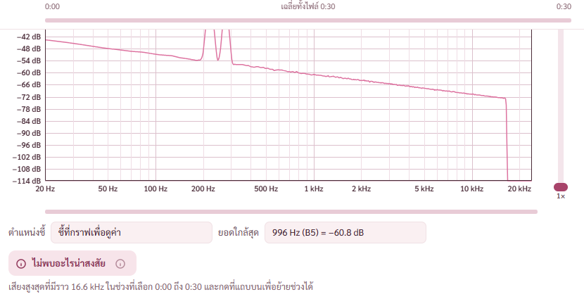
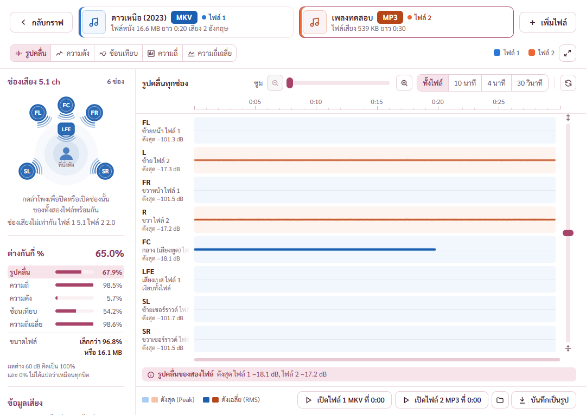

# รายงาน AUDIT กลุ่ม 1 ผลตรวจหรือผลแปลงผิดแบบไม่บอก · 15 พ.ย. 2569

ยังไม่ commit

พี่กันสั่ง *"เอาทั้งสามกลุ่มเลย เเต่ทำทีละกลุ่ม กลึ่ม 1 เสร็จก่อน เเล้วค่อยถามเราว่าจะทำต่อไหม"* · กลุ่ม 1 มีสี่ข้อ (29 21 22 17)

## ข้อ 29 ไดรฟ์ USB หลุดหรือไฟล์อ่านไม่ได้กลางตรวจละเอียด เรื่องนั้นขึ้นว่าไฟล์เสียหาย

- เดิม ระหว่างตรวจละเอียด ถ้าไดรฟ์หลุด ffmpeg ฟ้องว่าอ่านดิสก์ไม่ได้ (Input/output error) โปรแกรมนับเป็นภาพแตกเสียงหาย แล้วขึ้นการ์ดไฟล์เสียหายพร้อมเวลาที่เจอ ทั้งที่ไฟล์อาจยังดีอยู่
- ใหม่ บรรทัดที่บอกว่าอ่านดิสก์ไม่ได้ (Input/output error, I/O error, Error number -5, Permission denied, No such file, Device not ready) ไม่นับเป็นไฟล์เสีย และถ้าหลังรอบแรกไฟล์หายไปหรือขนาดกับเวลาแก้ไฟล์เปลี่ยน ขึ้นว่าตรวจไม่ได้ พร้อมคำว่า "อ่านไฟล์ไม่จบระหว่างตรวจ ไดรฟ์อาจหลุดหรือไฟล์ถูกย้าย ไฟล์อาจยังดีอยู่ เสียบไดรฟ์ให้แน่นแล้วตรวจใหม่" · รอบหาจุดเสียละเอียดถ้า ffprobe เปิดไฟล์ไม่ได้เลยก็ขึ้นตรวจไม่ได้เหมือนกัน (เดิมใช้จุดคร่าวจากรอบแรกแทน)
- ตรวจ cargo test ชุดใหม่ `disk_errors_are_not_damage` (บรรทัดดิสก์สี่แบบนับเป็นอ่านดิสก์ไม่ได้ บรรทัดไฟล์เสียสามแบบไม่นับ ไฟล์ที่หายไประหว่างตรวจได้ตรวจไม่ได้) แดงกับโค้ดก่อนแก้
- ข้อนี้ไม่มีภาพ เพราะทำให้ไดรฟ์หลุดจริงกลางตรวจในตัวตรวจไม่ได้ · พี่กันลองได้โดยตรวจละเอียดไฟล์ในแฟลชไดรฟ์แล้วดึงออกกลางทาง ต้องขึ้นตรวจไม่ได้ ไม่ใช่ไฟล์เสียหาย

## ข้อ 21 หน้าความถี่เฉลี่ยเตือนไฟล์ไม่ลดคุณภาพปลอมกับไฟล์ MP3 AAC AC-3 ทุกไฟล์

- เดิม เปิดไฟล์ MP3 128 kb/s ในหน้าความถี่เฉลี่ย ขึ้นเตือนสีเหลือง "อาจเคยเป็น MP3 หรือ AAC มาก่อน" ทั้งที่ไฟล์เป็น MP3 อยู่แล้ว และหน้าความถี่ของไฟล์เดียวกันไม่เตือน
- ใหม่ เตือนเฉพาะไฟล์ชนิดไม่ลดคุณภาพ (FLAC PCM ALAC TrueHD MLP DTS-HD MA WavPack APE TAK TTA) ใช้รายชื่อเดียวกับหน้าความถี่ · ไฟล์ MP3 ที่แปลงกลับเป็น FLAC ยังขึ้นเตือนเหมือนเดิม
- ตรวจ check-bugs6 เพิ่มข้อใหม่ เปิด MP3 ต้นทางของไฟล์ "ตัดแบบ mp3.flac" ต้องไม่ขึ้นเตือน ข้อเดิม FLAC ปลอมต้องยังขึ้นเตือน · แดงกับโค้ดก่อนแก้ (MP3 ขึ้นเตือน) · ผ่าน 13 จาก 13

## ข้อ 22 ดูแทร็กเสียงที่ 2 แล้วกดเทียบหรือแปลงเสียง โปรแกรมใช้แทร็กแรกแทนโดยไม่บอก

- เดิม หนังดาวเหนือมีเสียงไทย AAC 1 ช่องเป็นแทร็กแรก เสียงอังกฤษ AC-3 5.1 เป็นแทร็กที่สอง · เลือกเสียง 2 ในหน้ากราฟแล้วกดเทียบ หน้าเทียบเอาเสียงไทย 1 ช่องมาเทียบ · กดแปลงเสียง คิวแปลงเสียงไทยแทน
- ใหม่ หน้าเทียบอ่านแทร็กที่เลือกทุกจุด (ภาพรวม ความถี่เฉลี่ย บันทึกเป็นรูป ผลต่าง) ชิปไฟล์บอก "เสียง 2 อังกฤษ" เมื่อไฟล์มีหลายแทร็ก · คิวแปลงเสียงแปลงแทร็กที่เลือก แถวคิวบอก "แทร็กเสียงที่ 2 จาก 2 ในไฟล์หนัง" ต่อจากชนิดเสียง ไม่ไว้ท้ายแถวที่โดนจางหาย · กดชิปไฟล์หรือกลับกราฟจากหน้าเทียบ กลับมาที่แทร็กเดิม · ปุ่มเทียบความถี่หลังแปลงเสร็จก็ใช้แทร็กเดิม
- ตรวจ check-track-pick ใหม่ 5 ข้อ (เลือกเสียง 5.1 แล้ว หน้าเทียบชิปบอกเสียง 2 หน้าเทียบได้ช่องเสียง 5.1 รวม 6 ช่อง กลับกราฟเดี่ยวยังเป็นแทร็กที่ 2 คิวแปลงได้ AC-3 5.1) แดง 3 ข้อกับโค้ดก่อนแก้ ผ่าน 5 จาก 5 · cargo test ชุดใหม่ `probe_and_convert_picked_audio_track` ขอแทร็กที่สองได้สตรีม AC-3 6 ช่อง แปลงเป็น FLAC ได้ 6 ช่อง ขอแทร็กที่ไม่มีบอกว่ามีกี่แทร็ก แดงกับโค้ดก่อนแก้

## ข้อ 17 แยกบทของหนัง MP4 ได้ไฟล์ .chapters.xml ที่ข้างในเป็นซับแทร็กแรก

- เดิม หนัง MP4 ที่มีบทและมีซับ ติ๊กบทของหนังแล้วกดแยก ได้ไฟล์ชื่อ .chapters.xml ที่ข้างในเป็นไฟล์ Matroska มีซับ เปิดไม่ได้ แต่ขึ้นว่าแยกสำเร็จ · MP4 ที่ไม่มีซับขึ้นว่าไม่เจอแทร็กที่ 1
- ใหม่ บทของไฟล์ที่ไม่ใช่ MKV อ่านด้วย ffprobe แล้วเขียนเป็นไฟล์บท Matroska XML รูปเดียวกับที่ mkvextract เขียน มีเวลาเริ่ม เวลาจบ และชื่อบท · ไฟล์ที่ไม่มีบทบอกว่าไฟล์นี้ไม่มีบทของหนัง · ชนิดที่ไม่ใช่สตรีม เช่นไฟล์แนบ บอกว่าแยกจากไฟล์ที่ไม่ใช่ MKV ด้วยวิธีนี้ไม่ได้ ไม่หยิบซับมาแทน
- ตรวจ cargo test ชุดใหม่ `mp4_chapters_extract_as_matroska_xml` (ทำ MP4 ที่มีซับกับบทสองบทชื่อไทย แยกแล้วได้ XML สองบท ใส่กลับด้วย mkvmerge ได้สองบท MP4 ไม่มีบทบอกว่าไม่มีบท ไฟล์แนบไม่ได้ไฟล์) แดงกับโค้ดก่อนแก้ · `writes_matroska_xml` เวลาและอักษรพิเศษในชื่อบทถูก
- ข้อนี้ไม่มีภาพ หน้าจอไม่เปลี่ยน เปลี่ยนเฉพาะไฟล์ที่ได้

## ผลตรวจรวม

- cargo test 279 จาก 279 (เพิ่ม 4 ชุด) · เทสใหม่ทั้งสี่ชุดแดงกับโค้ดก่อนแก้ แล้วเขียวกับโค้ดที่แก้
- ตัวตรวจผ่านโปรแกรมทดสอบที่หน้าต่าง 1280 × 800 · check-bugs6 13 จาก 13 · check-track-pick 5 จาก 5 · check-convert 41 จาก 41 (คิวแปลงเสียงทั้งหน้า) · check-gmkv 26 จาก 26 (แยกไฟล์ทั้งหน้า) · ภาพรายงานเก่าที่ตัวตรวจถ่ายทับ คืนด้วย git checkout แล้ว

## ยังไม่ได้ตรวจ

- ข้อ 29 ไดรฟ์หลุดจริงกลางตรวจ ต้องพี่กันลองกับแฟลชไดรฟ์
- ตัวจริงใต้ CSP ยังไม่ได้สร้างมาลองรอบนี้ (ทั้งสี่ข้อเปลี่ยนตรรกะ ไม่ได้เปลี่ยนการโหลดรูป)
