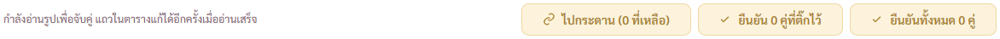
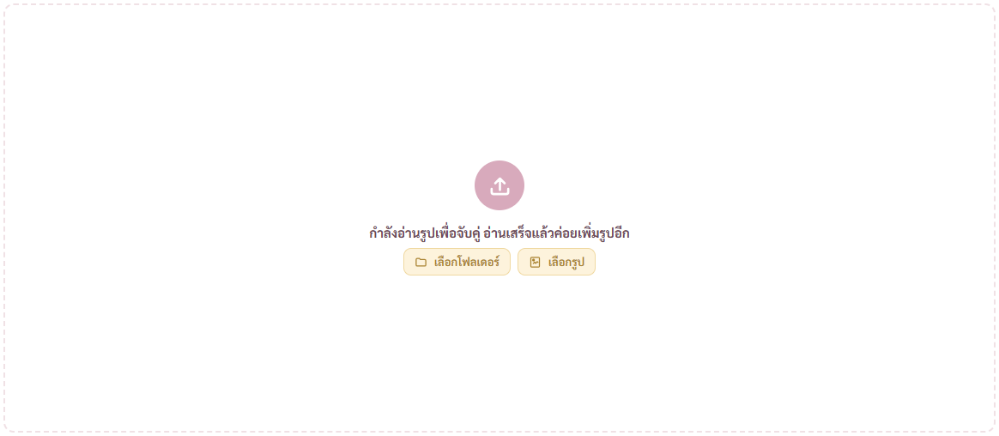
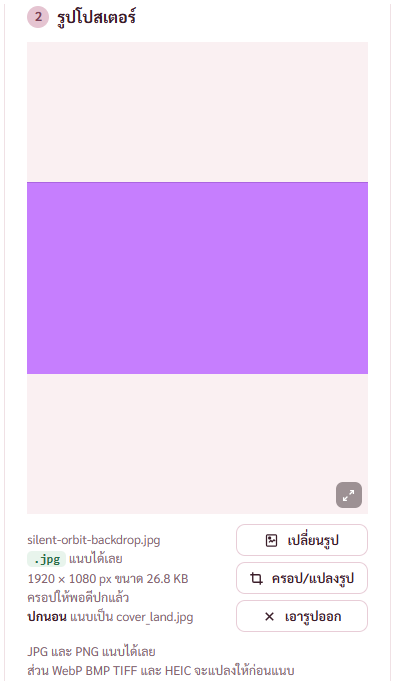
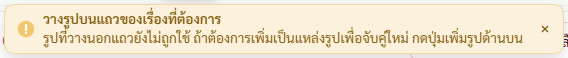

# รายงาน AUDIT กลุ่ม 2 หน้าจับคู่ปก · 15 พ.ย. 2569

ยังไม่ commit

พี่กันสั่ง *"ทำกลุ่ม 2 ต่อ"* · กลุ่ม 2 มีสามข้อ (10 8 12)

## ข้อ 10 จับคู่อัตโนมัติกำลังอ่านรูปอยู่ แล้วไปแก้แถวในตาราง พออ่านเสร็จสิ่งที่แก้หายหมด

- เดิม ตัวจับคู่จดรายการแถวไว้ตอนเริ่ม แล้วเอารายการนั้นวางทับตอนอ่านเสร็จ ระหว่างอ่านรูปถ้าเข้าไปครอป เอาติ๊กออก หรือยืนยันในตาราง สิ่งที่แก้หายหมด แถวที่ยืนยันแล้วกลับมารอยืนยัน · ลากรูปเพิ่มระหว่างอ่านได้ ทำให้จับคู่ซ้อนสองงาน
- ใหม่ ฝั่ง Rust คำสั่งจับคู่อัตโนมัติถือตัวกันงานตลอดการอ่าน คำสั่งแก้แถวทุกตัวและการจับคู่ซ้อนตอบว่า "กำลังอ่านรูปเพื่อจับคู่ ยืนยัน ย้ายที่เก็บรูป หรือจำค่าครอปอยู่ รอให้เสร็จก่อน"
- หน้าจอระหว่างอ่าน
  - ตารางตรวจผล แถบล่างขึ้นว่า "กำลังอ่านรูปเพื่อจับคู่ แถวในตารางแก้ได้อีกครั้งเมื่ออ่านเสร็จ" ปุ่มไปกระดาน ปุ่มยืนยันสองปุ่ม และปุ่มในแถวกดไม่ได้ ชี้แล้วบอกเหตุผล แถบล่างสูงเท่าเดิม
  - หน้าแรก ช่องวางรูปจางลงพร้อมคำว่ากำลังอ่าน ปุ่มเลือกโฟลเดอร์กับเลือกรูปกดไม่ได้พร้อมเหตุผล ลากรูปมาวางขึ้นแถบบอกให้รอ ไม่เพิ่มรูป
- ตรวจ check-link เพิ่ม 3 ข้อ (สั่งจับคู่ แก้แถว และจับคู่ซ้อนพร้อมกัน สองคำสั่งหลังถูกปฏิเสธ · ตารางระหว่างอ่าน · หน้าแรกระหว่างอ่าน) แดงกับโค้ดก่อนแก้

## ข้อ 8 รวมปกนอนที่จับคู่ไว้เข้าไฟล์ แล้วกดเปลี่ยนแบบปกบนการ์ด ได้รูปบิดเบี้ยวหรือกลายเป็นปกตั้ง

- เดิม กดรวมเข้าไฟล์จากปกนอนบนชั้นวาง หน้าใส่โปสเตอร์ขึ้นการ์ดเหลืองให้เลือก ตัดพอดี เติมขอบ ตามรูปเดิม กดตัดพอดีแล้วกรอบ 2 : 3 ถูกบีบลงรูป 1920 × 1080 ภาพแบนยืด กดเติมขอบได้ปกตั้งขอบชมพูแทนปกนอน
- ใหม่ ปกนอนที่ครอปไว้แล้วไม่ขึ้นการ์ดเลือกแบบ เหมือนรูปที่ครอปเองแล้ว · ถ้าเปลี่ยนแบบปกบนการ์ด ใช้กรอบปกตั้งเสมอ ไม่พาค่าปกนอนไปด้วย · ฝั่ง Rust ทำปกนอนเฉพาะเมื่อกรอบที่ตัดเป็น 16 : 9 จริง (คลาดได้ 3%) กรอบ 2 : 3 ได้ปกตั้งไม่บีบ
- ตรวจ check-link ข้อใหม่ รวมปกนอนของเรื่อง Silent Orbit แล้วการ์ดเลือกแบบต้องไม่ขึ้น · cargo test ข้อใหม่ในเทสปกนอน กรอบ 2 : 3 ที่ติดค่าปกนอนต้องได้ 1000 × 1500 · แดงกับโค้ดก่อนแก้ทั้งคู่

## ข้อ 12 ในตารางตรวจผล ลากรูปมาวางพลาดแถว โปรแกรมเอาไปจับคู่ใหม่ทั้งชุดเงียบ ๆ

- เดิม ลากรูปจะวางบนแถวแต่ปล่อยพลาดไปโดนหัวตารางหรือแถบล่าง ไม่มีอะไรขึ้น แต่โปรแกรมเพิ่มรูปเป็นแหล่งรูปแล้วจับคู่ใหม่ทั้งชุด รูปนั้นอาจไปลงเรื่องอื่น · ลากไฟล์ที่ไม่ใช่รูปมาวาง ข้อความไปค้างที่หน้าแรก
- ใหม่ ในตาราง วางนอกแถวไม่เพิ่มแหล่งรูปและไม่จับคู่ใหม่ ขึ้นแถบ "วางรูปบนแถวของเรื่องที่ต้องการ" พร้อมบอกว่าถ้าต้องการเพิ่มเป็นแหล่งรูปให้กดปุ่มเพิ่มรูปด้านบน · ไฟล์ที่ไม่ใช่รูปขึ้นแถบ "ไฟล์ที่ลากมาไม่ใช่รูป" ในตาราง แถบผิดพลาดไม่หายเอง
- ตรวจ check-link เพิ่ม 2 ข้อ แดงกับโค้ดก่อนแก้

## ผลตรวจรวม

- cargo test 279 จาก 279 · ข้อใหม่ของข้อ 8 แดงกับโค้ดก่อนแก้
- check-link 170 จาก 170 (เพิ่ม 6 ข้อ) · กับโค้ดก่อนแก้ข้อใหม่ทั้ง 6 ข้อแดง ข้อเดิม 164 ข้อผ่าน · ภาพรายงานเก่าที่ตัวตรวจถ่ายทับ คืนด้วย git checkout แล้ว
- ตรวจที่โปรแกรมทดสอบแบบอยู่หลังสุด ภาพถ่ายผ่าน CDP

## ยังไม่ได้ตรวจ

- ลากรูปจริงจาก Explorer มาวางนอกแถวในตาราง และลากระหว่างอ่านรูป ตัวตรวจจำลองตัวรับไฟล์ ต้องพี่กันลองเอง
- จับคู่ซ้อนจริงกับโฟลเดอร์รูปใหญ่ ตัวตรวจสั่งคำสั่งพร้อมกันแทน
- ตัวจริงใต้ CSP ยังไม่ได้สร้างมาลองรอบนี้
