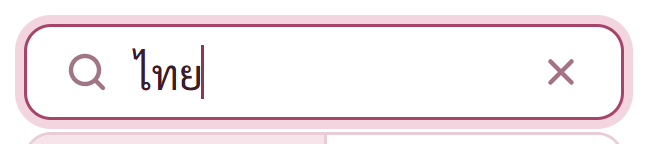
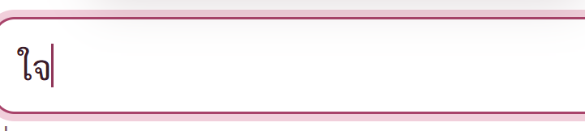
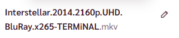
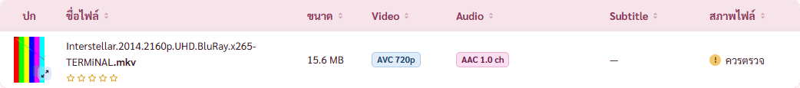
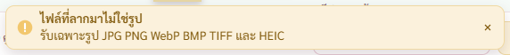

# รายงาน AUDIT กลุ่ม 3 ตัวหนังสือล้นหรือโดนตัด · 15 พ.ย. 2569

ยังไม่ commit

พี่กันสั่ง *"ทำกลุ่ม 3 ต่อ"* · กลุ่ม 3 มีสองข้อ (36 34) · ระหว่างทำมีงานแทรกเรื่องแถบแจ้งเตือน จดเป็น BUGS ข้อ 138 ส่วนที่ทำแล้วอยู่ท้ายรายงาน

## ข้อ 36 พิมพ์คำที่ขึ้นต้นด้วย ไ ใ โ ในช่องค้นหาและช่องเปลี่ยนชื่อ หัวสระโดนตัดที่ขอบซ้าย

- เดิม ชั้นวาดตัวหนังสือของช่องพิมพ์เริ่มที่ขอบซ้ายพอดีและตัดของที่ล้น หัว ไ กับ ใ ของ Sarabun ยื่นเลยขอบซ้าย 2 จุด โ ยื่น 1 จุด จึงขาดไปนิดหนึ่ง
- ใหม่ ชั้นวาดเว้นซ้าย 2 จุดแล้วดึงกลับ หัวสระอยู่ครบ ตัวหนังสือยังเริ่มตรงกับช่องพิมพ์ ขีดกะพริบอยู่ตรงตัวอักษร ไม่ได้เปลี่ยนฟอนต์ · ใช้กับทุกช่องที่ใช้ชั้นวาดนี้ ทั้งช่องค้นหาทุกหน้า และช่องพิมพ์ไทย (ช่องเปลี่ยนชื่อ ชื่อ Chapter ชื่อแทร็ก ชื่อไฟล์ใหม่ ช่องวางค่า hash)
- ตรวจ check-thai-edge ใหม่ 6 ข้อ พิมพ์ ไทย ใจ โรง ลงช่องค้นหาชั้นวางกับช่องเปลี่ยนชื่อ วัดขอบหมึกของตัวแรกเทียบขอบที่ตัด และตัวหนังสือตรงช่องพิมพ์ · แดงครบ 6 ข้อกับสไตล์เดิม

## ข้อ 34 ชื่อไฟล์หนังยาวที่ไม่มีเว้นวรรค ล้นออกนอกแผงขวาและตาราง

- เดิม ตัวจัดบรรทัดกลางผูกชื่อกับนามสกุลเป็นก้อนห้ามตัดบรรทัด ไฟล์ชื่อ Interstellar.2014.2160p.UHD.BluRay.x265-TERMiNAL.mkv ในแผงขวายาวเลยขอบแผง 84 จุด ปุ่มเปลี่ยนชื่อหลุดออกนอกแผง ในตารางชื่อล้นทับคอลัมน์ขนาดไฟล์
- ใหม่ ชื่อแบบไฟล์ที่ยาวไม่มีเว้นวรรคตัดบรรทัดหลังจุด ขีด หรือขีดล่าง นามสกุลผูกไว้กับท้ายชื่อตั้งแต่ตัวคั่นสุดท้าย (TERMiNAL.mkv อยู่ด้วยกันเสมอ) คำระหว่างตัวคั่นไม่ขาดกลาง · ประโยคภาษาไทยที่ผูกตัวเลขกับคำไว้ยังเหมือนเดิม ใช้เฉพาะก้อนที่ไม่มีอักษรไทย หรือมีจุด ขีด ขีดล่างแบบชื่อไฟล์
- รอบแรกผูก 6 ตัวท้าย ดูภาพแล้วในตารางตัดกลางคำ "TE / RMiNAL" จึงเปลี่ยนเป็นผูกตั้งแต่ตัวคั่นสุดท้าย แล้วเพิ่มข้อตรวจคำขาดกลาง
- ตรวจ check-longfile ใหม่ 7 ข้อ (ลอกหนังทดสอบไปตั้งชื่อยาวใน D:\dev\tmp แล้วลบตอนจบ · แผงขวาไม่ล้น ปุ่มข้างชื่ออยู่ในแผง นามสกุลอยู่บรรทัดเดียวกับท้ายชื่อ ไม่มีคำขาดกลาง หัวหน้าข้อมูลไฟล์ไม่ล้น ตารางไม่ล้นทับคอลัมน์ถัดไป ไม่มีคำขาดกลาง) · แดง 3 ข้อกับโค้ดเดิม หัวหน้าข้อมูลไฟล์ไม่ล้นแม้โค้ดเดิมเพราะที่กว้างพอ · ข้อคำขาดกลางแดงกับแบบผูก 6 ตัวท้าย
- ตัวจัดบรรทัดนี้ใช้ทั้งโปรแกรม รันตัวตรวจหน้าที่ใช้เยอะแล้ว ผ่านครบ check-table 30 จาก 30 · check-bname 19 จาก 19 · check-longname 20 จาก 20 · check-marks 23 จาก 23

## งานแทรกที่ทำไประหว่างกลุ่ม 3 (ส่วนหนึ่งของ BUGS ข้อ 138)

พี่กันเห็นแถบแจ้งเตือนค้างในหน้าต่างทดสอบ ทัก *"มันจะค้างไปถึงไหน"* · *"เราเห็น เเค่ยืนยันจับคู่ ทำไมสีเเดง"* · *"มันควร popup ขนาดเท่ากัน ไม่ใช่อันนึงยาว อันนึงสั้น"* · *"ควรสีเขียวไหม การเตือนควรสีเหลืองกับเเดง"* แล้วสั่ง *"เอาเข้าคิวนะ"*

- ต้นเหตุ แถบสีเหลืองกับแดงตั้งไว้ไม่หายเองทุกแบบ และตัวตรวจ check-link ที่แคลร์เพิ่งเขียนลากไฟล์ทดสอบแล้วไม่ปิดแถบ แถบจึงค้าง แถบสีแดงคือไฟล์ .txt ที่ตัวตรวจลากมา ไม่ได้มาจากการยืนยันจับคู่
- ทำแล้ว ทุกแถบกว้างเท่ากัน 560 จุด · แถบผลการลากวางของหน้าจับคู่ปก (กำลังอ่านรูปให้รอ วางนอกแถว ไฟล์ไม่ใช่รูป) หายเองใน 6 วินาที แถบใหม่แทนแถบเก่าไม่ซ้อน และไฟล์ไม่ใช่รูปเป็นสีเหลือง เพราะไม่มีอะไรเสียหาย · สีแดงเก็บไว้ให้ของที่ทำไม่สำเร็จจริง แถบสำเร็จใช้สีชมพูตามโทน ไม่มีสีเขียว · check-link ปิดแถบที่ตัวเองทำตอนจบ และเพิ่มข้อตรวจแถบหายเองกับไม่ซ้อน ผ่าน 172 จาก 172

## BUGS ข้อ 138 ไล่แถบแจ้งเตือนทั้งโปรแกรม (ทำต่อจากกลุ่ม 3 ตามคิว)

ไล่อ่านแถบแจ้งเตือนครบ 110 จุดใน 15 ไฟล์ แบ่งตามหลักที่พี่กันวางไว้ว่าการเตือนใช้สีเหลืองกับแดง

| แบบ | สี | หายเองไหม | ตัวอย่าง |
|---|---|---|---|
| ทำไม่สำเร็จจริง | แดง | ไม่หาย ต้องกดปิด | บันทึกการตั้งค่าไม่สำเร็จ เปิดเล่นไม่ได้ ยืนยันไม่สำเร็จ |
| ผลที่ต้องรู้และต้องดูต่อ | เหลือง | ไม่หาย ต้องกดปิด | ยืนยันได้บางคู่ มีไฟล์ที่ไม่ได้ลบ ไฟล์ตั้งค่าเสีย เปิดตรงนาทีไม่ได้ |
| บอกว่าสิ่งที่กดยังทำไม่ได้ตอนนี้ | เหลือง | หายเองใน 6 วินาที | ใส่ไฟล์หนังก่อน ไฟล์นี้เพิ่มไว้แล้ว กำลังใส่โปสเตอร์อยู่ ต้องเลือกอย่างน้อยหนึ่งแบบ |
| ผลกลาง ๆ ที่คนกดเอง | ชมพู | หายเองใน 6 วินาที | หยุดตรวจแล้ว ตรวจไปกี่เรื่อง หยุดยืนยันแล้ว |
| ทำสำเร็จ | ชมพู | หายเองใน 3 วินาที | เหมือนเดิม |

- เปลี่ยน 21 จุด ในนี้ 10 จุดเดิมเป็นสีชมพูข้อมูลทั้งที่เป็นการบอกว่ากดแล้วยังทำไม่ได้ เปลี่ยนเป็นสีเหลือง · แถบเรื่องเดียวกันแทนแถบเดิม ไม่ซ้อนกันหลายแถบ
- หน้าเสียงและซับ 5 จุด หน้าตรวจไฟล์ 2 จุด หน้ากราฟ 2 จุด หน้าข้อมูลไฟล์ 1 จุด กระดานจับคู่ 3 จุด ตารางจับคู่ 3 จุด หน้าใส่โปสเตอร์ 2 จุด หน้าตั้งค่า 2 จุด ผลตรวจทั้งชุด 1 จุด
- ตรวจ check-stage1 เพิ่มข้อแถบสำเร็จกับแถบผิดพลาดกว้างเท่ากัน ผ่าน 54 จาก 54 (รอบแรกตกข้อสีตอนชี้ปุ่มคู่ซึ่งเป็นจังหวะเมาส์ รันซ้ำผ่าน) · check-link 172 จาก 172
- ระหว่างทางเจอว่า check-stage1 ทิ้งเมนูซ้ายแบบพับไว้ check-link ข้อเลขรอจึงตก แก้ให้ check-stage1 กางเมนูคืนตอนจบ และข้อเลขรอดูแค่ว่าไม่มีตัวเลข · ข้อ 10 ของ check-link ตกหนึ่งรอบเพราะงานจับคู่จบก่อนคำสั่งที่ตามไป ให้ลองซ้ำได้ห้ารอบ
- ยังไม่ได้ดูภาพของแถบที่เปลี่ยนทุกจุดบนหน้าจริง เปลี่ยนแค่สีกับเวลาหายเอง ข้อความเดิม

## สิ่งที่แคลร์ทำพลาดระหว่างทาง

- ตัวตรวจ check-longfile รอบแรกกดปุ่มมุมมองตารางแล้วคืนค่าผ่านคำสั่งตรงซึ่งหน้าไม่รับ ชั้นวางค้างเป็นตาราง แก้ให้จำมุมมองบนหน้าแล้วกดปุ่มคืน และคืนชั้นวางเป็นภาพปกแล้ว
- check-longname ตกเพราะขนาดปกค้างเป็นกลางจากตัวตรวจอื่น แก้ให้ตั้งปกเล็กเองก่อนวัดและคืนขนาดเดิมตอนจบ

## ยังไม่ได้ตรวจ

- ช่องพิมพ์อื่นที่ใช้ชั้นวาดเดียวกัน (ชื่อ Chapter ชื่อแทร็ก ช่องวางค่า hash) ตรวจด้วยตาจากโครงเดียวกัน ตัวตรวจวัดเฉพาะช่องค้นหาชั้นวางกับช่องเปลี่ยนชื่อ
- ชื่อไฟล์ยาวภาษาไทยปนจุด ตัวตรวจใช้ชื่ออังกฤษ
- ตัวจริงใต้ CSP ยังไม่ได้สร้างมาลองรอบนี้
