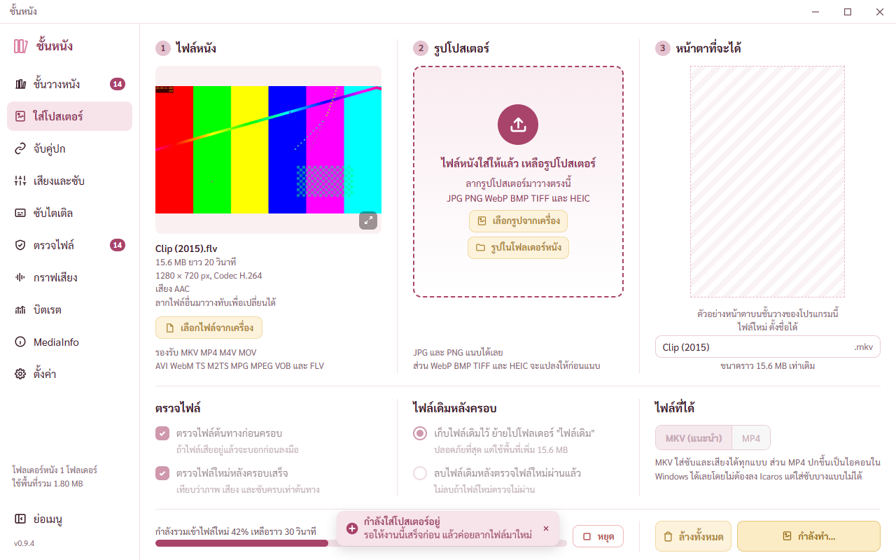
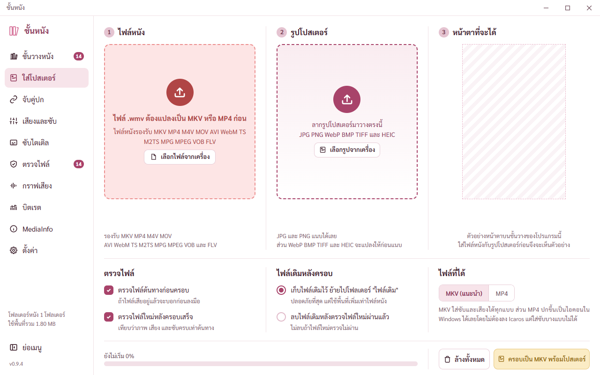
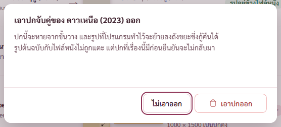
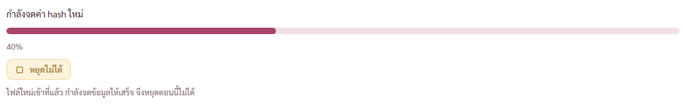
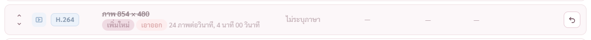
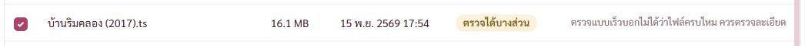
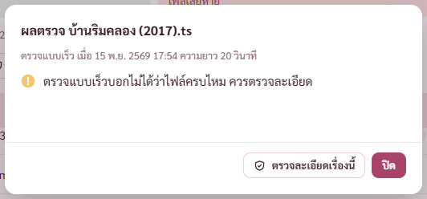

# รายงานแก้ข้อ AUDIT ชุดแรก 9 ข้อ · 15 พ.ย. 2569

พี่กันเลือกจากข้อที่แคลร์เสนอ
- กลุ่มไฟล์หรือปกผิดหรือหาย (ข้อ 6 14 11 13 9 15) *"อ่านเเล้ว เเต่ละอันน พีคๆเลย"* แล้วยืนยัน *"อันนี้คือเอาด้วยนะ"*
- ข้อ 5 *"ตอนทำงานอยู่ ทำให้มันลากมาไม่ได้"*
- ข้อ 28 กับ 30 *"แก้เลย"*
- *"เสร็จเเล้ว ยังไม่ commit นะ"*

ยังไม่ commit · เลขข้อในรายงานนี้คือเลขใน docs/AUDIT-2026-11-12.md ติ๊กปิดในไฟล์นั้นแล้ว เหลือ 128 ข้อ

## ข้อ 5 ลากไฟล์มาวางระหว่างกำลังใส่โปสเตอร์

- เดิม หน้ากลับเป็น "ยังไม่เริ่ม 0%" ปุ่มหยุดหาย ทั้งที่งานยังวิ่งอยู่ข้างหลัง
- ใหม่ ระหว่างงานวิ่งลากไฟล์มาวางไม่ได้ ช่องลากไม่ขึ้นสีรับไฟล์ วางแล้วขึ้นกล่อง "กำลังใส่โปสเตอร์อยู่ รอให้งานนี้เสร็จก่อน แล้วค่อยลากไฟล์มาใหม่" และตอนโหลดไฟล์ใหม่ไม่ทับสถานะงานที่กำลังวิ่ง (`PosterPage.tsx`)
- ตรวจ check-result 2 ข้อ แดงกับโค้ดเดิมทั้งสองข้อ

## ข้อ 6 เปิดไฟล์หนังเรื่องใหม่ไม่สำเร็จ แต่โปสเตอร์ไปลงไฟล์เรื่องก่อนหน้า

- เดิม ลากไฟล์ที่ใช้ไม่ได้มาแทน การ์ดแดงแต่โปรแกรมยังจำไฟล์เก่า กดเริ่มแล้วไปแก้ไฟล์เก่า
- ใหม่ ล้างไฟล์หนังเรื่องก่อนตั้งแต่เริ่มโหลด ปุ่มเริ่มบอกให้ใส่ไฟล์หนังก่อน และรายละเอียดของการ์ดผลบอกชื่อไฟล์ที่ได้
- เจอระหว่างถ่ายภาพ หัวการ์ด "ไฟล์ .wmv ใช้ไม่ได้ ต้องแปลงเป็น MKV หรือ MP4 ก่อน" ตัดบรรทัดตรง "หรือ ⏎ MP4 ก่อน" เปลี่ยนเป็น "ไฟล์ .wmv ต้องแปลงเป็น MKV หรือ MP4 ก่อน" บรรทัดเดียว
- ตรวจ check-result 2 ข้อ (ข้อ 6 แดงกับโค้ดเดิม) · check-review ผ่าน 14 จาก 14

## ข้อ 9 ครอปแล้วกดยืนยันทันที ปกที่เขียนจริงเป็นแบบก่อนครอป

- ใหม่ หน้าจอรอจำค่าครอปให้เสร็จ ระหว่างนั้นปุ่มยืนยันของแถวกดไม่ได้และบอกว่ากำลังจำค่าครอป ปุ่มยืนยันทั้งหมดก็รอ · ฝั่ง Rust คำสั่งจำค่าครอปถือตัวกันงานตลอดคำสั่ง ยืนยันแซงเข้ามาไม่ได้ (`link_set_crop`)
- ตรวจ check-link 1 ข้อ ดักการเปลี่ยนของปุ่มตั้งแต่ก่อนกด แดงเมื่อถอดตัวกันออก
- ยังไม่ได้ลองกับรูป HEIC ขนาดใหญ่ของจริง ภาพหน้าจอจับจังหวะนี้ไม่ได้เพราะเสร็จในไม่กี่สิบมิลลิวินาที

## ข้อ 11 จับคู่ทุกเรื่องรอบใหม่แล้วยืนยันทั้งหมด ปกที่ครอปเองกลายเป็นครอปกลางรูป

- ใหม่ ตอนจับคู่ทุกเรื่องบนชั้นวาง ถ้ารูปที่ได้เป็นรูปต้นทางเดิมของปกช่องเดียวกัน ยกค่าครอปกับภาพหลังครอปเดิมมาด้วย (`carry_crops`) · ไฟล์รุ่นก่อนตอนแทนปกลงถังขยะแทนการลบถาวร (`replace_own`)
- ตรวจ cargo test เพิ่ม 2 ข้อ

## ข้อ 13 ปุ่ม "ยกเลิก" ในแถวที่บันทึกแล้ว เอาปกออกทันทีโดยไม่ถาม

- ใหม่ ปุ่มชื่อ "เอาปกออก" กดแล้วถามก่อน บอกว่าปกจะหายจากชั้นวาง รูปที่โปรแกรมทำไว้ลงถังขยะ และปกที่มีก่อนยืนยันจะไม่กลับมา · เอาออกแล้วแถวนับว่าแตะแล้ว จึงเข้ายืนยันทั้งหมดและหน้าต่างกันปิดถาม
- พี่กันทัก *"แบ่งแปลกๆ"* ตอนข้อความเป็นสามบรรทัดยาวไม่เท่ากัน เขียนใหม่เป็นสองประโยค ประโยคละบรรทัด หน้าต่างกว้าง 540 จุด
- ตรวจ check-link 5 ข้อ รวมจุดตัดบรรทัด แดงกับโค้ดเดิม

## ข้อ 14 กดหยุดตอนท้ายงานรวมไฟล์ ข้อความบอกผิด

- ใหม่ ก่อนย้ายไฟล์เดิมฝั่ง Rust ส่งสัญญาณว่าเลยจุดที่หยุดได้แล้ว หน้าจอเปลี่ยนปุ่มหยุดเป็น "หยุดไม่ได้" พร้อมบรรทัด "ไฟล์ใหม่เข้าที่แล้ว กำลังจดข้อมูลให้เสร็จ จึงหยุดตอนนี้ไม่ได้" และกล่องยืนยันหยุดไม่เปิด
- กรอบงานสูง 143 จุดเท่าเดิมทั้งก่อนและหลัง (พี่กันถาม *"อันนี้ มันกินที่ขึ้นมาไหม"*)
- ตรวจ check-merge 2 ข้อ ข้อหน้าจอแดงกับโค้ดเดิม

## ข้อ 15 ลากไฟล์หนังอีกเรื่องมาเพิ่ม ภาพของไฟล์นั้นติดเข้าไฟล์ใหม่

- ใหม่ แทร็กภาพของไฟล์ที่ลากมาเพิ่ม เริ่มต้นไม่ใส่ และมีปุ่มใส่กับเอาออกท้ายแถว
- ตรวจ check-merge 1 ข้อ แดงกับโค้ดเดิม

## ข้อ 28 ตรวจแบบเร็วไฟล์ TS VOB MPEG บอกว่าโครงไฟล์ครบ

- ใหม่ ผลตรวจแบบใหม่ "ตรวจได้บางส่วน" จุดเหลือง ข้อความ "ตรวจแบบเร็วบอกไม่ได้ว่าไฟล์ครบไหม ควรตรวจละเอียด" หน้าต่างผลตรวจมีปุ่มตรวจละเอียดเรื่องนี้ · เคยตรวจละเอียดว่าสมบูรณ์แล้วค่า hash ยังตรง ยังนับว่าสมบูรณ์ · สรุปชุดตรวจบอกจำนวนที่ตรวจได้บางส่วน
- ตรวจ check-stage6 ผ่าน 23 จาก 23 · cargo test เพิ่ม 1 ข้อ

## ข้อ 30 หน้าตรวจไฟล์ค้างกำลังตรวจ

- ใหม่ ตั้งกำลังตรวจก่อนสั่ง ไม่ตั้งทับหลังคำสั่งตอบกลับ · กดหยุดแล้วถามฝั่ง Rust ว่ายังตรวจอยู่ไหม ถ้าไม่ได้ตรวจแล้วปลดหน้าจอเอง
- ตรวจ check-stage6 2 ข้อ (หน้าจอค้างจำลองแล้วกดหยุดปลดใน 154 ms · ตรวจเรื่องเดียวซ้ำ 5 รอบไม่ค้าง) · พิสูจน์ด้วยโค้ดเดิมแล้วกดหยุดยังค้าง

## ผลตรวจรวม

- cargo test ผ่าน 275 ข้อ ข้าม 1 (เดิม 272)
- check-result 28 จาก 29 · ข้อที่แดงคือปุ่มสองปุ่มในช่องลากรูปตกเป็นสองแถว ค้างมาตั้งแต่ก่อนรอบนี้
- check-stage6 23 จาก 23 · check-merge 23 จาก 23 · check-link 164 จาก 164 · check-review 14 จาก 14 · check-marks 23 จาก 23
- check-link มีข้อนับจำนวนคู่ที่ติ๊กไว้ที่ผลไม่นิ่ง แดง 1 ใน 7 รอบที่รันวันนี้ รอบอื่นผ่าน ไม่ได้มาจากงานรอบนี้
- ภาพรายงานเก่าที่ตัวตรวจถ่ายทับ คืนด้วย git checkout ทีละโฟลเดอร์แล้ว

## ที่ต้องลองเอง

- ลากไฟล์จริงจาก Explorer มาวางระหว่างใส่โปสเตอร์ (ตัวตรวจใช้ทางลัดแทนการลาก)
- ครอปรูป HEIC ใหญ่แล้วกดยืนยันทันที (ข้อ 9)
