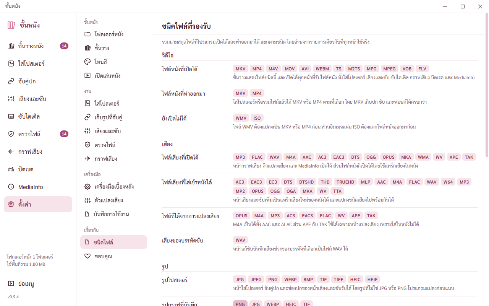
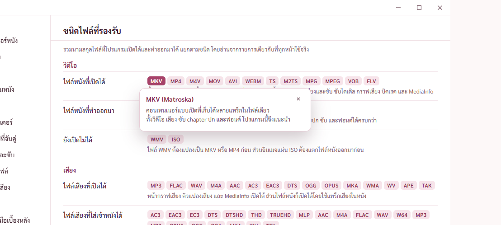
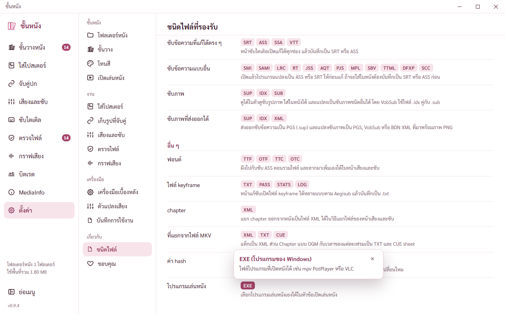
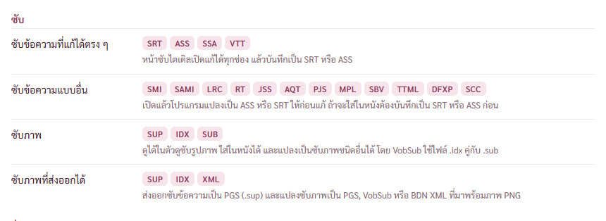
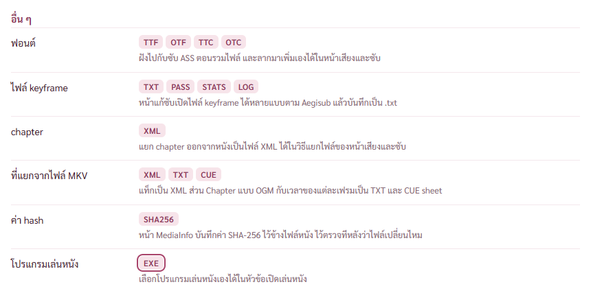

# รายงาน 15 พ.ย. 2569 หัวข้อชนิดไฟล์ที่รองรับในหน้าตั้งค่า (BUGS ข้อ 127)

## คำสั่งของพี่กัน
- *"เธอสร้างหน้าตั้งค่าตัวนึงหน่อย เขียนชนิดไฟล์ทั้งหมดที่โปรแกรมเรารองรับ เเล้วรายละเอียดคร่าวๆ เพราะเราจำไม่ได้ เลยสร้างสักหน้าที่รวมนามสกุลทั้งหมด ทั้ง วิดีโอ เสียง รูป ซับ เเละอื่นๆ"*
- สั่งเพิ่มระหว่างทำ *"ตอนเอาเมาส์ไปกด มันจะขึ้น popup คล้ายๆดรอปดาวขึ้นมา ว่านามสกุลนี้ คืออะไรยังไง"*

## สิ่งที่ทำ
1. **หัวข้อใหม่ ชนิดไฟล์** อยู่กลุ่มเกี่ยวกับ ก่อนหัวข้อขอบคุณ แยก 5 กลุ่ม วิดีโอ เสียง รูป ซับ อื่น ๆ รวม 18 แถว แต่ละแถวมีชื่อ ป้ายนามสกุล และคำอธิบายบรรทัดเดียวว่าหน้าไหนใช้ ทำอะไรได้ และข้อจำกัด
2. **รายการนามสกุลมาจากที่เดียวกับที่โปรแกรมใช้จริง** เดิมรายการไฟล์หนังกับรูปพิมพ์ซ้ำไว้ในห้าหน้า (ใส่โปสเตอร์ เสียงและซับ MediaInfo กระดานจับคู่ปก และ api.ts) ตอนนี้รวมไว้ที่ `src/lib/api.ts` ที่เดียว ทั้ง `MOVIE_EXT` `IMAGE_EXT` และเพิ่ม `ENCODE_OUT_EXT` (ไฟล์ที่ได้จากการแปลงเสียง) กับ `KEYFRAME_EXT` · หัวข้อนี้อ่านจาก `src/lib/fileTypes.ts` ที่นำเข้ารายการเหล่านี้
3. **เทสฝั่ง Rust** `file_types_match_frontend` ใน latest.rs เทียบรายการใน api.ts กับที่ฝั่ง Rust รับจริง คือไฟล์หนังของชั้นวาง (`library::ACCEPTED`) รูปโปสเตอร์ (`poster_image::ACCEPTED`) นามสกุลที่ตัวแปลงเสียงเขียน (`EncodeSpec::ext`) และซับข้อความที่แปลงได้ (`subs::FF_TEXT` `OWN_TEXT`) ถ้าวันหน้าเพิ่มชนิดฝั่งเดียว เทสจะแดง
4. **กดป้ายนามสกุลแล้วกางกล่องบอกว่าคืออะไร** ป้ายทุกป้ายเป็นปุ่ม กดแล้วกางกล่องแบบเดียวกับกล่อง ⓘ ทั้งโปรแกรม หัวกล่องเป็นนามสกุลกับชื่อเต็ม เช่น MKV (Matroska) เนื้อความบอกความหมายและที่ใช้ในโปรแกรมนี้ เขียนไว้ 79 นามสกุล (`EXT_INFO` ใน fileTypes.ts)
   - กล่องวัดที่ว่างบนจอก่อนกาง ป้ายแถวล่างสุดกางขึ้นข้างบน กด Esc กดที่อื่น หรือกดป้ายอื่น ปิดกล่องเดิม เปิดได้ทีละกล่อง ป้ายที่เปิดอยู่เข้มค้าง ชี้แล้วเข้มขึ้นในโทนเดียวกัน
   - เพิ่มตัวเลือก `children` `btnClass` `noAbbr` ให้ `InfoTip.tsx` ใช้ของอื่นเป็นปุ่มเปิดได้ และปิดการขยายตัวย่อ เพราะหัวกล่องบอกชื่อเต็มแล้ว (ตอนแรกหัวกล่องขึ้น "MKV (Matroska Video) (Matroska)" และ WAV ขึ้น "PCM (Pulse-Code Modulation) )" ซ้อนวงเล็บ)
   - ข้อความที่ยาวสองบรรทัดขึ้นบรรทัดใหม่ตรงรอยต่อความหมาย อ่านจุดตัดครบทุกกล่องแล้ว

## ภาพ
ภาพรวมหัวข้อ ทุกแถวบรรทัดเดียว ป้ายที่ตกบรรทัดไม่เหลือป้ายเดียวโดด ๆ

กดป้าย MKV กล่องกางใต้ป้าย

กดป้าย EXE ที่อยู่ล่างสุดของหน้า กล่องพลิกขึ้นข้างบน ไม่จมขอบจอ

กลุ่มซับ

กลุ่มอื่น ๆ

## ที่เจอระหว่างทำแล้วแก้
- คำอธิบายไฟล์หนังตกบรรทัดเหลือ "จนถึง MediaInfo" บรรทัดบนถ่าง เกลาคำให้อยู่บรรทัดเดียว
- ป้าย TAK ตกไปอยู่บรรทัดล่างคนเดียว ลดช่องชื่อจาก 210 เป็น 170 จุดและเปลี่ยนชื่อแถวเป็น ไฟล์หนังที่ทำออกมา
- คำอธิบาย DTS ตัดกลางคำ "สูง ⏎ กว่า" กับ TIF และ FLAC เหลือคำโดด เกลาคำทั้งหมด

## ผลตรวจ
- `check-settings.mjs` ผ่าน 70 จาก 70 ข้อ (เพิ่ม 20 ข้อของหัวข้อนี้ ป้ายตรงกับ api.ts ทุกรายการ ซับสามแถวรวมกันตรง SUB_EXT ไม่ล้นขวา ไม่มีจุดกลาง ทุกแถวบรรทัดเดียว ป้ายไม่โดด ป้ายทุกป้ายเป็นปุ่มมีคำอธิบาย กล่อง MKV ถูกต้อง Esc ปิด ป้ายล่างสุดกล่องอยู่ในจอ กดที่อื่นปิด เปิดได้ทีละกล่อง ทุกกล่องไม่มีบรรทัดท้ายเหลือคำโดด)
- พิสูจน์ว่าข้อตรวจแดงกับของที่พัง ใส่คำอธิบายยาวแบบเดิมกับช่องชื่อ 210 จุดลงในหน้าชั่วคราว ข้อบรรทัดเดียวกับข้อป้ายโดดแดงทั้งคู่ · ข้อหัวกล่องกับข้อคำโดดแดงจริงกับโค้ดรอบแรกก่อนแก้
- `cargo test file_types_match_frontend` ผ่าน · เติม wmv เข้า MOVIE_EXT ชั่วคราวแล้วแดง บอกรายการทั้งสองฝั่ง แล้วคืนไฟล์เหมือนเดิมทุกไบต์
- `npx tsc --noEmit` ผ่าน
- ตรวจที่หน้าต่าง 1280 × 800 ในโปรแกรมทดสอบที่อยู่หลังสุด

## ยังไม่ได้ตรวจ
- ขนาดหน้าต่างอื่น (check-sizes) กับตัวจริงใต้ CSP รันตอนตรวจรวมก่อน commit ชุดข้อ 123 ถึง 127

## ยังไม่ commit
commit พร้อมชุดข้อ 123 ถึง 127 ตอนจบชุด
