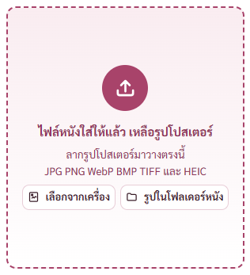
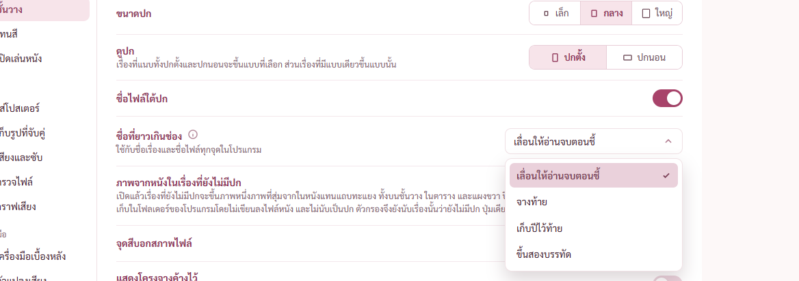
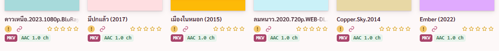
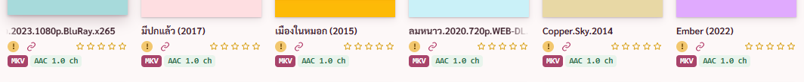

# รายงานชื่อยาวเกินช่องแทนจุดสามจุด และปุ่มสองปุ่มในช่องลากรูป · 15 พ.ย. 2569

ยังไม่ commit

## ปุ่มสองปุ่มในช่องลากรูปหน้าใส่โปสเตอร์

พี่กันสั่ง *"แก้"*

- เดิม ที่หน้าต่าง 1280 × 800 ใส่หนังแล้ว ปุ่ม "เลือกรูปจากเครื่อง" กับ "รูปในโฟลเดอร์หนัง" ตกเป็นสองแถว เพราะสองปุ่มรวม 292 จุด แต่ช่องลากเหลือที่ข้างใน 268 จุด
- ใหม่ ตอนมีสองปุ่ม ปุ่มแรกเป็นคำ "เลือกจากเครื่อง" ระยะขอบในปุ่ม 6 จุด รวมราว 261 จุด อยู่แถวเดียว (ตอนมีปุ่มเดียวยังเป็นคำเต็ม)
- ตรวจ check-result ตรวจข้อนี้ที่ 1280 × 800 เสมอ (เดิมตรวจที่ขนาดหน้าต่างจริง) ผ่าน 29 จาก 29 แดงกับโค้ดเดิม

## ข้อตรวจนับคู่ที่ติ๊กไว้ใน check-link

พี่กันถาม *"คือไรนะ"*

- ข้อตรวจรุ่นแรกเริ่มที่ติ๊กไว้ 9 คู่ เอาติ๊กออกเหลือ 8 ต่อมาโปรแกรมให้แถวที่ไม่มีปีไม่ติ๊กเอง ตัวเลขเริ่มเป็น 8 แต่ข้อตรวจยังคาด 8 หลังเอาติ๊กออก จึงผ่านเฉพาะรอบที่อ่านก่อนเลขเปลี่ยน
- แก้ให้คาด 7 คู่ และรอเลขเปลี่ยนจริงก่อนอ่าน check-link ผ่าน 164 จาก 164

## ชื่อที่ยาวเกินช่อง (BUGS ข้อ 51 ส่วนที่ค้าง)

พี่กันสั่ง *"ลองทำมอคอัป"* แล้วเลือก *"เอาทุกตัว กดเปลี่ยนได้ที่หน้าตังค่า เเต่เเบบ 4 คือตัวหลัก"*

- มอคอัป docs/mockups/ellipsis-pick.html สี่แบบ ทุกกรอบเป็นหน้าจริงของชั้นวาง
- หน้าตั้งค่า หัวข้อชั้นวาง แถวใหม่ "ชื่อที่ยาวเกินช่อง" ดรอปดาวน์สี่แบบ
  - เลื่อนให้อ่านจบตอนชี้ (ค่าตั้งต้น) ท้ายชื่อที่ล้นจางหาย ชี้แล้วชื่อค่อย ๆ เลื่อนจนเห็นท้ายชื่อ
  - จางท้าย
  - เก็บปีไว้ท้าย ชื่อใต้ปกจางกลางชื่อ ปีในวงเล็บอยู่ท้ายเสมอ จุดอื่นจางท้าย
  - ขึ้นสองบรรทัด ชื่อใต้ปกขึ้นบรรทัดที่สอง ทุกเรื่องจองสองบรรทัดเท่ากัน จุดอื่นจางท้าย
- ใช้กับทุกจุดที่เคยตัดเป็นจุดสามจุด 38 จุด ผ่านตัวกลางที่เดียว (`src/lib/longName.ts`) ดูว่าชื่อไหนล้นช่องแล้วติดป้าย สไตล์ท้าย app.css จัดตามแบบ · กล่องที่มีพื้นหรือเส้นขอบ (เช่นป้ายในตาราง) ตัดเฉย ๆ ไม่จาง เพราะจางแล้วพื้นหายไปด้วย แต่ยังเลื่อนตอนชี้ · ที่อยู่ไฟล์ที่ชิดขวาจางที่หัว
- กล่อง ⓘ แยกหัวข้อละแบบ ตัดบรรทัดตรงความหมาย
- ตรวจ check-longname ใหม่ 20 ข้อ (ทุกหน้าไม่มีกล่องที่ตัดเป็นจุดสามจุด ชื่อล้นได้ป้าย ชื่อสั้นไม่ได้ ชี้แล้วเลื่อนแล้วกลับ จางท้ายไม่เลื่อน เก็บปีแยกชื่อกับปี สองบรรทัดสูงเท่ากัน ดรอปดาวน์เปลี่ยนแบบและจำไว้ กว้าง 260 จุดตัดกล่อง ⓘ) แดงกับโค้ดที่ไม่มีตัวกลาง · check-table แก้ข้อที่เคยคาดจุดไข่ปลา ผ่าน 30 จาก 30 · check-bname 19 จาก 19 · check-settings 80 จาก 80 · check-marks 23 จาก 23

## ยังไม่ได้ตรวจ

- ตัวจริงใต้ CSP ยังไม่ได้สร้างตัวจริงมาลองรอบนี้ (ใช้สไตล์กับ CSSOM ที่ CSP ยอมอยู่แล้ว)
- ภาพมอคอัปถ่ายในหน้าต่างโปรแกรมทดสอบ จึงเห็นข้อมูลชุดทดสอบ เปิดในโครมจะเป็นข้อมูลตัวอย่าง
