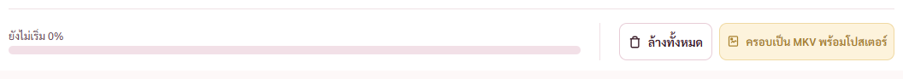
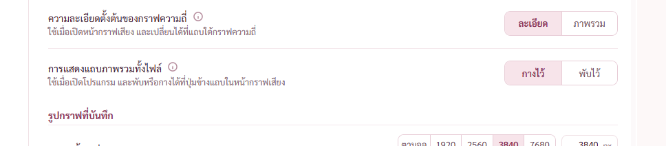
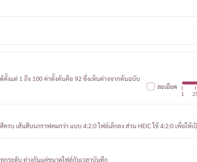
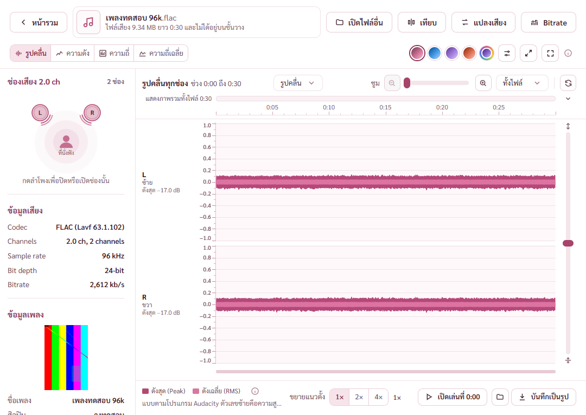
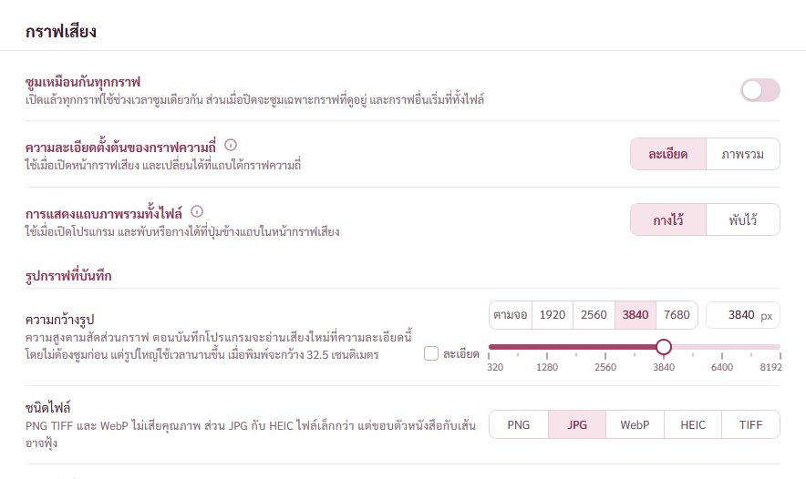
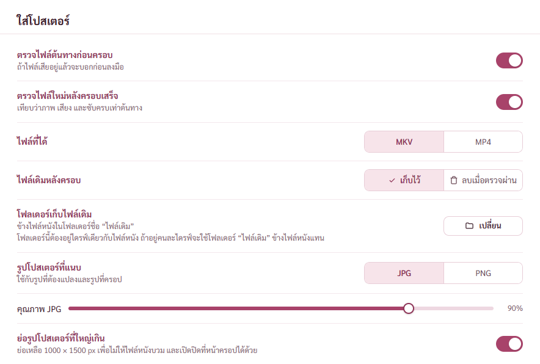
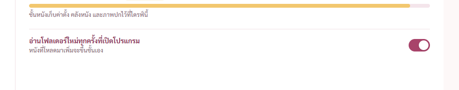

# รายงานชุด 13 กับข้อ 137 · 15 พ.ย. 2569

พี่กันสั่ง *"ทำตอนนี้เลย เเละถ้าจะรวมจาก audit ด้วย เสนอมาเลย"* (ชุด 13 คือ BUGS ข้อ 49 50 51 กับข้อ 28) แล้วแทรกข้อ 137 ระหว่างทำ *"เเต่ทำต่อจากนี้นะ"*

ยังไม่ commit · ตามกฎข้อย่อยในคิวทำครบชุดแล้ว commit ทีเดียว

## ข้อ 49 เส้นแบ่งระหว่างแถบความคืบหน้ากับปุ่มล้างทั้งหมด (หน้าใส่โปสเตอร์)

พี่กันแทรก *"แทรก ขอเส้นเเบ่ง ตรง ล้างทั้งหมด กับเส้นของงาน"*

- เส้นแนวตั้ง 1 จุด สีเดียวกับเส้นแบ่งคอลัมน์ข้างบน ตรงแนวเส้นคอลัมน์ที่สามพอดี (วัดได้ห่าง 0 จุดทุกขนาดหน้าต่าง) สูงเต็มแถว ปุ่มอยู่ที่เดิม ห่างเส้น 22 จุดเท่าการ์ดข้างบน
- หน้าต่างแคบ 1100 จุดเดิมปุ่มชิดเส้น ใส่ระยะ 22 จุดเท่ากัน
- ตัวตรวจ `check-result.mjs` เพิ่ม 4 ข้อ (1280 × 800, 1100 × 700, 1600 × 1000, 1920 × 1040) ผ่าน 25 จาก 25 · พิสูจน์แล้วว่าถอดเส้นออกแล้วข้อตรวจแดง

## ข้อ 50 ตั้งค่าว่าแถบภาพรวมทั้งไฟล์เปิดมาพับหรือกาง (หน้ากราฟเสียง)

พี่กันแทรก *"แทรก ปุ่มยุบขยายนี้ มีในตั้งค่าได้ว่าว่าจะเเสดงยุบไว้ห่อน หรือขยายไว้ก่อน"*

- หน้าตั้งค่า หัวข้อกราฟเสียง แถวใหม่ "การแสดงแถบภาพรวมทั้งไฟล์" เลือกกางไว้หรือพับไว้ ค่าตั้งต้นกางไว้ (แคลร์ตั้ง ตามค่าเดิมก่อนมีปุ่มพับ)
- ใช้เมื่อเปิดโปรแกรม และเปลี่ยนในหน้าตั้งค่าแล้วหน้ากราฟพับหรือกางตามทันที ส่วนกดพับกางในหน้ากราฟใช้จนปิดโปรแกรม ไม่เปลี่ยนค่าตั้ง
- คนที่เคยพับไว้กับที่จำแบบเดิม (graph-ov-fold) เปิดมาพับเหมือนเดิมครั้งแรก แล้วย้ายเป็นค่าตั้งใหม่
- กล่อง ⓘ แยกหัวข้อกางไว้กับพับไว้ บอกความหมาย ข้อดี ข้อเสีย ตัดบรรทัดตรงความหมายทุกย่อหน้า
- พี่กันทัก *"มาแบบ ไม่ทางการเลย ไปเกลามาหม่"* เกลาชื่อแถวเป็น "ความละเอียดตั้งต้นของกราฟความถี่" กับ "การแสดงแถบภาพรวมทั้งไฟล์" คำใต้ชื่อเปลี่ยนจาก "ค่านี้ใช้ตอน…" เป็น "ใช้เมื่อ…" และในกล่อง ⓘ เปลี่ยน "แค่ไหน" "แล้วกราฟจะไป" "ถ้าจอเตี้ย" เป็นคำทางการ
- ตัวตรวจ `check-settings.mjs` เพิ่ม 8 ข้อ (ความกว้างปุ่ม เลือกแล้วพับทันที เปิดโปรแกรมใหม่ยังพับ เลือกกาง คำใต้ชื่อบรรทัดเดียว จุดตัดบรรทัดสองกล่อง ⓘ ไม่ใช้ภาษาพูด)

## ข้อ 51 เครื่องหมายต้องห้ามในข้อความบนจอ

- ตัวเลข 264 จุดที่จดไว้ก่อนนับรวมคอมเมนต์ในโค้ด นับใหม่แบบตัดคอมเมนต์ออก ข้อความที่ขึ้นจอไม่มีจุดกลางแล้ว ฝั่งหน้าจอเหลือ 7 จุดที่เป็นตัวแยกบรรทัด (แยกข้อความตรงจุดกลางเป็นบรรทัดก่อนแสดง) ฝั่ง Rust เหลือเฉพาะข้อความของเทส
- ตัวตรวจถาวรใหม่ `check-marks.mjs` ไล่ 9 หน้ากับ 14 หัวข้อของหน้าตั้งค่า เปิดกล่อง ⓘ ทุกกล่องที่เห็น (120 กล่อง) หาจุดกลาง เครื่องหมายคำถามติดคำไทย และขีดยาวคั่นคำไทย ทั้งข้อความ title และ aria-label ผ่าน 23 จาก 23 · พิสูจน์แล้วว่าจับได้ครบทั้งสามแบบ
- ค้าง จุดสามจุดจากสไตล์ตัดท้ายชื่อยาว 38 จุด รอพี่กันเลือกว่าจะแทนด้วยอะไร

## ข้อ 137 ชื่อแถวตั้งค่าตัวหลักสีและตัวหนาแบบหัวข้อย่อย

พี่กันแทรก *"หัวข้อตั้ค่าตัวหลัก ขอสีเเละตัวหนาเหมือนกับ รูปกราฟที่บันทึก เเต่ตัวรองจากตัวหลัก ก็สีเดิม เหมือนรายะเอียดตั้งค่ารูปบันทึก"*

- ทุกหัวข้อของหน้าตั้งค่า ชื่อแถวหลักตัวหนาสีเดียวกับหัวข้อย่อย แถวที่อยู่ใต้หัวข้อย่อยคงสีเดิม คำอธิบายตัวเล็กคงเดิมทุกแถว
- แถวหลักที่วางต่อท้ายกลุ่มย่อย (อ่านโฟลเดอร์ใหม่ทุกครั้งที่เปิดโปรแกรม ผลอ่านคลื่นที่เก็บไว้ในเครื่อง) เป็นสีหลักด้วย
- รายชื่อโปรแกรมในหัวข้อเครื่องมือเบื้องหลังกับตัวแปลงเสียงไม่มีหัวข้อย่อยคั่น จึงเป็นสีหลักตามกฎเดียวกัน
- ตัวตรวจ `check-settings.mjs` เพิ่ม 2 ข้อ

## ข้อ 28 คลิกขวาขึ้นเมนูของเบราว์เซอร์

โค้ดกันอยู่แล้วตั้งแต่ชุด 2 (commit a71f07a) แต่ยังไม่เคยตรวจกับตัวจริง รอบนี้สร้างตัวจริง (`dev-app.ps1 -Built`) แล้วตรวจ

- `check-bugs2.mjs --built` ผ่าน 2 จาก 2 คลิกขวาบนหน้าโปรแกรมถูกกัน ในช่องพิมพ์ยังคลิกขวาได้ และกด F5 Ctrl+R Ctrl+P Ctrl+S แล้วหน้าไม่รีเฟรช
- คลิกขวาด้วยเมาส์จริงผ่าน CDP อีกทาง บนหน้าโปรแกรมเหตุการณ์ถูกกัน ในช่องพิมพ์ไม่ถูกกัน
- ยังไม่ได้ตรวจ เมนูของ WebView2 เป็นหน้าต่างของ Windows ถ่ายผ่าน CDP ไม่ได้ พี่กันลองคลิกขวาเองในตัวติดตั้งรุ่นถัดไป

## ภาพรายงานเก่าที่ตัวตรวจถ่ายทับ

check-result กับ check-settings ถ่ายทับโฟลเดอร์ `report-2026-11-09/จุดลากไฟล์` `report-2026-11-13/ชุด11` `report-2026-11-15/ชนิดไฟล์` คืนด้วย git checkout ทีละโฟลเดอร์แล้ว
