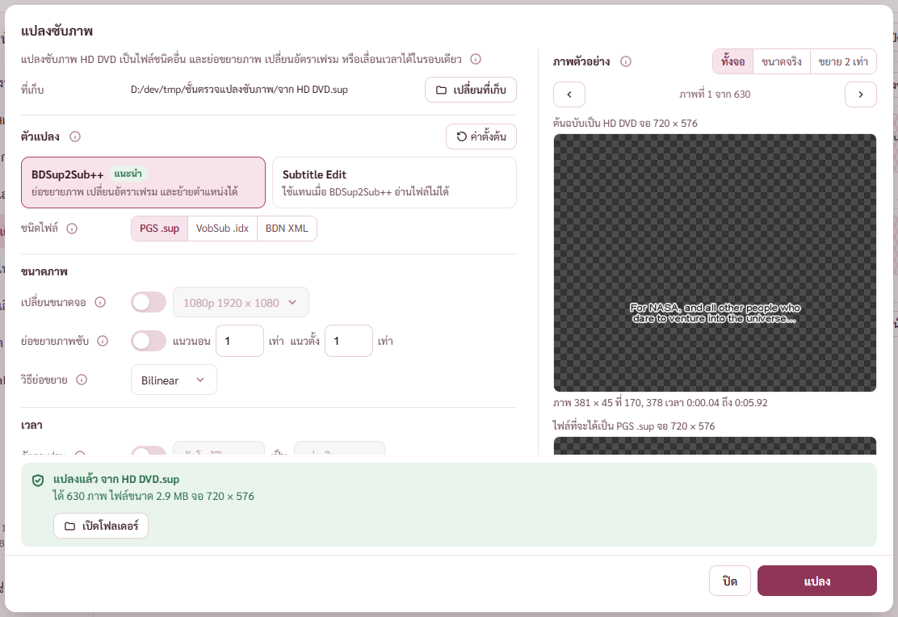

# รายงาน 15 พ.ย. 2569 เปิดซับภาพของแผ่น HD DVD ในหน้าซับไตเติล (BUGS ข้อ 129)

## คำสั่งของพี่กัน
- ย้ายจาก ROADMAP พี่กันสั่ง *"ทำเลย เอาไปใส่คิว"* แล้วสั่ง *"ทำข้อ 129 ต่อ"*

## ต้นเหตุ
ไฟล์ `test-media/ซับตัวอย่าง-ffmpeg/Subpictures_20.sup` ไม่ใช่ซับ PGS ของ Blu-ray แต่เป็นซับภาพของแผ่น HD DVD ที่ใช้นามสกุล .sup เหมือนกัน หัวไฟล์เป็น SP แทน PG · ffmpeg กับ mkvmerge ไม่รู้จักชนิดนี้ หน้าซับไตเติลเปิดไฟล์ผ่าน mkvmerge จึงขึ้นว่าอ่านไฟล์ไม่ได้ ส่วน BDSup2Sub++ อ่านได้ครบ 630 ภาพ

## สิ่งที่ทำ
1. **รู้จักไฟล์ HD DVD จากหัวไฟล์** (`imgconv::is_hddvd_sup`) แล้วให้ BDSup2Sub++ แปลงเป็น PGS เก็บไว้ในโฟลเดอร์ทำงานของโปรแกรม (`hddvd_pgs`) ใช้ของเดิมซ้ำถ้าไฟล์ไม่เปลี่ยน แปลงทั้งไฟล์ไม่ถึงวินาที ไฟล์ต้นฉบับไม่ถูกแตะ
2. **หน้าซับไตเติลเปิดได้** ทางเปิดไฟล์ใหม่ `merge::add_file_view` ได้แทร็ก HD DVD 630 ภาพ ตัวดูซับรูปถอดภาพจาก PGS ที่แปลงไว้ด้วยตัวถอดเดิม หัวตัวดูซับบอกว่าเป็นซับรูปภาพแบบ HD DVD
3. **หน้าต่างแปลงซับภาพ** ส่งไฟล์ต้นฉบับให้ BDSup2Sub++ ตรง ๆ แปลงเป็น PGS VobSub หรือ BDN XML ได้ ป้ายบอกต้นฉบับเป็น HD DVD จอ 720 × 576
4. **หน้าเสียงและซับยังไม่รับไฟล์นี้** เพราะ mkvmerge รวมเข้าหนังไม่ได้ เดิมขึ้นข้อความผิดพลาดของ mkvmerge ตอนนี้บอกว่า ไฟล์นี้เป็นซับภาพของแผ่น HD DVD ซึ่งใส่ในหนังตรง ๆ ไม่ได้ เปิดในหน้าซับไตเติลแล้วแปลงเป็น PGS ก่อน
5. **รวมตัวแยกซับภาพเป็นที่เดียว** หน้าซับไตเติลกับตัวดูซับเขียนรายการซับภาพซ้ำกันคนละที่ ตอนแรกเพิ่ม HD DVD ที่ตัวดูซับแล้วหน้าซับไตเติลยังเปิดเป็นแท็บแก้ซับ ตอนนี้ใช้ `isImageSub` ใน ftypes.tsx ร่วมกัน
6. คำอธิบายนามสกุล SUP ในหัวข้อชนิดไฟล์ของหน้าตั้งค่าบอกว่าซับ HD DVD ใช้นามสกุลเดียวกันและเปิดดูหรือแปลงได้

## ภาพ
ตัวดูซับรูปภาพเปิดซับ HD DVD ได้ 630 ภาพ

แปลงซับ HD DVD เป็น PGS เสร็จ

## ผลตรวจ
- cargo test `hddvd_sup_opens_for_view_and_converts` ผ่าน (รู้จักหัวไฟล์ ไม่สับสนกับ PGS กับ VobSub แปลงได้ 630 ภาพ ครั้งที่สองใช้ของเดิม ตัวดูซับรูปถอดภาพได้ หน้าซับไตเติลได้แทร็ก HD DVD หน้ารวมไฟล์บอกว่าใส่ในหนังไม่ได้ แปลงด้วยหน้าต่างแปลงซับภาพได้ 630 ภาพ 720 × 576 ไฟล์ต้นฉบับเหมือนเดิมทุกไบต์) · ปิดตัวรู้จักไฟล์ชั่วคราวแล้วแดง คืนไฟล์เหมือนเดิม
- check-imgconv เพิ่มส่วนซับ HD DVD 10 ข้อ ทำงานกับสำเนาในโฟลเดอร์ทดสอบ · รอบแรกเจอหน้าซับไตเติลเปิดเป็นแท็บแก้ซับ (ข้อ 5) แก้แล้ว
- ข้อความบนหน้าเสียงและซับตรวจในเทสฝั่ง Rust ไม่ได้กดผ่านหน้าจอ เพราะต้องโหลดหนังเข้าหน้านั้นแล้วสถานะค้างข้ามหน้า

## ยังไม่ commit
commit พร้อมชุดข้อ 123 ถึง 131 หลังเทสรวม (พี่กันสั่ง *"ทำถึง 131 เทสทั้งหมด เเล้ว commit"*)
