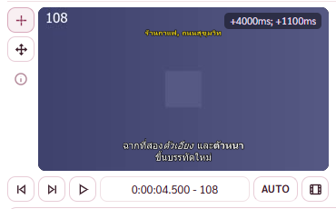
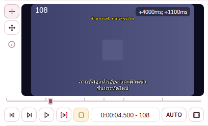

# ภาพนิ่งในหน้าแก้ซับ สีกับความทึบตรงตัวเล่น (BUGS ข้อ 124)

พี่กันสั่ง 15 พ.ย. 2569 *"ทำต่องานนี้เลย"* (ย้ายจาก ROADMAP หัวข้อขอบซับบนภาพนิ่ง) แล้ว *"ใส่ในคิว bug จะได้จดด้วย … ทำตามคิว"*

## ปัญหา

ภาพนิ่งของหน้าแก้ซับ (ซับที่วางทับภาพหนังบนจอ กับเมนูคลิกขวาบันทึกหรือคัดลอกภาพสามแบบ) ใช้ตัวกรอง subtitles ของ ffmpeg แบบเดียวกับที่ตัวส่งออก PGS เคยใช้ จึงโดนสองเรื่องเดียวกัน

| เรื่อง | ต้นเหตุ (พิสูจน์แล้ว) | ผลบนจอ |
|---|---|---|
| สีหม่น | ซับ ASS ที่บอก YCbCr Matrix เป็น TV.709 TV.601 หรือไม่บอก ตัวกรองบีบสีเหลือช่วง 16 ถึง 235 ตอนวาดลงภาพ RGB | เหลือง 255,215,0 ออกมา 235,201,16 ป้ายเหลืองของหนังทดสอบ 255,224,0 ออกมา 235,208,16 |
| ขอบกับเงาโปร่งครึ่งหนึ่งจาง | โหมดพื้นโปร่งใส alpha=1 คิดความทึบของสีโปร่งแสงผิด | เงาความทึบ 128 เหลือราว 63 ขอบตัวหนังสือจางและบางกว่าตอนเล่น |

ซับ SRT ที่ ffmpeg แปลงเองมีบรรทัด YCbCr Matrix: None อยู่แล้ว สีไม่โดนบีบ เหลือแค่เรื่องความทึบ

## ที่แก้ (subshot.rs กับ pgs.rs)

- ภาพซับทุกทางใช้ตัววาดเดียวกับ PGS ที่แก้แล้ว คือวาดบนพื้นดำทึบกับพื้นขาวทึบในคำสั่งเดียว แล้วคิดความทึบเอง (`pgs::spawn_pair` `render_pair` `pair_to_rgba`)
- ซับ ASS ตั้งบรรทัด YCbCr Matrix เป็น None ก่อนวาด ให้สีตรงสไตล์ แล้วคิดสีแบบตัวเล่น (VSFilter แบบที่ mpv ทำ) เมื่อซับเป็น TV.601 หรือไม่บอก บนหนังสูงเกิน 576 จุด (`prep`)
- บันทึกแบบมีซับ (ภาพหนังหรือวิดีโอจำลอง) เดิมให้ ffmpeg วาดซับลงภาพ ตอนนี้ดึงภาพหนังอย่างเดียวแล้ววางซับทับเองแบบตัวเล่น สีซับคูณความทึบบวกพื้นคูณส่วนที่เหลือ (`subs_on_png`)
- ภาพบนจอกับบันทึกแบบเฉพาะซับใช้ `overlay_png` ตัวเดียวกัน
- เวลายังละเอียดระดับไมโครวินาทีเหมือนเดิม (ย้ายจาก `at` มาอยู่ใน `spawn_pair` ซึ่งใช้หน่วยเวลาเดียวกัน)
- ไฟล์หนังยังถูกอ่านอย่างเดียว ไม่มีอะไรเขียนลงหนัง

## ภาพก่อนและหลัง

ก่อนแก้ ขอบดำรอบตัวหนังสือจาง ป้ายเหลืองด้านบนหม่น

หลังแก้ ขอบเข้มและคมแบบตอนเล่น ป้ายเหลืองตรงสไตล์

## การตรวจ

- cargo test ผ่าน 251 ข้อ ข้าม 1 ข้อที่ตั้งใจข้าม · เทสใหม่ใน subshot.rs
  - `overlay_exact_color_and_half_alpha` ซับ TV.709 สีเหลืองตรง 255,215,0 และเงาความทึบราว 128 · แดงกับของเดิม (ได้ 235,201,16)
  - `overlay_tv601_on_hd_like_player` ซับ TV.601 กับซับไม่บอก บนหนัง 720 ได้สีแบบตัวเล่น · แดงกับของเดิม
  - `subs_on_image_exact_color` ซับวางบนภาพเทาได้สีตรงและเงาราว 45 · แดงกับของเดิม
  - `time_uses_microsecond_base` เปลี่ยนจากเทียบข้อความคำสั่ง เป็นวาดภาพจริงที่ 1,990 ms ต้องมีซับ 490 กับ 2,010 ms ต้องว่าง · พิสูจน์แดงด้วยการแก้ชั่วคราวให้ปัดเวลาเป็นวินาที แล้วคืน
- `check-subvtools.mjs` ผ่าน 56 จาก 56 ข้อ เพิ่มข้อสีป้ายเหลืองในภาพที่บันทึกแบบมีซับและเฉพาะซับ ได้ 255,224,0 ทั้งคู่ (เดิม 235,208,16) · ภาพที่ตัวตรวจถ่ายทับรายงานเก่าคืนด้วย git checkout แล้ว
- ยังไม่ได้ตรวจ เทียบด้วยตาว่าภาพนิ่งกับภาพที่ mpv เล่นจริงเหมือนกันบนจอของพี่กัน (ตัวตรวจวัดสีจากตัวเลข) · ยังไม่ commit (คิวข้อ 123 ถึง 126 commit ทีเดียว)
