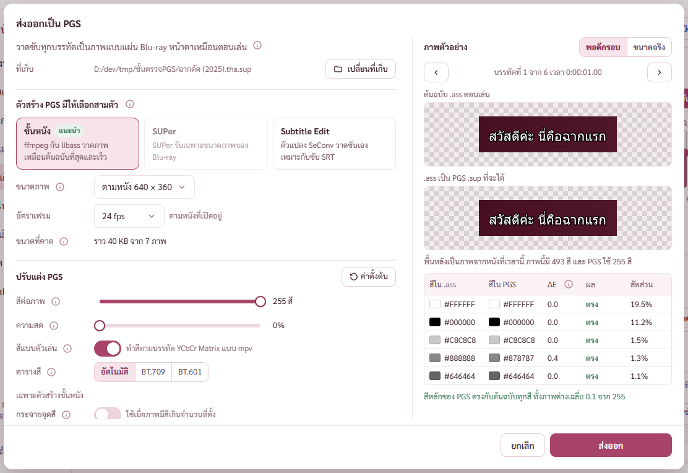
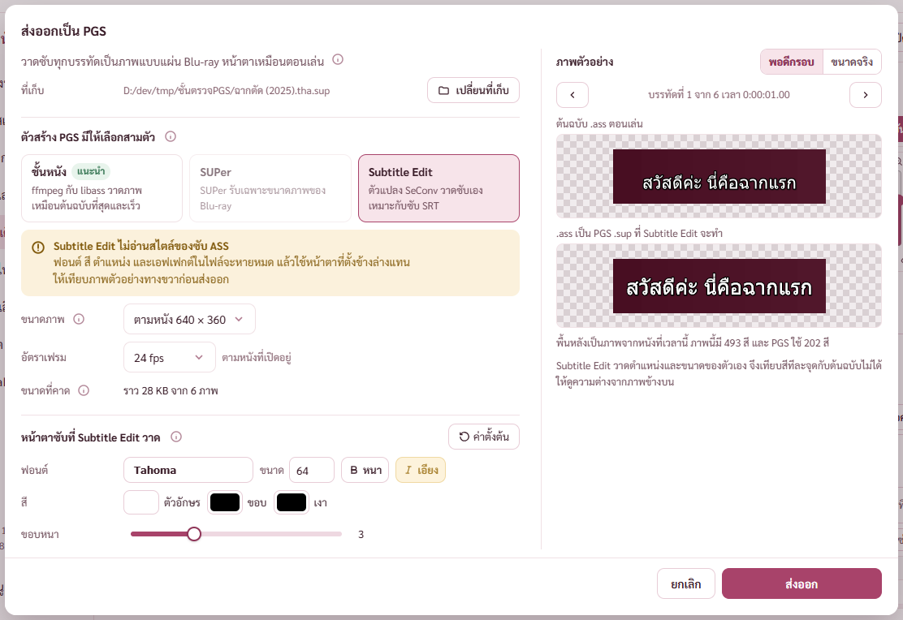
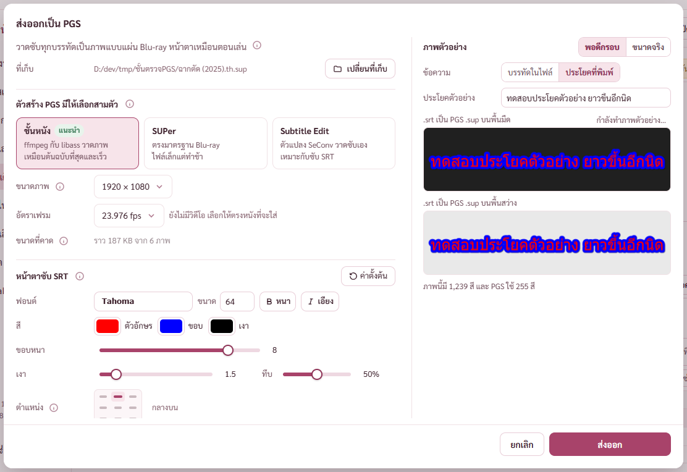
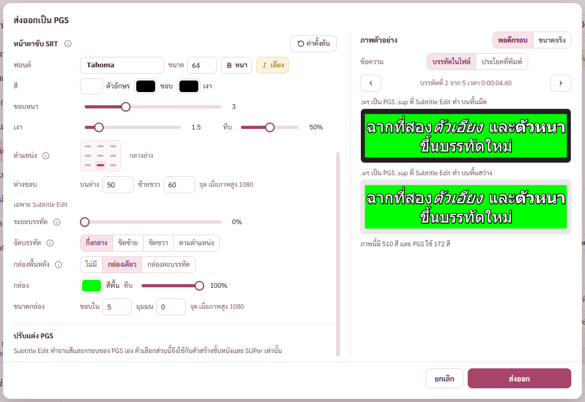
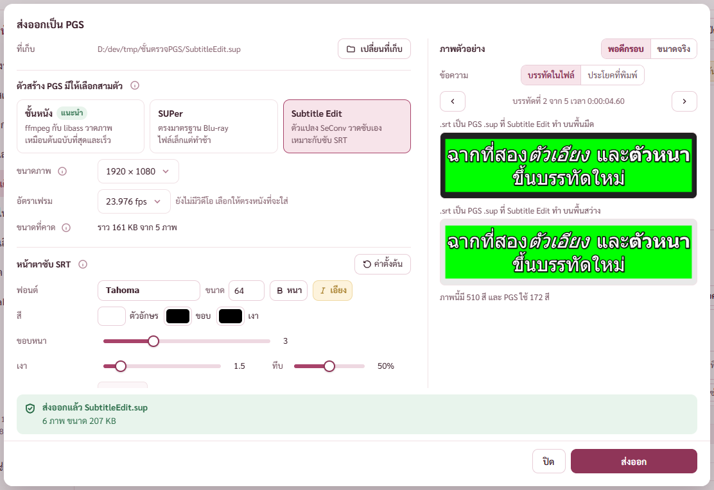
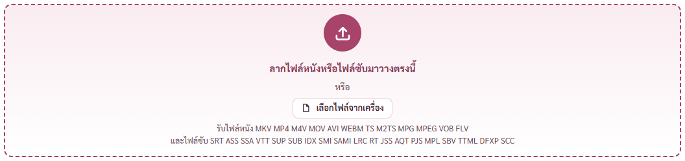
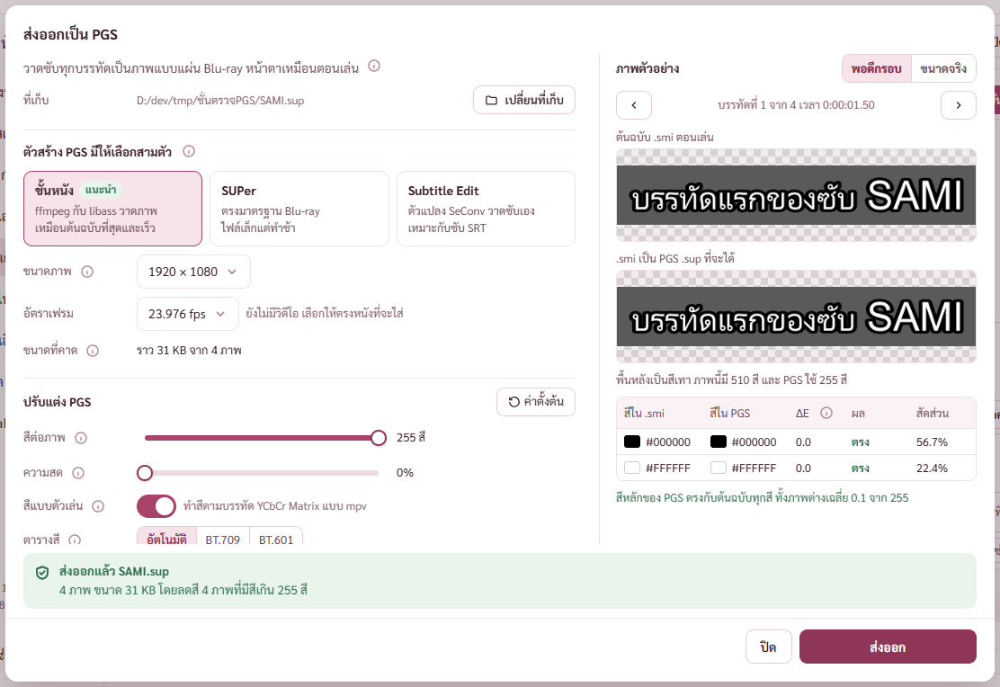
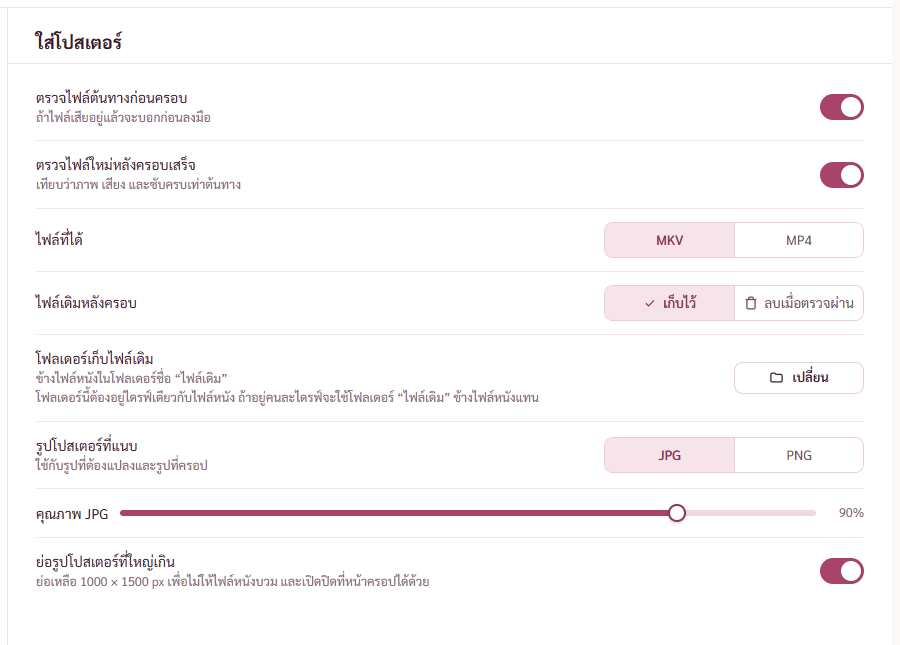
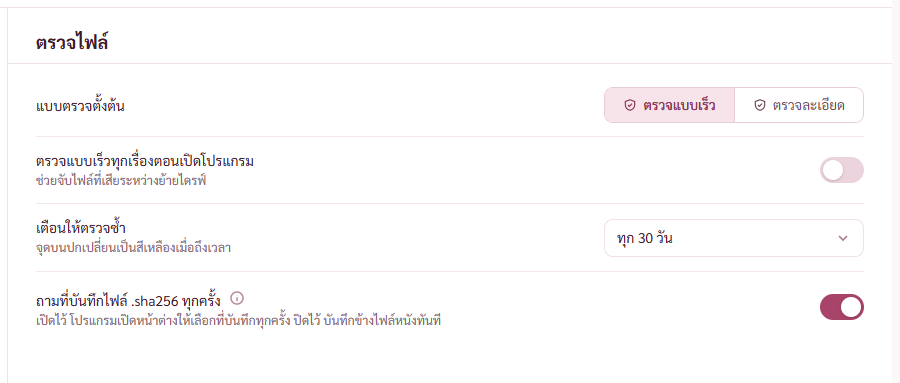
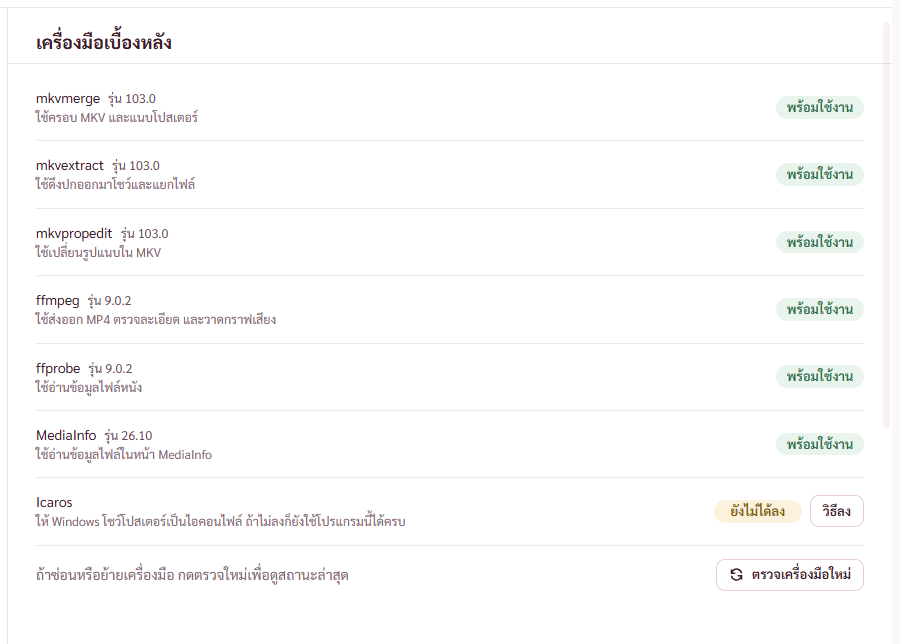

# ระบบส่งออกซับเป็น PGS ทั้งหมด (BUGS ข้อ 118 ถึง 123)

รายงานรวมไว้กลับมาอ่านตอนจะปรับระบบ PGS ครั้งหน้า ว่าใช้เครื่องมืออะไร เจอปัญหาอะไร แก้อย่างไร และวัดได้เท่าไหร่

พี่กันสั่ง 15 พ.ย. 2569 *"แปลว่าระบบ PGS มันมีเยอะมาก ที่เธอทำมา ก็เขียนรายงานเอาไว้ด้วยนะ เจอปัญหาอะไร แก้อะไรมา ใช้ระบบไหน เผื่อตอนไปปรับระบบ จะได้กลับไปอ่าน"*

ผลค้นก่อนลงมือกับผลเทียบเครื่องมือรอบแรกอยู่ [research/pgs-ส่งออกจาก-ass.md](research/pgs-ส่งออกจาก-ass.md) · รายงานนี้เป็นสถานะล่าสุด ถ้าขัดกันให้เชื่อรายงานนี้

## 1. PGS คืออะไร ทำไมต้องมีหลายตัวสร้าง

- PGS เก็บซับเป็นภาพ ไม่ใช่ข้อความ ไฟล์ .sup เป็นชุดคำสั่งเรียงตามเวลา แต่ละชุดมี PCS (บอกภาพไหนขึ้นตรงไหน) WDS (กรอบบนจอไม่เกินสองกรอบ) PDS (จานสีไม่เกิน 255 สี เก็บเป็น YCbCr กับความทึบ) ODS (ภาพแบบ RLE) และ END
- ข้อจำกัดที่ต้องแลก ภาพละไม่เกิน 255 สี ขึ้นพร้อมกันไม่เกินสองกรอบ และเอฟเฟกต์เคลื่อนไหวต้องวาดใหม่ทุกเฟรม
- พี่กันเคาะ *"เราไม่ได้ใช้เครื่องเล่นบลูเรย์ ไม่สนว่าจะถอดทันไหม สนความละเอียด"* เกณฑ์เลือกจึงเป็นความเหมือนต้นฉบับ ไม่ใช่มาตรฐานเครื่องเล่น

## 2. ตัวสร้างในโปรแกรมตอนนี้ (สามตัว)

| ตัวสร้าง | ทำงานยังไง | ดี | เสีย | ไฟล์ |
|---|---|---|---|---|
| **ชั้นหนัง** (แนะนำ) | ffmpeg วาดซับด้วย libass ตัวเดียวกับตอนเล่น แล้วโปรแกรมลดสีและเขียน .sup เอง | เหมือนต้นฉบับที่สุดทั้งสีและขอบโปร่งใส ภาพเฟด ข้อความเลื่อน ย่อขยาย ทำเร็ว | ไฟล์ใหญ่กว่า SUPer ราวสามเท่า ไม่ได้ตรวจว่าเครื่องเล่น Blu-ray ถอดทัน | `pgs.rs` `export` |
| **SUPer** 0.3.0 ของ cubicibo | ชั้นหนังวาดภาพ PNG กับไฟล์ BDN XML แล้วให้ SUPer ทำ .sup | ไฟล์เล็ก ตรวจบัฟเฟอร์ของเครื่องเล่น ลดสีด้วย libimagequant | ช้ากว่าหลายเท่า ภาพเฟดกับข้อความเลื่อนเพี้ยนกว่า รับเฉพาะขนาดภาพของ Blu-ray ชุดหนัก 300 MB | `pgs.rs` `export_super` `run_super` |
| **Subtitle Edit** (SeConv 5.4.0) | เขียนซับเป็นไฟล์ชั่วคราวชนิดเดิม ให้ SeConv วาดด้วยตัววาดของมันเองแล้วทำ .sup | ไฟล์เล็ก หนึ่งภาพต่อบรรทัด มีกล่องพื้นหลังกับระยะบรรทัด | ไม่อ่านสไตล์ ตำแหน่ง เอฟเฟกต์ของ ASS ใช้หน้าตาเดียวทั้งไฟล์ จึงเหมาะกับ SRT | `pgs.rs` `export_seconv` `run_seconv` `seconv_style_args` |

พี่กันเคาะ SeConv 15 พ.ย. 2569 *"แต่ก็เอามาด้วยก็ดีนะ เเต่ใส่หมายเหตุ เเละภาพตัวอย่างอยู่เเล้วว่ามันจะหายหมด เเต่ถ้าเอามาแปลงเเค่ srt ก็ใช้ได้"* · ตัวเลือกของ SeConv *"ก็เอามา ให้ครบเลย"*

### ตัวที่ค้นแล้วไม่ได้ใส่ และเพราะอะไร

| เครื่องมือ | เหตุผล |
|---|---|
| ass2bdnxml (cubicibo 0.7g/0.7h) | วาดภาพด้วย libass ได้ แต่ทำ .sup เองไม่ได้ ต้องต่อกับ SUPer · ตอนแรกคิดจะใช้แทน ffmpeg เพราะสีตรงกว่า แต่หลังแก้ตัวกรองของ ffmpeg (ข้อ 3.1 กับ 3.2) ของเราตรงกว่าแล้ว จึงไม่ต้องแนบ · ชุด 0.7h แพ็ก DLL ผิดรุ่น (ต้องการ libunibreak-7 แต่มี -6) |
| BDSup2Sub | แปลงได้เฉพาะซับที่เป็นภาพอยู่แล้ว (VobSub .sup BDN XML) · พี่กันให้เอามาใช้ตอนทำระบบแปลงซับภาพเป็นซับภาพ BUGS ข้อ 125 |
| avs2bdnxml กับ Spp2Pgs | ต้องลง AviSynth ก่อน |
| sub2bd | หน้าจอครอบ ass2bdnxml ไม่ได้เพิ่มความสามารถ |

## 3. ปัญหาที่เจอ ต้นเหตุ และวิธีแก้

### 3.1 สีหม่นกว่าต้นฉบับ (เหลือง 255,215,0 กลายเป็น 235,201,16)
- **อาการ** ป้ายสีเหลืองสดใน ASS ออกมาเป็นเหลืองหม่นใน PGS ขอบน้ำเงินมืดลง
- **ต้นเหตุ (พิสูจน์แล้ว)** ตัวกรอง subtitles ของ ffmpeg อ่านบรรทัด `YCbCr Matrix` ของซับ ถ้าเป็น TV.* หรือไม่มีบรรทัดนี้ จะบีบสีเป็นช่วง 16 ถึง 235 ตอนวาดลงภาพ RGB เพื่อผสมกับภาพ YUV ของหนัง ภาพซับที่เราดึงออกมาจึงหม่น
- **วิธีแก้** ก่อนวาด ตั้งบรรทัดนี้เป็น None ในสำเนาของซับ (`set_matrix_none`) ภาพที่ได้ตรงสไตล์ทุกตัวเลข แล้วค่อยเลือกตารางสีตอนเขียนจานสีแบบที่ตัวเล่นทำ คือซับบอก TV.601 หรือไม่บอกบนหนัง HD ให้ปรับสีแบบ VSFilter (`script_tv601` `mangle601` · mpv เรียกว่าแบบ basic) ซับ TV.709 ไม่ต้องปรับ
- **ตัวเลือกบนจอ** สีแบบตัวเล่น (vsfilter) เปิดอยู่เป็นค่าตั้งต้น · ตารางสีของจานสี อัตโนมัติ BT.709 BT.601 (`matrices`)
- **เทส** `style_color_exact_for_tv709_script` `tv601_script_colors_like_player` `matrix_line_set_to_none` `preview_matches_ass_colors` · ตัวตรวจหน้าจอ ป้ายเหลือง #FFE000 ได้สีเดียวกันใน PGS ต่างไม่เกินสองหน่วย

### 3.2 ขอบกับเงาโปร่งครึ่งหนึ่งจางเกินจริง (ความทึบ 127 ออกมา 63)
- **อาการ** เงาครึ่งโปร่งใสบางลงครึ่งหนึ่ง ขอบเรืองแสงดูจาง
- **ต้นเหตุ (พิสูจน์แล้ว)** โหมด `alpha=1` ของตัวกรอง subtitles คิดความทึบของสีโปร่งใสผิด
- **วิธีแก้** วาดซับสองรอบในคำสั่งเดียว บนพื้นทึบดำกับพื้นทึบขาว วางซ้อนแนวตั้ง (vstack) แล้วคิด ความทึบ = 255 − (ขาว − ดำ) และสี = ภาพบนพื้นดำ (สีคูณความทึบแล้ว) (`spawn_batch` `pair_to_rgba`)
- **เทส** `half_transparent_shadow_keeps_alpha` `pair_gives_alpha` `straight_undoes_premultiplied_edges`

### 3.3 ซับเคลื่อนไหวเกิน 99 ภาพส่งออกไม่ได้
- **ต้นเหตุ** นิพจน์เวลา setpts ต่อด้วย + ได้ไม่ถึง 100 ส่วน ตัวส่งออกเดิมตั้งชุดละ 250 ภาพ ffmpeg ล้ม "Cannot allocate memory"
- **วิธีแก้** ชุดละ 64 ภาพ · เทส `export_long_animation_over_100_frames`

### 3.4 ภาพของบรรทัดเคลื่อนไหวขึ้นช้าหนึ่งเฟรม
- **ต้นเหตุ** ปัดเวลาเฟรมเป็นมิลลิวินาทีแบบใกล้สุด เฟรม 138 ที่ 5,755.7 ได้ 5,756 เลยเวลาเฟรม
- **วิธีแก้** ปัดลงแบบตัวเล่น · เทส `animation_points_never_after_frame_time`

### 3.5 SUPer ค้างแล้วล้ม "Encoder died: Empty@get"
- **อาการ** ส่งออกด้วย SUPer รอ 60 ถึง 190 วินาทีแล้วล้ม
- **ต้นเหตุ (พิสูจน์แล้ว)** ไฟล์ล็อกแคชของ pyopencl ค้างจากรอบก่อนที่ถูกปิดกลางทาง SUPer รอล็อกจนหมดเวลา
- **วิธีแก้** ตั้ง `PYOPENCL_NO_CACHE=1` ทุกครั้งที่เรียก และตั้ง `use_gpu=0` ใน config.ini ของ SUPer ตอนแตกเครื่องมือ (fetch-tools.ps1) · ล้มแล้วเก็บข้อความไว้ที่ `super-last.log`
- **เทส** `super_ignores_stale_pyopencl_lock` สร้างล็อกค้างแล้วต้องส่งออกได้ (พิสูจน์แดงกับของเดิม รอ 189 วินาทีแล้วล้ม)

### 3.6 SUPer ใหญ่ 300 MB 196 ไฟล์
- พี่กันถาม *"Super ขนาดใหญ่จังงงง 300 mb … เราใช้ทั้งหมดเลยไหม"*
- SUPer เป็นโปรแกรม Python ที่ห่อด้วย PyInstaller ไฟล์ใหญ่สุดคือ llvmlite 115 MB (ตัวคอมไพล์ของ numba) กับ OpenCV 112 MB ซึ่ง SUPer เรียกใช้ทั้งคู่ ตัดออกแล้วเปิดไม่ขึ้น จึงแนบทั้งโฟลเดอร์ · พี่กันตอบ *"ไม่ซีเรียสเรื่องขนาด"*
- ทางเลือกระยะยาว เขียน SUPer ใหม่ด้วย Rust อยู่ ROADMAP (ต้องเคาะเรื่องสัญญา GPLv3 ก่อน) · ส่วนที่ทำได้โดยไม่ลอกโค้ด คือเพิ่มความสามารถแบบ SUPer ให้ตัวสร้างชั้นหนังเอง BUGS ข้อ 126

### 3.7 ภาพตัวอย่างของ SeConv ไม่มีตัวอักษร
- **ต้นเหตุ** ตัวถอด .sup ของเรา (`decode_at`) ข้ามสีเบอร์ 0 ของจานสีโดยถือว่าโปร่งใสเสมอ แต่ SeConv ใช้สีเบอร์ 0 เป็นสีตัวอักษรทึบ
- **วิธีแก้** ไม่ข้ามเบอร์ 0 ดูความทึบจากจานสีจริง · เทส `seconv_engine_uses_style` แดงกับของเดิม

### 3.8 กระจายจุดสี (dither) ไม่ได้ช่วย
- ลอง Floyd–Steinberg กับซับทดสอบ ตัวเลขความเหมือนไม่ขึ้น ไฟล์ใหญ่ขึ้น จึงปิดเป็นค่าตั้งต้น เหลือเป็นตัวเลือก

## 4. ผลวัดความเหมือนต้นฉบับ

ซับทดสอบ 1920 × 1080 ยาว 12 วินาที ภาษาไทยมีวรรณยุกต์ ป้าย \pos กับ \blur ข้อความ \move กับ \fad เรืองแสงโปร่งใส คาราโอเกะ \t ย่อขยายหมุน · วัด PSNR เฉพาะบริเวณที่มีซับ เทียบกับภาพ libass ที่ผสมสีถูกต้อง (ยิ่งสูงยิ่งเหมือน)

| จังหวะ | ชั้นหนังหลังแก้สีกับความโปร่งใส | ass2bdnxml + SUPer |
|---|---|---|
| ภาพนิ่ง บทพูดกับป้าย | 62.0 | 58.5 |
| เริ่มเฟดเข้า | 55.4 | 30.3 |
| กลางทางเลื่อน | 58.7 | 20.8 |
| เรืองแสงกับคาราโอเกะ | 49.4 | 50.7 |
| คาราโอเกะท้าย | 49.6 | 50.9 |
| ย่อขยายหมุน | 57.0 | 40.6 |

- ขนาดไฟล์ SUPer ราว 0.36 เท่าของชั้นหนัง (ซับทดสอบ 4.85 MB กับ 1.72 MB) · SeConv 0.2 MB แต่ป้ายเคลื่อนไหวกับสไตล์หาย
- สรุป ชั้นหนังเหมือนต้นฉบับที่สุดเกือบทุกจังหวะ จึงเป็นตัวแนะนำ · SUPer ชนะเล็กน้อยตอนเรืองแสงกับคาราโอเกะ เพราะ libimagequant ลดสีขอบเรืองแสงได้ดี

## 5. หน้าต่างส่งออก (PgsDialog.tsx)

- ฝั่งซ้ายตั้งค่า ฝั่งขวาภาพตัวอย่าง หน้าต่าง 1100 × 760 เนื้อแต่ละฝั่งเลื่อนในตัว ค่าที่ตั้งจำในเครื่อง (`pgs-engine` `pgs-opts` `pgs-style`)
- **ตัวสร้าง** การ์ดสามใบ ชั้นหนังติดป้ายแนะนำ การ์ดที่ใช้ไม่ได้บอกเหตุผล (SUPer รับเฉพาะขนาด Blu-ray ไม่มีเครื่องมือในโฟลเดอร์)
- **ขนาดที่คาด** วาดภาพจริงไม่เกินแปดภาพกระจายทั้งเรื่อง เอาขนาดเฉลี่ยคูณจำนวนภาพ (`estimate` `pgs_estimate`) · SUPer คิดภาพเคลื่อนไหวราว 30% เพราะเปลี่ยนแค่สี · SeConv หนึ่งภาพต่อบรรทัด
- **หน้าตาซับ** ใช้กับ SRT ทุกตัวสร้าง และกับ ASS เมื่อเลือก Subtitle Edit · ฟอนต์ ขนาด หนา เอียง สีตัวอักษร ขอบ เงา ความหนาขอบ ระยะเงา ความทึบเงา ตำแหน่งเก้าจุด ห่างขอบบนล่างกับซ้ายขวา ตัวเลขคิดที่ภาพสูง 1080 แล้วย่อขยายตามภาพ
  - เฉพาะ Subtitle Edit ระยะบรรทัด จัดบรรทัดในก้อนซับ กล่องพื้นหลัง (ไม่มี กล่องเดียว กล่องละบรรทัด) สีและความทึบกล่อง ขอบในกล่อง มุมมน
  - SeConv ไม่มีตัวเลือกตัวเอียงทั้งไฟล์ ปุ่มเอียงกดไม่ได้พร้อมเหตุผล
- **ปรับแต่ง PGS** สีต่อภาพ 16 ถึง 255 ความสด สีแบบตัวเล่น ตารางสี · เฉพาะชั้นหนัง กระจายจุดสี กรอบพร้อมกัน · เฉพาะ SUPer ระดับบีบอัด ตัวลดสี จัดกรอบ กันภาพตกหล่นสองตัว วาดซ้ำทุกกี่วินาที บิตเรตไม่เกิน · เลือก Subtitle Edit แล้วส่วนนี้ซ่อน เพราะ SeConv ทำจานสีกับกรอบเอง
- **ภาพตัวอย่าง** ASS เทียบภาพตอนเล่นกับ PGS บนภาพหนังเวลานั้น พร้อมตารางสีหลักทีละสีกับค่า ΔE · SRT วางภาพ PGS พื้นโปร่งใสบนพื้นมืดกับพื้นสว่าง เลือกดูบรรทัดในไฟล์หรือประโยคที่พิมพ์ · ป้ายภาพบอกนามสกุลต้นทาง เช่น ".ass เป็น PGS .sup ที่จะได้"
- **คำเตือน** เอฟเฟกต์เคลื่อนไหว ขอบเบลอ ซับขึ้นพร้อมกันเกินสอง ขนาดไม่ใช่ Blu-ray · ASS กับ Subtitle Edit มีกล่องเตือนว่าสไตล์ ตำแหน่ง เอฟเฟกต์หาย

## 6. ซับข้อความแบบอื่นที่ส่งออกเป็น PGS ได้

พี่กันสั่ง *"เราอยากให้มันแปลงจาก text sub ตัวอื่นมา PGS ได้"*

| ชนิด | นามสกุล | ทางที่โปรแกรมอ่าน |
|---|---|---|
| SAMI MicroDVD LRC RealText JACOsub AQTitle PJS MPL2 SCC | smi sami sub lrc rt jss aqt pjs mpl scc | ffmpeg แปลงเป็น ASS (`subs.rs` `FF_TEXT` · ไฟล์ไทยแบบเก่าบอกชุดอักษรที่เดาได้ด้วย `-sub_charenc`) |
| YouTube SBV, TTML, DFXP | sbv ttml dfxp | โปรแกรมแปลงเป็น SRT เอง เพราะ ffmpeg ไม่มีตัวอ่าน (`subconv.rs`) |

- เปิดในหน้าซับไตเติลได้ทุกชนิด แก้แล้วส่งออก PGS ได้เหมือน ASS กับ SRT · กดบันทึกไฟล์นามสกุลอื่นจะไปบันทึกเป็นไฟล์ใหม่ ไม่ทับไฟล์เดิม
- .sub ที่เป็นซับภาพของ DVD (คู่กับ .idx) ไปตัวดูซับภาพตามเดิม

## 7. ไฟล์ที่เกี่ยวข้อง

| ไฟล์ | หน้าที่ |
|---|---|
| `src-tauri/src/pgs.rs` | ตัวสร้างทั้งสามตัว ตัวถอด .sup ภาพตัวอย่าง เทียบสี ขนาดที่คาด และเทส |
| `src-tauri/src/subconv.rs` | แปลง SBV TTML DFXP เป็น SRT |
| `src-tauri/src/subs.rs` | `FF_TEXT` `OWN_TEXT` ทางอ่านซับข้อความแบบอื่น |
| `src-tauri/src/merge.rs` | `add_file` ทำแทร็กของ SBV TTML DFXP เอง |
| `src/components/subedit/PgsDialog.tsx` | หน้าต่างส่งออก |
| `src/styles/subedit.css` | สไตล์ `se-pgs*` |
| `scripts/fetch-tools.ps1` | แตก SUPer (ตั้ง use_gpu=0) กับ SeConv ลง tools พร้อมสัญญา |
| `vendor/super/` `vendor/seconv/` | ไฟล์ต้นฉบับกับสัญญา (ไฟล์ใหญ่ไม่ขึ้น git) |
| `scripts/check-pgs.mjs` | ตัวตรวจหน้าต่างส่งออกผ่านโปรแกรมจริง |

## 8. งานรอบ 15 พ.ย. 2569 พร้อมภาพ (BUGS ข้อ 123)

พี่กันสั่ง *"ทำไมเธอแนะนำชั้นหนัง มันคือตัวไหน ffmpeg หรือตัวไหน เขียนบอกด้วย"* · *"ส่งออก PGS มีสองรูป บอกหน่อย จากนามสกุลไหน เป็น PGS"* · *"ไม่ใช่ว่าระบบแปลงมี 3-4 ตัวเหรอ แต่ทำไมมีสองตัวเลือก"* · *"เขียนขนาดไฟล์ซับที่น่าจะได้ด้วย"* · *"ขอเส้นแบ่งแนวนอนด้วย"* · *"เราอยากให้มันแปลงจาก text sub ตัวอื่นมา PGS ได้"* · *"อยากให้สามารถดูบรรทัดซับจริงได้ ตอนที่ดูตัวอย่าง แต่ระบบพิมประโยคเทสก็ยังใช้อยู่"* · *"ฝากดูหน้าตั้งค่า บางกรอบควรเรียงแนวเดียวกัน ขนาดเท่ากัน"*

### 8.1 ตัวสร้างสามตัว ป้ายนามสกุล เส้นแบ่ง ขนาดที่คาด
- การ์ดชั้นหนังเขียนว่า "ffmpeg กับ libass วาดภาพ" · กล่อง ⓘ บอกทั้งสามตัวพร้อมตัวที่ไม่ได้ใส่และเหตุผล
- ป้ายภาพ "ต้นฉบับ .ass ตอนเล่น" กับ ".ass เป็น PGS .sup ที่จะได้" · ซับ SRT ".srt เป็น PGS .sup บนพื้นมืด"
- เส้นแบ่งแนวนอนเหนือทุกหัวข้อของฝั่งตั้งค่า · แถวขนาดที่คาด "ราว 40 KB จาก 7 ภาพ" (ไฟล์จริง 29 KB)

### 8.2 Subtitle Edit กับซับ ASS เตือนว่าสไตล์หาย
- กล่องเตือนสองประโยค ภาพตัวอย่างเทียบต้นฉบับกับที่ Subtitle Edit วาด · ตัวเลือกปรับแต่ง PGS ซ่อนพร้อมเหตุผล · ปุ่มตัวเอียงกดไม่ได้พร้อมเหตุผล
- ไม่แสดงตารางเทียบสีทีละจุด เพราะ Subtitle Edit วาดตำแหน่งกับขนาดของตัวเอง ตารางเดิมขึ้นว่าขาวกลายเป็นดำ ΔE 100 ซึ่งไม่จริง

### 8.3 ซับ SRT ตำแหน่งเก้าจุด บรรทัดจริงกับประโยคที่พิมพ์
- ปุ่มเลือก "บรรทัดในไฟล์" กับ "ประโยคที่พิมพ์" · เริ่มที่บรรทัดในไฟล์พร้อมปุ่มก่อนหน้าถัดไป
- ตำแหน่งเก้าจุด ห่างขอบบนล่างกับซ้ายขวา

### 8.4 ตัวเลือกของ Subtitle Edit ครบ กล่องพื้นหลัง
- ระยะบรรทัด จัดบรรทัดในก้อนซับ กล่องพื้นหลังสามแบบ สีพื้นกับความทึบ ขอบในกล่อง มุมมน · ภาพตัวอย่างวาดด้วย SeConv จริง กล่องสีเขียวทึบขึ้นจริง 97,120 จุด

### 8.5 ซับข้อความแบบอื่น
- หน้าซับไตเติลรับเพิ่ม SMI SAMI LRC RT JSS AQT PJS MPL SBV TTML DFXP SCC · ช่องลากไฟล์แยกไฟล์หนังกับไฟล์ซับเป็นสองบรรทัด
- ส่งออกซับ SAMI ได้ 4 ภาพครบสี่บรรทัด

### 8.6 หน้าตั้งค่า กรอบในหัวข้อเดียวกันกว้างเท่ากันและขอบตรงแนว
- ใส่โปสเตอร์ ปุ่มเลือกสามแถวเดิมกว้าง 165 220 165 ตอนนี้ 260 เท่ากัน ปุ่มเปลี่ยนโฟลเดอร์กว้างครึ่งแถบ (130) ขอบซ้ายตรงช่องขวาตามที่พี่กันเคาะ 9 พ.ย. · ลองกว้าง 225 กับ 240 แล้ว คำ "ลบเมื่อตรวจผ่าน" ห่างขอบปุ่ม 0 กับ 4 จุด จึงใช้ 260
- ตรวจไฟล์ ปุ่มเลือกแบบตรวจเดิม 242 ดรอปดาวน์เตือนตรวจซ้ำ 117 ตอนนี้ 260 เท่ากัน
- กราฟเสียง แถวกราฟความถี่เปิดมาแบบเดิม 148 ตอนนี้ 165 เท่าแถวความลึกสีกับชุดสี
- เครื่องมือเบื้องหลังกับตัวแปลงเสียง ป้ายสถานะกว้างอย่างน้อย 88 ขอบซ้ายตรงแนวทั้งคอลัมน์
- การ์ด Subtitle Edit ในหน้าขอบคุณย้ายไปกลุ่มเครื่องมือที่แนบมาทำงานจริง ป้าย MIT เพราะแนบ SeConv มาแล้ว (README ด้วย)

### 8.7 บั๊กที่เจอจากตัวตรวจรอบนี้ แก้แล้ว
| บั๊ก | ต้นเหตุ | แก้ |
|---|---|---|
| เปิดซับ SAMI ไม่ได้ ขึ้นว่า mkvmerge อ่านไม่ได้ | ตัวเพิ่มไฟล์ (merge.rs `add_file`) ให้ mkvmerge อ่านแทร็กอย่างเดียว mkvmerge ไม่รู้จัก SAMI | ซับใน `FF_TEXT` ที่ mkvmerge อ่านไม่ได้ ทำแทร็กเอง นับบรรทัดจากซับที่แปลงแล้ว (ffprobe นับบรรทัดว่าง &nbsp; เกินเท่าตัว) · เทส `other_text_formats_open` แดงด้วยข้อความเดียวกับบนจอแล้วเขียว |
| ส่งออกด้วย Subtitle Edit ปุ่มขึ้น "กำลังส่งออก 0%" ทั้งรอบ | ฝั่ง Rust ส่งสัญญาณเริ่มก่อนตัวฟังของหน้าจอพร้อม | ตั้งสถานะของ Subtitle Edit ตั้งแต่กด |
| กล่อง ⓘ ตัวสร้างตัดกลางวลีหลายจุด | คำ ffmpeg ถูกเติมคำเต็มในวงเล็บจนบรรทัดยาว | เขียนคำใหม่ให้สั้นลง ตัดตรงความหมายทุกบรรทัด |
| กล่องผล "ส่งออกแล้ว" ของตัวสร้างเก่าค้างหลังเปลี่ยนตัวสร้าง | ไม่ได้ล้างผลเมื่อเปลี่ยนตัวสร้าง | ล้างผลเมื่อเปลี่ยนตัวสร้าง |
| ซับ SAMI หัวตารางเขียน "สีใน ASS" สรุปว่า "ตรงกับ ASS" | ข้อความเขียนตายตัวตอนรองรับแค่ ASS | หัวตารางใช้นามสกุลต้นทาง เช่น "สีใน .smi" สรุปเรียกว่าต้นฉบับ |

### 8.8 การตรวจ
- `check-pgs.mjs` ผ่าน 108 จาก 108 ข้อ ที่หน้าต่าง 1280 × 800 และ 1920 × 1032 · ส่งออกจริงทั้งสามตัวสร้างแล้ว ffprobe อ่านได้ · กล่อง ⓘ 22 กล่องตัดบรรทัดตรงที่คาดทุกย่อหน้า
- `check-settings.mjs` ผ่าน 48 จาก 48 ข้อ (เพิ่มข้อกรอบเท่ากัน 7 ข้อ)
- `cargo test` ผ่าน 248 ข้อ ข้าม 1 ข้อที่ตั้งใจข้าม
- ข้อตรวจใหม่พิสูจน์ว่าแดงกับของเดิม เปิด SAMI (รอบแรกแดง) ปุ่ม Subtitle Edit กำลังทำไฟล์ (รอบแรกแดง) ระยะคำกับขอบปุ่ม (225 ได้ 0 จุด 240 ได้ 4 จุด แดงทั้งคู่) ความกว้างกรอบในหน้าตั้งค่า (ค่าเดิมวัดได้ 165 220 165, 242 กับ 117, 148)
- ยังไม่ได้ตรวจ ตัวติดตั้ง (`check-install.mjs` เพิ่มข้อ SUPer กับ SeConv แล้ว รันตอนสร้างตัวติดตั้งรุ่นถัดไป) · ภาพ PGS บนทีวีหรือเครื่องเล่นจริง พี่กันต้องลองเอง

### 8.9 ข้อเสนอที่ยังไม่ได้ทำ
- หัวข้อเครื่องมือเบื้องหลังในหน้าตั้งค่ายังไม่มีแถวสถานะของ SUPer SeConv และ libmpv (หน้าต่างส่งออกบอกเหตุผลเองเมื่อไม่มีเครื่องมือ)

## 9. ถ้าจะปรับระบบครั้งหน้า

- สีเพี้ยน ดู `prepare` `matrices` `straight_px` ก่อน · ภาพตัวอย่างใช้ทางเดียวกับส่งออก ถ้าภาพตัวอย่างตรง ไฟล์จริงก็ตรง
- เพิ่มตัวเลือกของ SeConv ดู `seconv_exe --help` แล้วเพิ่มใน `SrtStyle` ทั้งสองฝั่ง (`pgs.rs` กับ `api.ts`) และ `seconv_style_args`
- งานที่ต่อคิวไว้ BUGS ข้อ 124 ภาพนิ่งในหน้าแก้ซับ (subshot.rs) ยังใช้ตัวกรองของ ffmpeg แบบเดิม สีกับความโปร่งใสยังเพี้ยนแบบข้อ 3.1 กับ 3.2 · ข้อ 125 แปลงซับภาพเป็นซับภาพด้วย BDSup2Sub · ข้อ 126 เพิ่มการเปลี่ยนสีแทนวาดภาพใหม่ตอนเฟด จัดกลุ่มชุดภาพ และตรวจบัฟเฟอร์ ให้ตัวสร้างชั้นหนัง
- ROADMAP เขียน SUPer ใหม่ด้วย Rust
