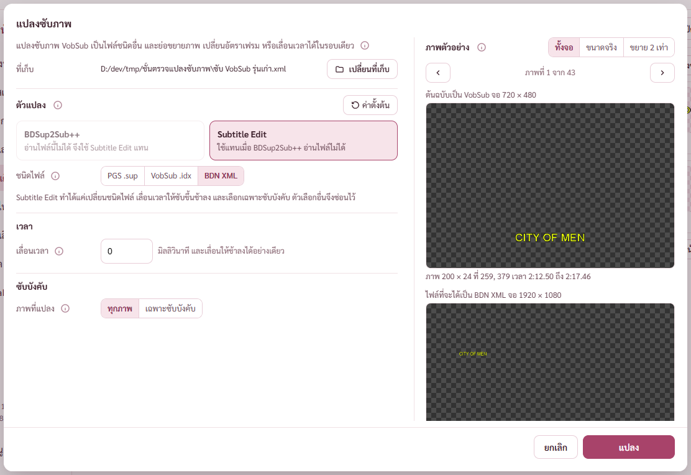
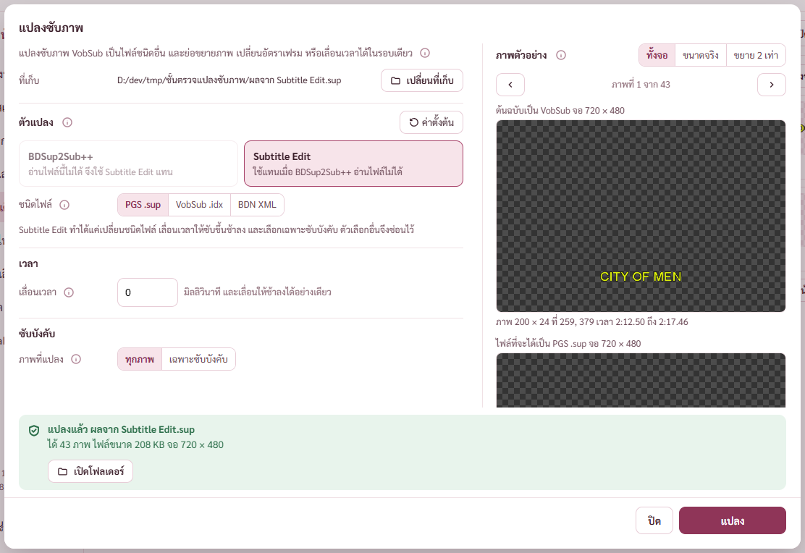

# รายงาน 15 พ.ย. 2569 BDSup2Sub++ อ่านไฟล์ไม่ได้แล้วสลับเป็น Subtitle Edit เอง (BUGS ข้อ 128)

## คำสั่งของพี่กัน
- พี่กันเสนอพร้อมภาพหน้าต่างตอนเปิด VobSub รุ่นเก่า *"ถ้าเลือกชนิดซับนี้ของ bub2sub มันควรขึ้นจางให้กดไม่ได้ เเละถ้ากดที่ BND เเล้วของ sub2sub ก็จะกดไม่ได้ เอาเเบบนี้ดีมั้ย"* แล้วสั่ง *"ตามคิวนะ"* และ *"ทำข้อ 128 ต่อ"*
- ส่วนที่สองเรื่อง BDN XML แคลร์แย้งไว้ตอนจดงาน ว่ากล่องแดงในภาพเกิดจากไฟล์ ไม่ได้เกิดจาก BDN XML เพราะทั้งสองตัวแปลงทำ BDN XML ได้ จึงไม่มีอะไรต้องจางตอนเลือก BDN XML

## เดิม
เปิดไฟล์ที่ BDSup2Sub++ อ่านไม่ได้ ภาพตัวอย่างขึ้นกล่องแดงว่าทำภาพตัวอย่างไม่ได้ พร้อมปุ่มใช้ Subtitle Edit แทน ต้องกดเอง การ์ด BDSup2Sub++ ยังดูเหมือนเลือกได้ และถ้ากดแปลงก่อน ได้กล่องแปลงไม่สำเร็จ

## ใหม่ (ImgConvDialog.tsx)
1. BDSup2Sub++ หยุดทำงานกับไฟล์นี้ (ข้อความ อ่านซับนี้ไม่ได้ ของ imgconv.rs) โปรแกรมใช้ Subtitle Edit แทนเอง ภาพตัวอย่างทำใหม่ทันทีโดยไม่ขึ้นกล่องแดงแวบก่อน
2. การ์ด BDSup2Sub++ จาง กดไม่ได้ ขึ้นว่า อ่านไฟล์นี้ไม่ได้ จึงใช้ Subtitle Edit แทน ทั้งบนการ์ดและตอนชี้ ป้ายแนะนำซ่อนตอนการ์ดจาง
3. กดแปลงเร็วก่อนภาพตัวอย่างรู้ว่าอ่านไม่ได้ ตอนแปลงล้มก็แปลงซ้ำด้วย Subtitle Edit จนเสร็จ ไม่ขึ้นกล่องแปลงไม่สำเร็จ
4. สลับเฉพาะไฟล์นี้ ตัวแปลงที่จำไว้ยังเป็น BDSup2Sub++ เปิดหน้าต่างใหม่หรือไฟล์ถัดไปเริ่มที่ BDSup2Sub++ ตามเดิม
5. ตัดสินจากข้อความอ่านซับนี้ไม่ได้ตัวเดียว การแปลงที่ล้มด้วยเหตุอื่น เช่นตัวเลือกย่อขยาย ไม่ได้แปลว่าอ่านไฟล์ไม่ได้ จึงไม่สลับเอง
6. เอาปุ่มใช้ Subtitle Edit แทนในกล่องผิดพลาดออก เพราะสลับให้เองแล้ว · คำแนะนำในกล่อง ⓘ ตัวแปลงเปลี่ยนเป็น ถ้าไฟล์ไหนอ่านไม่ได้ จะใช้ Subtitle Edit แทนเอง

## ภาพ
เปิด VobSub รุ่นเก่า การ์ด BDSup2Sub++ จางพร้อมเหตุผล ภาพตัวอย่างของ Subtitle Edit ขึ้นเอง

การ์ดตัวแปลงตอนจาง

แปลงด้วย Subtitle Edit เสร็จ

## ผลตรวจ
- `check-imgconv.mjs` ผ่าน 114 จาก 114 ข้อ (ส่วนไฟล์ที่อ่านไม่ได้เขียนใหม่ 15 ข้อ คือ สลับเองภาพตัวอย่างขึ้น การ์ดจางพร้อมเหตุผล ไม่มีป้ายแนะนำ ไม่มีปุ่มกดเอง ค่าที่จำไว้ไม่เปลี่ยน กดการ์ดจางไม่เปลี่ยนกลับ การ์ดสองใบสูงเท่ากัน แปลงด้วย Subtitle Edit ได้ไฟล์ PGS จริง กดแปลงเร็วแล้วแปลงซ้ำเอง เปิดหน้าต่างใหม่เริ่มที่ตัวเดิม ไฟล์ถัดไปกลับมาใช้ BDSup2Sub++ จุดตัดบรรทัดกล่อง ⓘ)
- พิสูจน์ว่าข้อตรวจแดง ปิดการสลับในโค้ดชั่วคราว ข้อตรวจใหม่แดง 7 ข้อ แล้วคืนไฟล์เหมือนเดิมทุกไบต์ รันใหม่กับโค้ดจริงเขียวครบ และถ่ายภาพใหม่ทับภาพจากรอบแดง
- `npx tsc --noEmit` ผ่าน · ตรวจที่หน้าต่าง 1280 × 800 ในโปรแกรมทดสอบที่อยู่หลังสุด

## ยังไม่ได้ตรวจ
- กรณีที่โฟลเดอร์เครื่องมือไม่มี Subtitle Edit เลย (การ์ดจางเขียนแค่ อ่านไฟล์นี้ไม่ได้ และขึ้นกล่องแดงตามเดิม) ตัวติดตั้งแนบ Subtitle Edit มาเสมอ จึงไม่ได้จำลองกรณีนี้
- ตัวจริงใต้ CSP กับขนาดจออื่น รันตอนตรวจรวมก่อน commit ชุดข้อ 123 ถึง 128

## ยังไม่ commit
commit พร้อมชุดข้อ 123 ถึง 128 ตอนจบชุด
