# รายงาน 15 พ.ย. 2569 · หน้าต่างแปลงซับภาพเป็นซับภาพ (BUGS ข้อ 125)

## คำสั่งของพี่กัน
- *"เอามาก็ดีนะ ตอนระบบแปลงจากซับภาพเป็นซับภาพ"* แล้ว *"ทำต่องานนี้เลย"* · *"อนุญาตโหลด"* (BDSup2Sub++ 1.0.5 ขนาด 8,428,379 ไบต์ จาก GitHub)
- *"ส่วนของ UXUI เอามาจากเจ้านั้นได้นะ แปลงมา เเละเสริมของเราถ้ามีจุดที่อยากเพิ่ม เเละดูว่า subtitle edit หน้า UI เป้นยังไงก็ปรับๆมา"*
- ระหว่างทำ *"อยากให้สามารถเลือกดู เฉพาะตัวซับได้ด้วย เพิ่มจากฝั่งขวาที่เเสดงซับพร้อมตัวอย่างวิดีโอ เพราะอยากเอาไว้ดูความละเอียดของซับที่เปลี่ยน"*
- ระหว่างทำ *"ชนิดผล เปลี่ยนเป็น ชนิดไฟล์ ไปดูคำไทยดีๆนะ"*
- *"ห้ามเด้งหน้าจออะไรนะ เครื่องงนั้น ทำงานพื้นหลังเท่านั้น"* · *"ตอนนี้เราสั่งเธอโดยรีโมทมานะ ดังนั้นเเคปภาพมาด้วย"* (ทุกอย่างรันหลังสุด ภาพถ่ายผ่าน CDP)

## สิ่งที่ได้

### 1. ปุ่มแปลงซับภาพในตัวดูซับรูปภาพ
ซับ PGS หรือ VobSub ที่เปิดในหน้าซับไตเติล (หรือดูซับในหน้าเสียงและซับ) มีปุ่มแปลงซับภาพทางขวาของข้อความสรุป

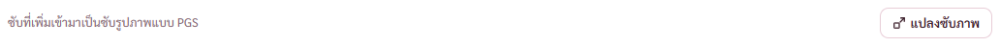

### 2. หน้าต่างแปลงซับภาพ หน้าตาตามกลุ่มของ BDSup2Sub
- ฝั่งซ้ายเรียงกลุ่มตามหน้าต่าง Conversion Options กับแถบบนของ BDSup2Sub คือ ตัวแปลง ชนิดไฟล์ ขนาดภาพ (เปลี่ยนขนาดจอ ย่อขยายภาพซับ วิธีย่อขยาย) เวลา (อัตราเฟรม เลื่อนเวลา ภาพที่ขึ้นสั้นไป) ตำแหน่ง (ย้ายแนวตั้ง สัดส่วนภาพหนัง ย้ายแนวนอน) สีและซับบังคับ (จานสี ภาพที่มองไม่เห็น ภาพที่แปลง ป้ายซับบังคับ) และเฉพาะ VobSub (ภาษา เกณฑ์ความทึบ เกณฑ์ความสว่าง)
- เอาแบบของ Subtitle Edit มาใช้ คือสวิตช์เปิดทีละกลุ่ม ปิดแล้วไม่ส่งค่ากลุ่มนั้น
- ของที่ชั้นหนังเสริม ภาพตัวอย่างแปลงจริงทั้งไฟล์ด้วยตัวเลือกเดียวกัน (VobSub เห็นเหลือ 4 สีจริง) · ตัวสำรอง Subtitle Edit · ไม่เขียนทับไฟล์ที่มี · จำค่าที่ตั้ง · ปุ่มค่าตั้งต้น · ทุกตัวเลือกมีปุ่ม ⓘ 20 กล่อง

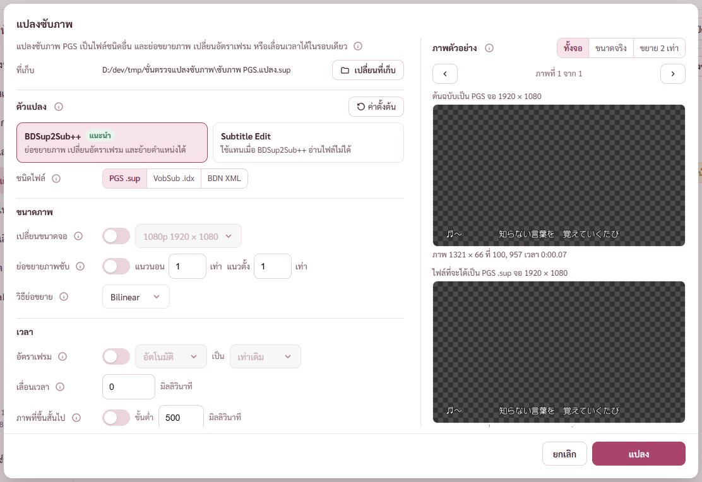

### 3. มุมมองภาพตัวอย่าง ทั้งจอ ขนาดจริง ขยาย 2 เท่า (พี่กันขอระหว่างทำ)
- ทั้งจอ วางซับบนจอเท่าขนาดจอของไฟล์ ดูตำแหน่ง
- ขนาดจริง ตัดเฉพาะตัวซับ หนึ่งจุดของภาพเท่าหนึ่งจุดบนหน้าต่าง ต้นฉบับ 1080p กว้าง 1321 จุด ย่อเป็น 720p เหลือ 881 จุด เห็นความละเอียดที่เปลี่ยนจริง · เลื่อนกรอบหนึ่งแล้วอีกกรอบเลื่อนตามสัดส่วน
- ขยาย 2 เท่า แบบเห็นจุดภาพชัด (pixelated) เห็นขอบตัวหนังสือหลังย่อ

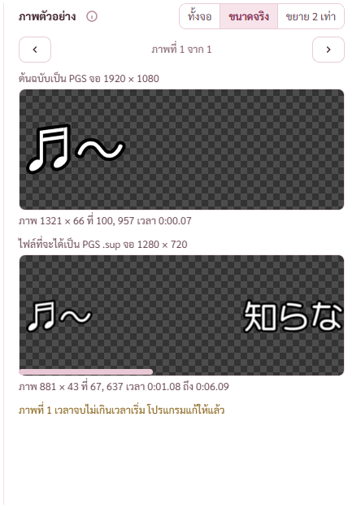

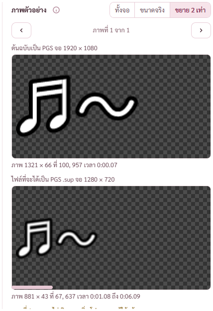

### 4. ย่อเป็น 720p กับเลื่อนเวลา
ตำแหน่งกับขนาดย่อตามสัดส่วนจอ เลื่อนเวลา 1,000 มิลลิวินาทีแล้วภาพขึ้นช้าลง 1 วินาที

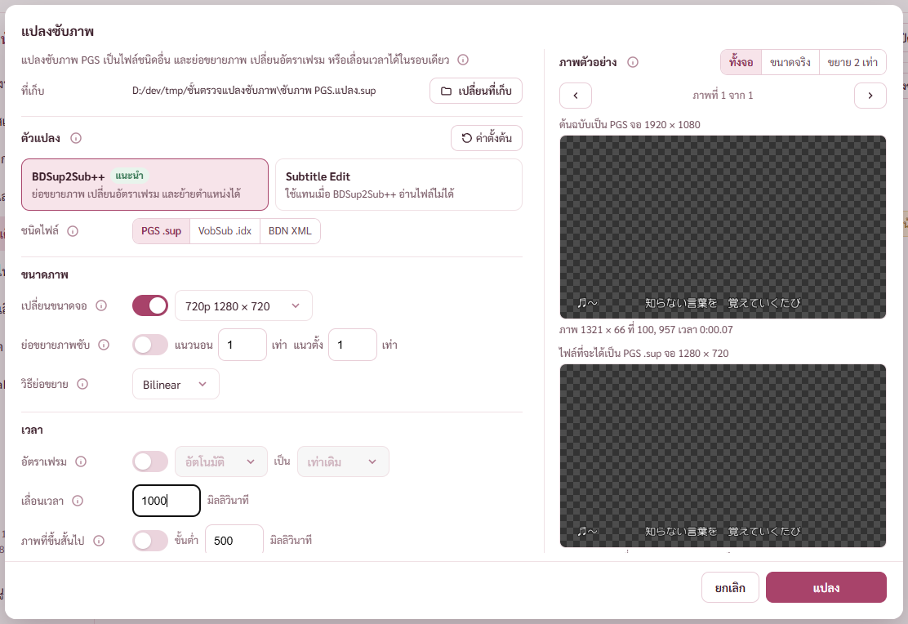

### 5. VobSub ตัวเลือกเฉพาะ และแปลงจริง
ภาษาตั้งต้นตามภาษาของแทร็ก · แปลงแล้วได้ .idx กับ .sub คู่กัน ffprobe อ่านกลับเป็น dvd_subtitle 1280 × 720 · แปลงซ้ำชื่อเดิมบอกว่ามีอยู่แล้ว ไม่เขียนทับ กดตั้งชื่อใหม่ต่อเลขได้ · BDN XML ได้โฟลเดอร์ที่มีไฟล์ XML กับภาพ PNG

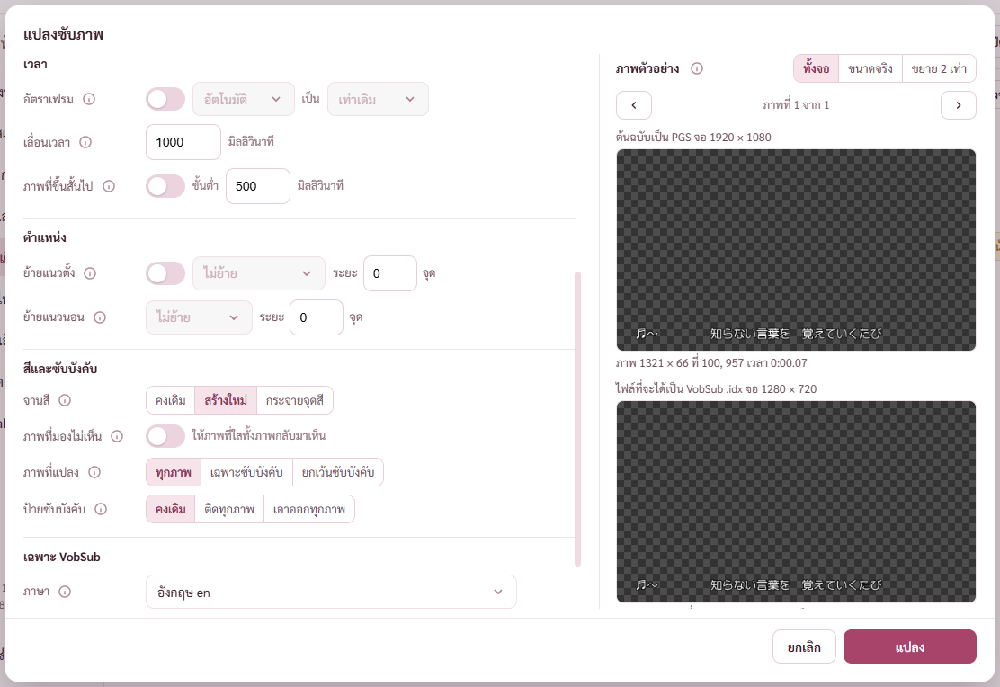

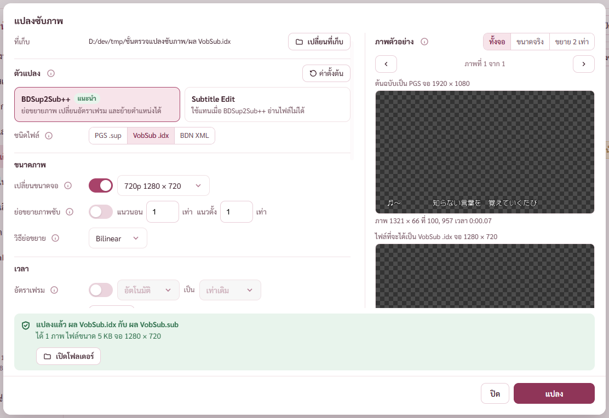

### 6. Subtitle Edit ตัวสำรอง
เลือก Subtitle Edit แล้วซ่อนตัวเลือกที่มันทำไม่ได้พร้อมบอกเหตุผล (ทำได้แค่เปลี่ยนชนิดไฟล์ เลื่อนเวลาให้ช้าลง และเลือกเฉพาะซับบังคับ) · ไฟล์ VobSub รุ่นเก่าที่ BDSup2Sub++ อ่านไม่ได้ แปลงด้วย Subtitle Edit ได้ 43 ภาพ (รอบแรกมีกล่องเหตุผลกับปุ่มใช้ Subtitle Edit แทนให้กดเอง ข้อ 128 เปลี่ยนเป็นสลับให้เอง ดู REPORT-2026-11-15-สลับตัวแปลงซับภาพ.md)

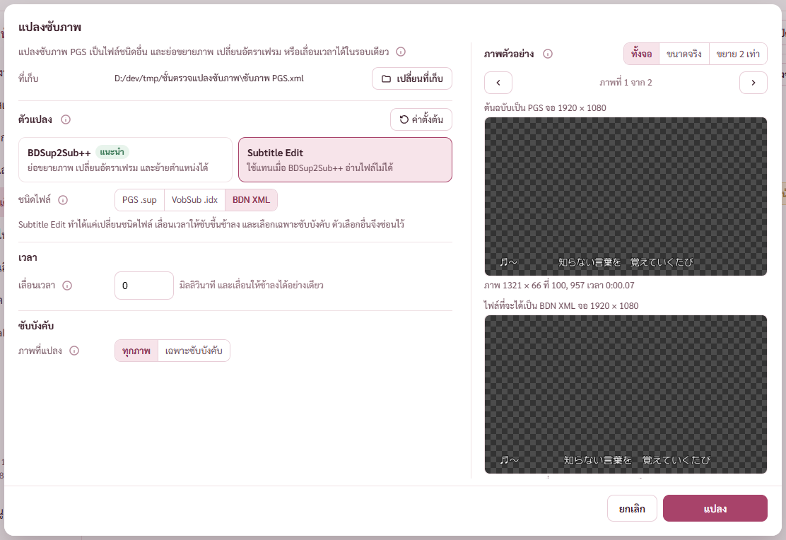

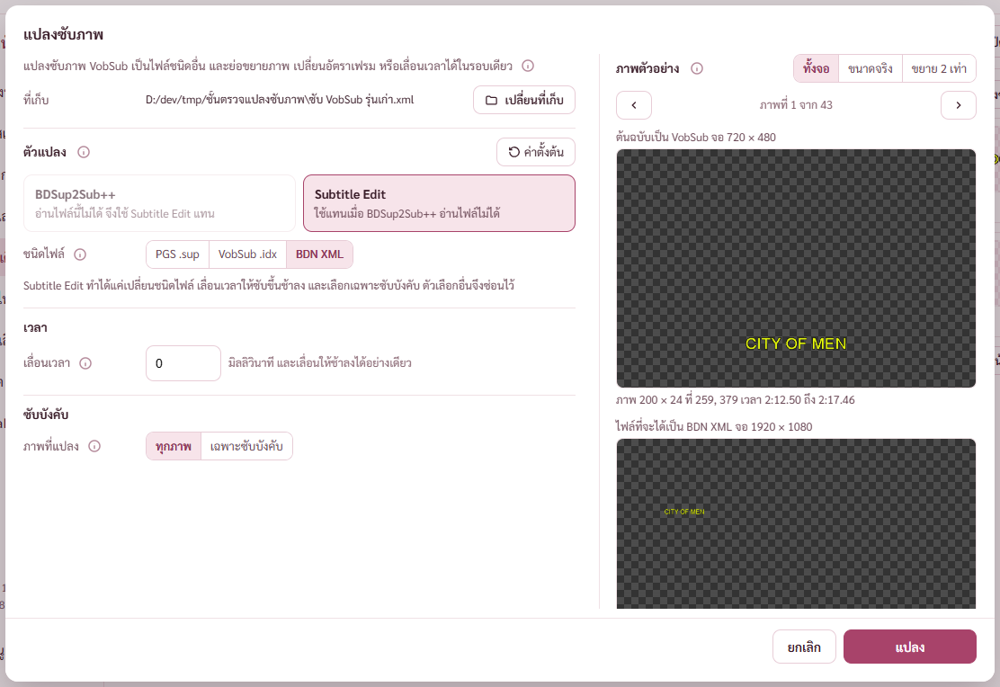

### 7. ไฟล์หลายภาพ และตอนตัวถอดภาพต้นฉบับอ่านไม่ได้
ภาพที่ 2 จาก 43 ต้นฉบับกับไฟล์ที่จะได้เวลา 2:27.36 และตำแหน่งตรงกัน · ตัวถอดภาพต้นฉบับอ่านไม่ได้ กรอบต้นฉบับบอกเหตุผล ไม่ค้างเป็นโครงจาง ภาพที่จะได้ยังขึ้น

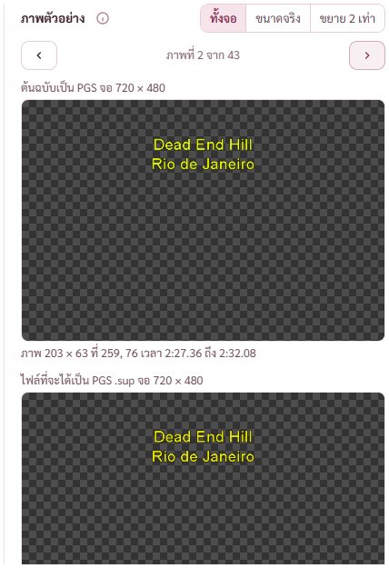

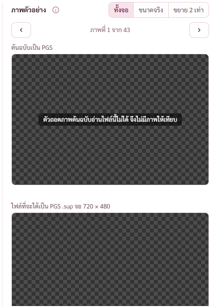

### 8. หน้าขอบคุณ README และเอกสารเครื่องมือ
การ์ด BDSup2Sub++ รุ่น 1.0.5 ป้าย Apache-2.0 ในกลุ่มเครื่องมือที่แนบมาทำงานจริง ไอคอนดึงจากในไฟล์ bdsup2sub++.exe · README แถวขอบคุณ · vendor/README หัวข้อ BDSup2Sub++ ค่า SHA-256 กับกับดักที่เจอ · ตัวตรวจตัวติดตั้งนับเครื่องมือ 34 ไฟล์

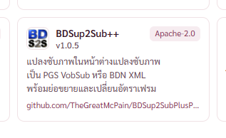

## คำที่เกลาตามคำสั่ง *"ไปดูคำไทยดีๆนะ"*
| เดิม | ใหม่ |
|---|---|
| ชนิดผล | ชนิดไฟล์ |
| ย่อขยาย อัตราเฟรม และย้ายตำแหน่งได้ครบ | ย่อขยายภาพ เปลี่ยนอัตราเฟรม และย้ายตำแหน่งได้ |
| ตัวสำรองเมื่อ BDSup2Sub++ อ่านไฟล์ไม่ได้ | ใช้แทนเมื่อ BDSup2Sub++ อ่านไฟล์ไม่ได้ |
| ย่อขยายอิสระ | ย่อขยายภาพซับ (มีหน่วย เท่า) |
| ตัวย่อขยาย | วิธีย่อขยาย |
| ภาพที่ขึ้นสั้นเกิน | ภาพที่ขึ้นสั้นไป |
| เลื่อนเวลาไปข้างหน้า (กำกวมว่าเร็วหรือช้า) | เลื่อนเวลาให้ซับขึ้นช้าลง |
| ระยะ [0] | ระยะ [0] จุด |
| ภาพที่ได้ | ภาพที่แปลง |
| ป้ายบังคับ ตั้งทุกภาพ ล้างทุกภาพ | ป้ายซับบังคับ ติดทุกภาพ เอาออกทุกภาพ |
| เข้มกับกลาง กลางกับสว่าง | ระหว่างเข้มกับกลาง ระหว่างกลางกับสว่าง |
| ต้นฉบับ PGS / PGS เป็น PGS .sup ที่จะได้ | ต้นฉบับเป็น PGS / ไฟล์ที่จะได้เป็น PGS .sup |
| เวลา 0:00:00.07 | เวลา 0:00.07 ถึง … (ไม่มีชั่วโมงศูนย์นำหน้า มีเวลาจบ) |
| 43 ภาพ ขนาด 208 KB | ได้ 43 ภาพ ไฟล์ขนาด 208 KB |
| ผล VobSub.idx มีอยู่แล้ว โปรแกรมไม่เขียนทับ | มีไฟล์ชื่อ ผล VobSub.idx อยู่แล้ว โปรแกรมจึงไม่เขียนทับ กดตั้งชื่อใหม่ต่อเลข หรือเลือกที่เก็บใหม่ |

กล่อง ⓘ ทุกกล่องอ่านจุดตัดบรรทัดเอง แก้ 12 กล่องที่ตัดกลางวลี เช่น "ซับจึงอยู่ / ตรงตำแหน่ง" "ต้องกว้างกว่า 16:9 / (1.78)" แล้วจดจุดตัดทุกกล่องเป็นข้อตรวจถาวร

## บั๊กที่เจอและแก้ระหว่างทำ (ทุกข้อมีข้อตรวจที่พิสูจน์แล้วว่าแดงกับของเดิม)
1. **ภาพตัวอย่าง VobSub ค้างเป็นภาพ PGS** เปลี่ยนชนิดไฟล์แล้วหน้าต่างขอภาพตัวอย่างก่อนที่ที่เก็บจะเปลี่ยนนามสกุล ฝั่ง Rust ส่งภาพ PGS เดิม (127 สี) · คำขอใช้นามสกุลตามชนิดไฟล์ที่เลือกเสมอ ตอนนี้ 4 สี
2. **ตัวถอดซับรูปของตัวดูซับบอกเวลาผิดทุกภาพ** (บั๊กเดิม) ffmpeg เลื่อนภาพแรกให้เริ่มที่ศูนย์ ซับที่ภาพแรกอยู่ 2:12.48 ขึ้นว่า 0:00.0 · ใส่ `-copyts` ใน subs.rs และเปลี่ยนชื่อที่เก็บภาพที่ถอดไว้ (`subimg-v2-`) ไม่ให้ใช้ผลเก่า · เทส Rust ใหม่สร้าง .sup ที่เริ่ม 100 วินาที แดงเมื่อไม่มี -copyts (ได้ 0) เขียวเมื่อมี
3. **หน้าต่างแสดงเวลาภาพต้นฉบับหารพันซ้ำ** เวลาของตัวถอดเป็นวินาที
4. **ป้ายใต้ภาพเทียบกันไม่ได้** ffmpeg กับ BDSup2Sub++ เว้นขอบใสรอบภาพไม่เท่ากัน ภาพตรงกันแต่ป้ายบอก 1329 กับ 1439 · ป้ายนับจากส่วนที่มีภาพจริงทั้งสองฝั่ง ตอนนี้ตรงกันในสองจุด
5. **ปิดแล้วเปิดหน้าต่างใหม่กับไฟล์เดิม ภาพต้นฉบับค้างเป็นโครงจาง** หน้าต่างจำสถานะเก่า · สร้างหน้าต่างใหม่ทุกครั้งที่เปิด
6. **Subtitle Edit แปลงเป็น VobSub กับ BDN XML ไม่ได้** ส่งชื่อ .idx มันเขียนไฟล์ .sub ลงชื่อนั้นแล้วล้ม · BDN XML ได้โฟลเดอร์ชื่อ t.xml ที่มี index.xml · ตั้งชื่อตามชนิดและจัดไฟล์ผลให้เหมือนผลของ BDSup2Sub++ (`seconv_settle`) · เทส Rust ใหม่แดงกับโค้ดเดิม
7. **แถบเลื่อนลอยค้างกลางกรอบ** (บั๊กของตัววาดแถบเลื่อนกลาง OverlayScrollbar.tsx) กล่องเปลี่ยนขนาดโดยไม่ได้เลื่อน แถบไม่ตาม · เฝ้าขนาดกล่องที่แถบเกาะอยู่ และตอนมีหน้าต่างซ้อนซ่อนเฉพาะแถบของกล่องหลังหน้าต่าง
8. **กล่องทำภาพตัวอย่างไม่ได้ตกไปใต้กรอบจนต้องเลื่อน** · อยู่แทนกรอบภาพของผล
9. **กดภาพถัดไปแล้วรอ 600 มิลลิวินาที** · เปลี่ยนแค่ภาพที่ดูขอทันที เปลี่ยนตัวเลือกยังรอหยุดปรับ

## ผลตรวจ
- `check-imgconv.mjs` ผ่าน 105 จาก 105 ข้อ ที่ 1280 × 800 และ 1920 × 1032 (ทำให้พังชั่วคราวห้าจุด ข้อที่คู่กันแดงครบ · ตัววาดแถบเลื่อนแบบเดิม ข้อแถบเลื่อนแดงข้อเดียว)
- `check-settings.mjs` ผ่าน 50 จาก 50 ข้อ (รอบแรกข้อตัดบรรทัดของการ์ดใหม่แดง เกลาคำแล้วผ่าน · คืนภาพรายงานเก่าที่ตัวตรวจถ่ายทับแล้ว)
- `cargo test` ผ่าน 261 ข้อ ไม่ผ่าน 0 ข้าม 1 (เพิ่มเทสใหม่ 2 ข้อ seconv_vobsub_and_bdn กับ image_times_are_real_file_times)
- `check-subchap.mjs` ผ่าน 27 จาก 27 ข้อ (ตัวดูซับกับหน้าซับไตเติล เพราะแตะตัวดูซับรูปกับตัวถอดซับรูป · คืนภาพรายงานเก่าที่ถูกถ่ายทับแล้ว)
- ทุกอย่างรันในโปรแกรมทดสอบที่เปิดอยู่หลังสุด ไม่มีหน้าต่างเด้ง BDSup2Sub++ เปิดแบบซ่อนคอนโซลและส่ง `--output` ทุกครั้ง

## ยังไม่ได้ตรวจ ต้องให้พี่กันลอง
- ซับ VobSub จากแผ่น DVD จริงกับซับ PGS ในหนังจริงของพี่กัน (ตัวตรวจใช้ไฟล์ตัวอย่างของ ffmpeg กับหนังทดสอบ)
- ปุ่มเปลี่ยนที่เก็บ (กล่องเลือกที่เก็บของ Windows) กับปุ่มเปิดโฟลเดอร์ (Explorer) ตัวตรวจใช้ทางลัดแทนเพื่อไม่ให้เด้งขึ้นจอ
- เอาไฟล์ที่แปลงแล้วไปเล่นในเครื่องเล่นจริง

## ยังทำไม่ได้ จดลง ROADMAP แล้ว
- ไฟล์ซับภาพที่ mkvmerge กับ ffmpeg อ่านไม่ได้ แต่ BDSup2Sub++ อ่านได้ (เช่น Subpictures_20.sup 630 ภาพ) เปิดในหน้าซับไตเติลไม่ได้ เพราะทางเปิดไฟล์ใช้ร่วมกับหน้าเสียงและซับ

## ข้อเสนอของพี่กันที่จดต่อคิว
- BUGS ข้อ 128 พอรู้ว่า BDSup2Sub++ อ่านไฟล์ไหนไม่ได้ การ์ด BDSup2Sub++ จางกดไม่ได้แล้วใช้ Subtitle Edit แทนเอง · พี่กันสั่ง *"ตามคิวนะ"* ต่อคิวหลังข้อ 127 · แคลร์เผลอลงมือก่อนแล้วคืนโค้ดทั้งหมด ไม่มีส่วนไหนค้างในโปรแกรม

## ยังไม่ commit
งานคิว BUGS ข้อ 123 ถึง 126 commit ทีเดียวตอนจบชุด
