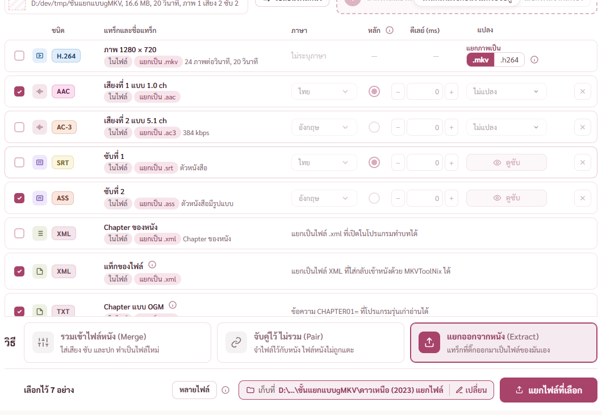

# รายงาน 15 พ.ย. 2569 วิธีแยกไฟล์แบบ gMKVExtractGUI (BUGS ข้อ 130)

## คำสั่งของพี่กัน
- พี่กันถามว่ามี gMKVExtractGUI หรือยัง แล้วสั่ง *"เอา"* กับ *"เอาเข้าคิว"* ส่งที่เก็บ https://github.com/Gpower2/gMKVExtractGUI ให้ดู และสั่ง *"เอาอันนี้เข้าขอบคุณด้วยนะ"*
- *"ทำถึง 131 เทสทั้งหมด เเล้ว commit"*

## อ่านซอร์สก่อนทำ (สัญญา Unlicense)
อ่าน `MkvExtractModes.cs` (โหมดของ mkvextract tags chapters cuesheet timestamps_v2) `gMKVExtractFilenamePatterns.cs` (ตัวแทนชื่อไฟล์) และ `gMKVMerge.cs FindAndSetDelays` (ดีเลย์ของเสียง = เวลาแรกของเสียงลบเวลาแรกของภาพ จาก minimum_timestamp ของ mkvmerge) แล้วเขียนเองใน Rust ไม่ได้ลอกโค้ด

## สิ่งที่เพิ่มในวิธีแยกออกจากหนัง (เฉพาะไฟล์ MKV)
1. **แท็กของไฟล์** แยกเป็น XML ที่ใส่กลับเข้าหนังด้วย MKVToolNix ได้ (ขึ้นเมื่อไฟล์มีแท็ก)
2. **Chapter แบบ OGM** ข้อความ CHAPTER01= กับ CHAPTER01NAME= ที่โปรแกรมรุ่นเก่าอ่านได้ (ขึ้นเมื่อไฟล์มี Chapter)
3. **CUE sheet** รายการเพลงตาม Chapter · หนังที่ไม่มีแท็กเวลาของแต่ละ Chapter ได้แค่รายชื่อเพลงไม่มีเวลา เพราะ mkvextract เขียนแบบนั้น กล่อง ⓘ บอกไว้
4. **เวลาของแต่ละเฟรม** (timestamps v2) ของทุกแทร็กที่ติ๊ก ไฟล์ละแทร็ก ยังไม่ติ๊กแทร็กช่องนี้กดไม่ได้พร้อมเหตุผล
5. **ดีเลย์ในชื่อไฟล์** เสียงที่ช้ากว่าภาพได้ชื่อต่อท้าย DELAY 120ms ซึ่งหน้าเสียงและซับอ่านกลับเป็นดีเลย์ของแทร็กเองตอนเพิ่มไฟล์
6. **รูปแบบชื่อไฟล์** หน้าตั้งค่าหัวข้อเสียงและซับ ตัวแทน {Filename} {Type} {Number} {Language} {Delay} {TrackName} มีตัวอย่างชื่อที่จะได้ ปุ่มค่าตั้งต้น และ ⓘ อธิบายตัวแทนทั้ง 6 ตัว · ค่าตั้งต้นได้ชื่อแบบเดิม (แคลร์ตั้ง) · ตัวแทนที่ไม่มีค่าไม่ทิ้งจุดหรือเว้นวรรคซ้อน
7. **แยกหลายไฟล์** ปุ่มหลายไฟล์ในแถบล่าง เลือกไฟล์ MKV หลายไฟล์ แล้วแยกชิ้นที่ติ๊กแบบเดียวกันทีละไฟล์ลงโฟลเดอร์แยกไฟล์ข้างไฟล์นั้น ฝั่ง Rust หาเลขแทร็ก นามสกุล และภาษาของไฟล์นั้นใหม่ (ไฟล์ที่เสียงเป็น Vorbis ได้ .ogg) ชิ้นที่ไฟล์นั้นไม่มีบอกในผล ชื่อซ้ำตั้งชื่อใหม่ต่อเลข ไฟล์แนบไม่แยกเพราะแต่ละไฟล์มีไม่เหมือนกัน
8. **การ์ดขอบคุณ** gMKVExtractGUI 2.15.0 กลุ่มไอเดีย ป้าย Unlicense ลิงก์อยู่ในรายการตายตัวของ latest.rs

## ภาพ
แถวใหม่ในตาราง (ติ๊กเสียงที่ 1 ซับที่ 2 กับแถวใหม่ทั้งหมด)

แถบล่างมีปุ่มหลายไฟล์

รูปแบบชื่อไฟล์ในหน้าตั้งค่า

แยกหลายไฟล์เสร็จ

## ผลตรวจ
- cargo test `pattern_names` (ชื่อตั้งต้นเหมือนเดิม ดีเลย์อ่านกลับได้ ตัวแทนว่าง อักษรต้องห้าม เว้นวรรคซ้อน ชิ้นใหม่) กับ `gmkv_style_extras` (แยกแท็ก OGM CUE timestamps ได้ไฟล์จริง ไฟล์ MP4 ไม่รับ หนังที่เสียงช้า 120 ms ได้ดีเลย์ 120 แยกหลายไฟล์ปรับนามสกุลกับภาษา ไฟล์หนังเดิมไม่ถูกแตะ) ผ่าน · ทำตัวคิดดีเลย์ให้คืนศูนย์ชั่วคราวแล้วแดง คืนไฟล์เหมือนเดิม · เทสเดิมของการแยกผ่านครบ 8 ข้อ
- `check-gmkv.mjs` ใหม่ ผ่าน 26 จาก 26 ข้อ ทำงานกับสำเนาใน D:\dev\tmp\ชั้นแยกแบบgMKV ลบตอนจบ คืนรูปแบบชื่อเดิมตอนจบ · รอบแรกเจอตัวตรวจคาดดีเลย์ในรูปแบบที่ไม่มี {Delay} กับหน้าตั้งค่าจำค่าเก่าหลังตัวตรวจเปลี่ยนค่าตั้งเอง แก้ตัวตรวจแล้ว และเจอเว้นวรรคซ้อนในชื่อไฟล์ที่ไม่มีภาษา แก้ทั้งฝั่ง Rust กับตัวอย่าง
- ตัวอย่างในหน้าตั้งค่า (lib/extractName.ts) ตรงกับชื่อที่ฝั่ง Rust แยกจริง ตัวตรวจเทียบชื่อไฟล์จริงกับรูปแบบเดียวกัน

## ยังไม่ได้ตรวจ
- กล่องเลือกหลายไฟล์ของ Windows ตัวตรวจส่งรายการผ่าน window.__extractFiles พี่กันต้องลองกดเอง
- หนังจริงที่มี CUE sheet เดิมฝังอยู่

## ยังไม่ commit
commit พร้อมชุดข้อ 123 ถึง 131 หลังเทสรวม
