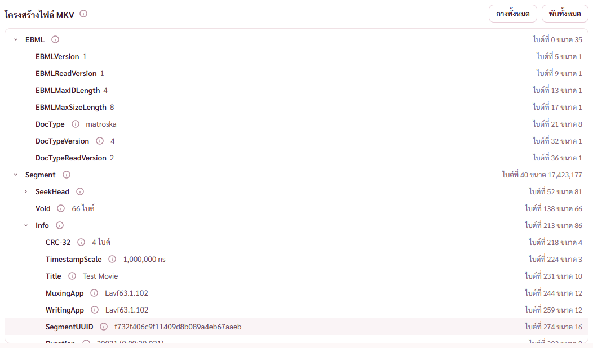
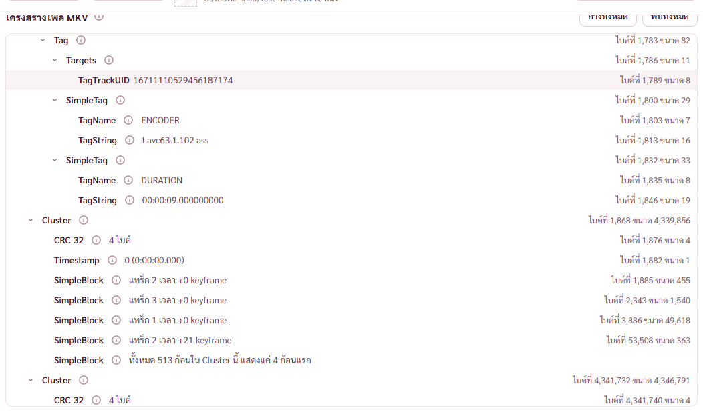

# รายงาน 15 พ.ย. 2569 โครงสร้างไฟล์ MKV แบบ mkvinfo (BUGS ข้อ 131)

## คำสั่งของพี่กัน
- *"เอา เเละอธิบายเพิ่มด้วย"* กับ *"เอาเข้าคิว"* แล้วสั่ง *"ทำถึง 131 เทสทั้งหมด เเล้ว commit"*
- สั่งเพิ่มระหว่างทำ *"OGM CUE เป็นนามสกุลใหม่ ก็เอาใส่เพิ่มในหน้าตั้งค่าด้วยนะ"*

## ทางที่เลือก
- ตอนจดงานเขียนว่าจะทำมอคอัปให้เลือกตำแหน่งก่อน แต่พี่กันสั่งให้ทำถึงข้อ 131 จึงทำในโปรแกรมเลยตามกฎ CLAUDE.md ที่ว่าอันไหนพี่กันสั่งทำในโปรแกรมเลย
- ชุด MKVToolNix ที่แนบมามีแค่ mkvmerge mkvextract mkvpropedit ไม่มี mkvinfo.exe แทนที่จะโหลดเพิ่ม แคลร์เขียนตัวอ่านโครงไฟล์แบบ EBML เองใน Rust (`mkvtree.rs`) อ่านอย่างเดียว และแปลงค่าให้อ่านง่ายกว่า mkvinfo
- ตำแหน่ง การ์ดโครงสร้างไฟล์ MKV ในหน้าข้อมูลไฟล์ ต่อจากหัวข้อของ MediaInfo ก่อนการ์ดค่า hash (แคลร์ตั้ง) · กดปุ่มอ่านโครงสร้างแล้วค่อยอ่าน ดิสก์จะได้ไม่ทำงานทุกครั้งที่เปิดหน้า

## สิ่งที่ทำ
1. **ตัวอ่าน EBML** (`mkvtree.rs`) รู้จักชั้นตามมาตรฐาน Matroska 128 ชั้น ชั้นที่ไม่รู้จักขึ้นว่าไม่รู้จักพร้อมรหัส · ไฟล์อัดสดที่ Segment หรือ Cluster ไม่รู้ขนาดอ่านได้จนจบ
2. **แปลงค่าให้อ่านง่าย** เวลาแปลงเป็นชั่วโมงนาทีวินาที ชนิดแทร็กบอกเป็นคำ (1 video) DefaultDuration บอกเป็นเฟรมต่อวินาที SeekID บอกเป็นชื่อชั้น วันที่เป็น UTC ก้อนข้อมูลบอกเลขแทร็ก เวลา และ keyframe
3. **ไม่อ่านข้อมูลภาพเสียง** Cluster แสดงสามก้อนแรก CuePoint ห้าจุดแรก ก้อนข้อมูลสี่ก้อนแรกต่อ Cluster แล้วบอกจำนวนทั้งหมด ไฟล์แนบบอกแค่ขนาด · ไฟล์ที่มีชั้นเกิน 6,000 ชั้นบอกว่าแสดงไม่หมด
4. **หน้าจอ** (`MkvTree.tsx`) ต้นไม้กางพับได้ เปิดมากางหัวไฟล์ Segment Info Tracks ไว้ ปุ่มกางทั้งหมดกับพับทั้งหมด ทุกแถวบอกตำแหน่งไบต์กับขนาด · ไฟล์ที่ไม่ใช่ MKV MKA MKS WebM ไม่มีการ์ดนี้
5. **ปุ่ม ⓘ** อธิบาย 71 ชั้นเป็นภาษาไทย ชื่อชั้นเป็นคำอังกฤษตามกฎคำเทคนิค ปิดการขยายตัวย่อในกล่องพวกนี้ (ตอนแรกขึ้น ffmpeg (Fast Forward MPEG) (Lavf) ซ้อนวงเล็บ) และเกลาคำทุกกล่องให้ตัดบรรทัดตรงความหมาย
6. **หัวข้อชนิดไฟล์ในหน้าตั้งค่า** เพิ่มแถว ที่แยกจากไฟล์ MKV (XML TXT CUE) และคำอธิบายของ .cue .txt .xml ให้ตรงกับที่ใช้จริง ตามที่พี่กันสั่งเพิ่ม

## ภาพ
เปิดมา กางหัวไฟล์ Segment กับ Info

แท็กกับก้อนข้อมูล บอกจำนวนก้อนทั้งหมด

## ผลตรวจ
- cargo test `reads_test_movie_like_mkvinfo` (ห้าแทร็ก CodecID ตรง Chapter สามอัน Duration ตรงกับ mkvmerge -J ก้อนข้อมูลบอก keyframe ไฟล์ไม่ถูกแตะ) `not_matroska_and_values` `unknown_sizes` ผ่าน · ทำตัวหาจุดจบของก้อนไม่รู้ขนาดเสียชั่วคราวแล้วแดง คืนไฟล์เหมือนเดิม · วันที่ในเทสเทียบกับตัวคิดวันที่ของ node แทนการคิดมือ (คิดมือคลาดหนึ่งวัน)
- `check-mkvtree.mjs` ใหม่ ผ่าน 19 จาก 19 ข้อ ค่าในต้นไม้เทียบกับ mkvmerge -J ของไฟล์เดียวกัน จุดตัดบรรทัดของกล่อง ⓘ 57 กล่องเทียบตารางที่อ่านแล้ว ไม่มีแถวล้นขวา ไฟล์หนังไม่ถูกแตะ ไฟล์ MP4 ไม่มีการ์ด
- ข้อตรวจคำโดดแบบเดิมผ่านทั้งที่ยังมีกล่องตัดกลางคำ เช่น เล็ก ⏎ ลงเล็กน้อย จึงเปลี่ยนเป็นเทียบจุดตัดทั้งกล่อง

## ยังไม่ได้ตรวจ
- ไฟล์ MKV ที่ใหญ่มากหรือไฟล์อัดสดของจริง (เทสใช้ไฟล์จำลองที่ไม่รู้ขนาด)

## ยังไม่ commit
commit พร้อมชุดข้อ 123 ถึง 131 หลังเทสรวม
