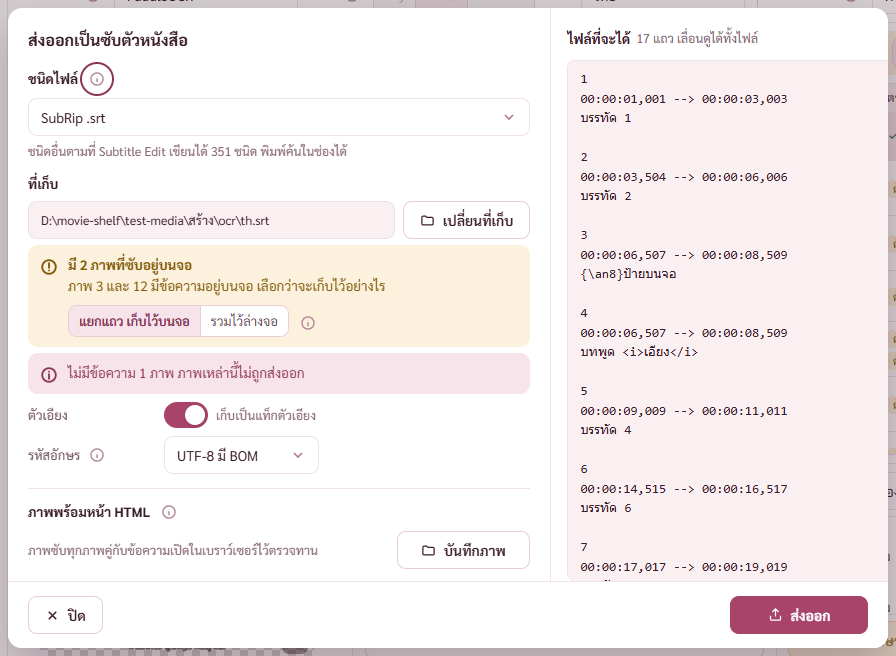
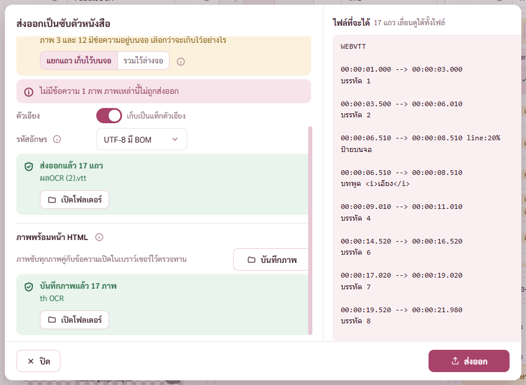
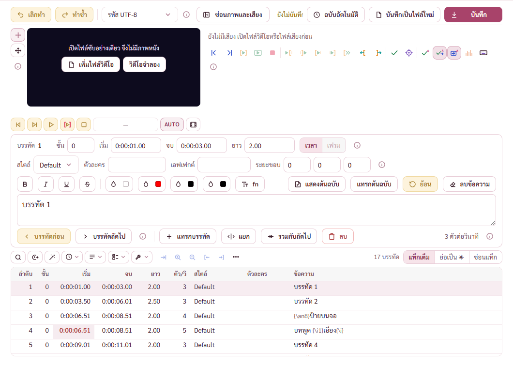

# รายงาน 17 พ.ย. 2569 · แผน OCR ขั้น 12 ส่งออกและส่งต่อ กับ BUGS ข้อ 151

พี่กันสั่งลำดับงานหลังขั้น 11 *"ถ้าเวร็จอันนี้ ก็ commit"* · *"ตามนั้น"* (ข้อ 151 แล้วขั้น 12 ขั้น 13 ขั้น 14) แล้วสั่งตอนเลิกงาน *"ทำให้เสร็จ"* · *"ไม่รันการเเยกไฟล์นะ อันไหนที่ทำให้คอมค้าง ไม่ต้องเทส ค่อยเทสตอนเราอยู่"* · งานรอบนี้ทำเบื้องหลังทั้งหมด

## ข้อ 151 ซับรูปในหนังขึ้น 100% แล้วต้องรออีกสองนาที

พี่กันสั่ง *"ฝากงาน มันอ่านซับครบ 100% เเต่ต้องรออีก 2 นาทีกว่าจะขึ้น"*

- วัดซับ VobSub ญี่ปุ่นของ Shin Godzilla 1,875 ภาพ จากคู่ไฟล์ที่แยกไว้แล้ว ไม่ได้แยกใหม่ อ่านภาพ 0.39 วินาที ครอปและเก็บภาพ 4.05 วินาที ช่วงหลังอ่านจากไฟล์บนเครื่องนี้จึงไม่ใช่สองนาที **ต้นเหตุยังไม่พบ**
- เดิมแถบเต็ม 100% ตั้งแต่ก่อนเก็บภาพ ช่วงเก็บภาพทีละไฟล์ไม่มีความคืบหน้า · แก้แล้ว ดึงจากหนัง 0–80% อ่านภาพ 80–85% เก็บภาพ 85–100% (PGS ลอกแทร็ก 0–85%) แถบขึ้นคำว่า กำลังเก็บภาพซับ ทั้งตัวดูซับและหน้า OCR
- เก็บภาพสี่เธรดพร้อมกัน Godzilla จาก 4.05 เหลือ 2.96 วินาที
- จดเวลาแต่ละช่วงลงบันทึกของโหมดพัฒนา บรรทัด `[ซับรูป VobSub]`
- **ยังไม่ได้ลอง** ช่วงดึงซับออกจากหนังด้วย mkvextract เพราะเป็นการแยกไฟล์ ต้องลองกับ Shin Godzilla ตอนพี่กันอยู่ แล้วดูจากบันทึกเวลาว่าสองนาทีอยู่ช่วงไหน

## ขั้น 12 หน้าต่างส่งออก

ยกโครงจากมอคอัปที่พี่กันดูแล้ว ซ้ายตั้งค่า ขวาไฟล์ที่จะได้ทั้งไฟล์ ฝั่งขวาชนขอบบนกับขอบขวาของหน้าต่างตามที่พี่กันสั่งตอนดูมอคอัป

- ชนิดไฟล์ SubRip กับ Advanced SubStation เขียนเอง ชนิดอื่นอีก 349 ชนิดตามที่ SeConv ของ Subtitle Edit เขียนได้ พิมพ์ค้นในช่องได้ (ข้อ 143 ㉕)
- ซับบนจอ (ข้อ 143 ⑭) เตือนพร้อมเลขภาพ เลือก แยกแถว เก็บไว้บนจอ (ติด `{\an8}` เวลาเดียวกับบทพูด แบบ SplitTextByAlignmentGroups) หรือ รวมไว้ล่างจอ
- ภาพที่ยังไม่อ่านหรือไม่มีข้อความบอกจำนวน และไม่ถูกส่งออก
- รหัสอักษร UTF-8 มี BOM UTF-8 ไม่มี BOM UTF-16 TIS-620 · Shift-JIS ที่อยู่ในมอคอัปเอาออก เพราะโปรแกรมยังเข้ารหัส Shift-JIS ไม่ได้ (แคลร์ตัดสิน)
- ไม่ทับไฟล์เดิม ชื่อซ้ำขึ้นการ์ดพร้อมปุ่มตั้งชื่อใหม่ต่อเลขท้าย กับเลือกที่เก็บเอง · ผลสำเร็จมีปุ่มเปิดโฟลเดอร์ หายเองใน 8 วินาที ผิดพลาดค้างจนกดปิด
- ชนิดไฟล์ ตำแหน่งบนจอ ตัวเอียง รหัสอักษร จำไว้ในเครื่อง

### ภาพพร้อมหน้า HTML

แปลจาก OcrHtmlExporter ของ Subtitle Edit · ภาพทุกภาพเป็น images/0001.png คู่กับ index.html ไฟล์เดียว ค้นคำ กรองเฉพาะภาพที่ไม่มีข้อความ เลือกพื้นหลังภาพมืด สว่าง ตารางหมากรุก และโทนของหน้า คำบนหน้าเป็นภาษาไทย · เขียนลงโฟลเดอร์ใหม่ชื่อ `<ชื่อซับ> OCR` ไม่ทับของเดิม (Subtitle Edit เขียนลงโฟลเดอร์ที่เลือกตรง ๆ)

### ไปหน้าแก้ซับ

ปุ่มไปหน้าแก้ซับในแถบล่างของหน้า OCR เปิดผลเป็น ASS ขนาดภาพตามจอของซับรูป ป้ายบนจอเก็บ `{\an8}` แล้วปุ่มแก้ซับกับวิดีโอกดได้ · ยังไม่มีไฟล์ของตัวเอง นับว่ายังไม่บันทึก กดบันทึกแล้วถามที่เก็บ · หน้าแก้ซับมีที่แก้ค้างอยู่ ถามก่อนว่าไปหน้าแก้ซับเดิมหรือแทนที่ด้วยผล OCR

### ขอบคุณ

เพิ่ม PaddleOCR ONNX Runtime Tesseract Hunspell ในกลุ่มเครื่องมือที่แนบมา แก้การ์ด Subtitle Edit ให้บอกระบบ OCR และเพิ่ม ort spellbook (MPL-2.0) fancy-regex ในห้องสมุด Rust อื่น ๆ ทั้ง README หน้าตั้งค่า และรายการลิงก์ตายตัว · ยังไม่มีไอคอนของจริงของสี่โครงการใหม่ ใช้ไอคอนในโปรแกรมแทน

## บั๊กที่เจอระหว่างตรวจแล้วแก้

1. ส่งออกชนิดของ SeConv ไปไดรฟ์ D ขึ้น เปลี่ยนชื่อไม่สำเร็จ · ต้นเหตุ SeConv เขียนผลในโฟลเดอร์ทำงานของโปรแกรมบนไดรฟ์ C แล้วย้ายข้ามไดรฟ์ไม่ได้ · แก้ ลอกเป็นไฟล์ชั่วคราวข้างที่เก็บแล้วเปลี่ยนชื่อในไดรฟ์เดียวกัน · เทสเดิมไม่จับเพราะ dev.ps1 ตั้งโฟลเดอร์ชั่วคราวไว้ไดรฟ์ D เทสใหม่ให้โฟลเดอร์ทำงานอยู่ไดรฟ์ C พิสูจน์แล้วว่าแดงกับโค้ดเดิม
2. ชนิดไฟล์ที่จำไว้ (เช่น WebVTT) ตอนเปิดหน้าต่างขึ้น SubRip ก่อนแล้วสลับเองหลังรายชื่อโหลดเสร็จ · แก้ โหลดรายชื่อตั้งแต่เปิดหน้า OCR และระหว่างยังโหลด ปุ่มส่งออกกดไม่ได้พร้อมเหตุผล
3. การ์ดผลบันทึกภาพอยู่ใต้ขอบคอลัมน์ต้องเลื่อนเอง · แก้ เลื่อนเข้ามาให้เห็นเอง · ที่อยู่ไฟล์มีทับสองแบบปนกัน แก้เป็นแบบ Windows แบบเดียว

## การตรวจ

- cargo test ชุดเต็ม 394 ข้อผ่าน (เพิ่มเทส ocrexport 4 ข้อ ตำแหน่งบนจอ เวลาจบที่ไม่รู้ รหัสอักษรสามแบบ ไม่ทับไฟล์ ส่งออก WebVTT ข้ามไดรฟ์ หน้า HTML · เทสตัวเก็บภาพหลายเธรด)
- check-ocr.mjs 140 ข้อผ่าน เพิ่มข้อขั้น 12 24 ข้อ (ส่งออกจริงลง `D:\dev\tmp\ชั้นตรวจส่งออกOCR` แล้วลบ · ใช้ `__ocrExpTarget` `__ocrHtmlFolder` `__openDry` แทนกล่องของ Windows)
- check-av เพิ่มข้อตรวจคำบนแถบความคืบหน้าของข้อ 151 แต่ยังไม่ได้รันทั้งตัว เพราะเปิดซับในหนังด้วย mkvextract
- ยังไม่ได้ตรวจ ช่วงดึงซับจากหนังของข้อ 151 · ไปหน้าแก้ซับกับซับรูปในหนังที่มีภาพหนังจริง · หน้า OCR ทุกขนาดจอ (ขั้น 13)

## ต่อไป

ขั้น 13 เทสรวม แล้วขั้น 14 ผู้ช่วยตรวจทานสามตัว · งานที่รอพี่กันอยู่ ข้อ 151 กับ Shin Godzilla สร้างตัวติดตั้ง
