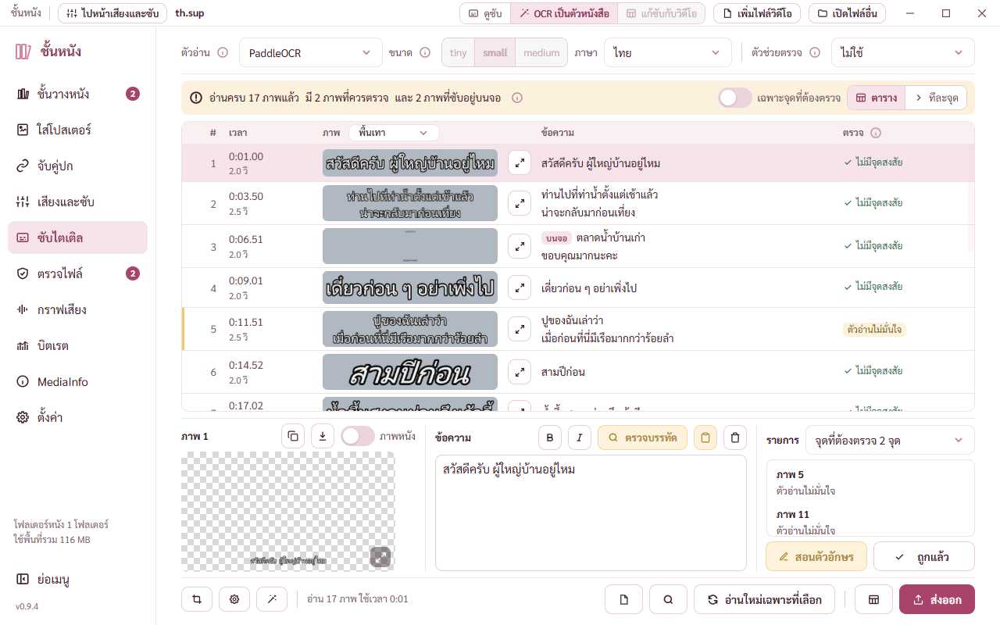
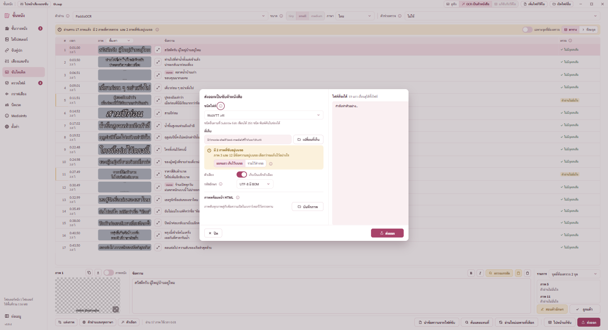
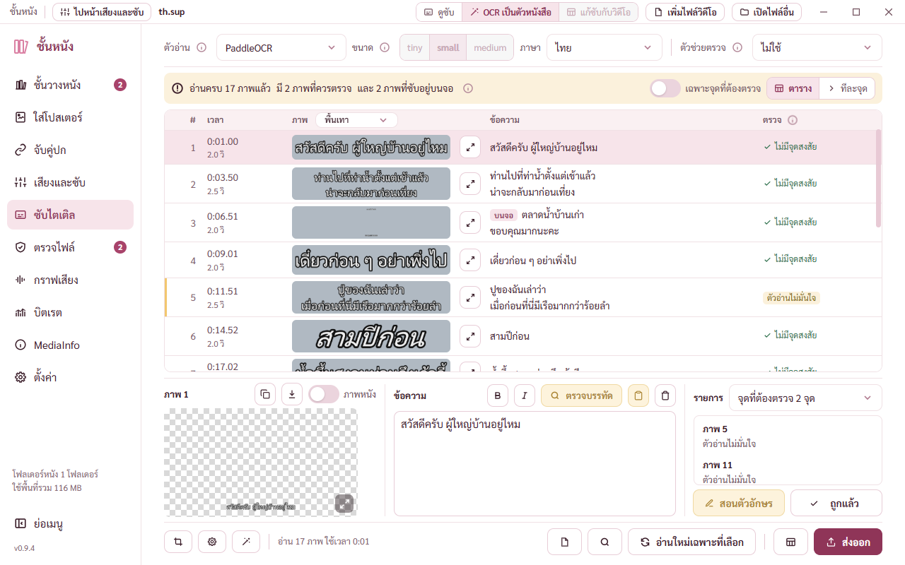

# รายงาน 17 พ.ย. 2569 · แผน OCR ขั้น 13 เทสรวม

ทำต่อจากขั้น 12 ตามลำดับที่พี่กันสั่ง *"ตามนั้น"* (ข้อ 151 ขั้น 12 ขั้น 13 ขั้น 14) · ทำเบื้องหลังทั้งหมด ไม่รันการแยกไฟล์ตามคำสั่ง *"ไม่รันการเเยกไฟล์นะ"* · เทสเสร็จปิดโปรแกรมทดสอบทุกครั้ง

## ผล

| ตรวจ | ผล |
|---|---|
| cargo test ชุดเต็ม ตั้งไฟล์ ACCA กับซับญี่ปุ่น Godzilla | 396 ข้อผ่าน 1 ข้อข้าม |
| PaddleOCR v6 small กับซับ PGS ของ ACCA | ถูกทั้งภาพ 438 จาก 439 (เกณฑ์ในแผนไม่ต่ำกว่า 436) ใน 10.1 วินาที |
| PaddleOCR v6 กับซับ VobSub ญี่ปุ่นของ Godzilla (เทสใหม่) | จับคู่กับ SRT ได้ 1,853 จาก 1,875 ภาพ ถูกทั้งภาพ 1,498 (80.8%) ถูกรายตัวอักษร 96.8% แนวตั้ง 264 ภาพ ถูกทั้งภาพ 153 ใน 45 วินาที |
| check-sizes ทุกหน้าสี่ขนาดจอ รวมหน้า OCR กับหน้าต่างส่งออก (เพิ่มใหม่) | 69 จาก 69 ข้อ |
| check-ocr.mjs (ขั้น 11 กับ 12) | 140 จาก 140 ข้อ |
| check-ocr-built.mjs ตัวจริงใต้ CSP (ใหม่) | 7 จาก 7 ข้อ ภาพซับขึ้น อ่านไทยถูก ตัวอย่างส่งออก ไปหน้าแก้ซับ ไม่มีการละเมิด CSP |

## ภาพ

หน้า OCR ที่ 1280 × 800 หลังอ่านซับไทยทดสอบครบ แถบล่างมีปุ่มไปหน้าแก้ซับกับส่งออก

หน้าต่างส่งออกที่ 2560 × 1392

ตัวจริงใต้ CSP

## สิ่งที่เจอ

1. **ซับญี่ปุ่นที่ยังผิด** ส่วนใหญ่เป็นสามแบบ ① คำอ่านตัวเล็กเหนือคันจิ (ฟุริงานะ) ถูกอ่านเป็นอีกบรรทัด เช่น ภาพ 43 ได้ きどう ขึ้นบรรทัดแรก ② วงเล็บของชื่อคนพูดหาย เช่น （通信士） ได้ 通信士 ③ คันจิคล้ายกันสลับ เช่น 員 เป็น 貝 · ข้อ ① แก้ได้ด้วยการตัดบรรทัดที่สูงไม่ถึงครึ่งของบรรทัดอื่นตอนแบ่งบรรทัด แคลร์จะเสนอในขั้น 14 ตามผลผู้ช่วยตรวจทานความถูกของข้อความ
2. **เทียบอย่างเป็นธรรม** ไฟล์ SRT ญี่ปุ่นใช้วงเล็บและตัวอังกฤษแบบเต็มความกว้าง และใส่คำอ่านในวงเล็บหลังคันจิซึ่งภาพไม่มี เทสจึงไม่นับสองอย่างนี้ ก่อนปรับนับได้ถูกทั้งภาพ 64.4% ถูกรายตัวอักษร 94.0%
3. คำเตือนตอนสร้างตัวจริง `parse_sizes` ไม่ถูกเรียก (หน้าต่างฝึกจากฟอนต์แยกขนาดเองแล้วส่งเป็นตัวเลข) ตั้งให้สร้างเฉพาะตอนเทส ตัวจริงไม่มีคำเตือนแล้ว
4. ตัวตรวจขนาดจอเดิมอ่านซับไทยด้วยภาษาที่จำค้างไว้ (อังกฤษ ญี่ปุ่น จีน) ภาพในรายงานจึงเป็นข้อความผิด แก้ให้ตั้งภาษาไทยแล้วอ่านใหม่ทุกครั้ง

## ยังไม่ได้ตรวจ รอพี่กันอยู่หน้าเครื่อง

- สร้างตัวติดตั้งกับ check-install
- ข้อ 151 ดึงซับ VobSub จากไฟล์ Shin Godzilla ด้วย mkvextract แล้วดูบันทึกเวลา
- check-av check-gmkv check-subchap ทั้งตัว เพราะแยกไฟล์จากหนังทดสอบ
- ลองกับซับรูปจริงของพี่กัน

## ต่อไป

ขั้น 14 ผู้ช่วยตรวจทานสามตัวที่พี่กันอนุญาตไว้ ฝั่ง Rust หน้าจอ และความถูกของข้อความ
