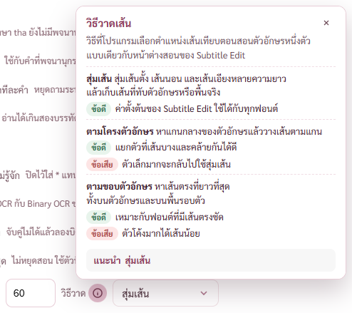
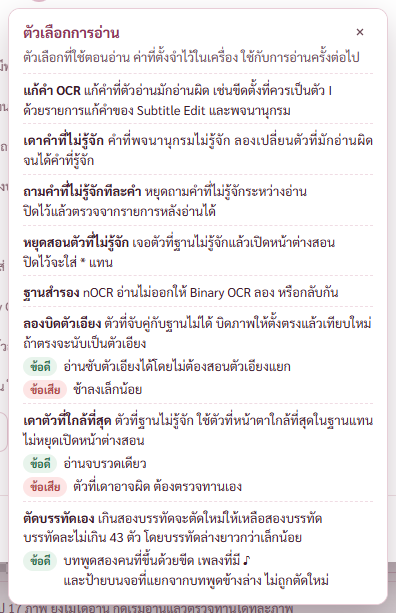
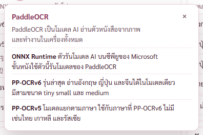
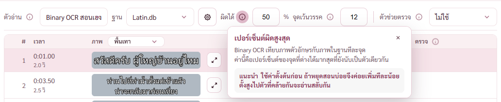

# รายงาน 17 พ.ย. 2569 · แผน OCR ขั้น 14 ผู้ช่วยตรวจทาน 3 ตัวแล้วแก้ตามผล

ทำต่อจากขั้น 13 ตามลำดับที่พี่กันสั่ง *"ตามนั้น"* (ข้อ 151 ขั้น 12 ขั้น 13 ขั้น 14) · ผู้ช่วยตรวจทาน 3 ตัว ฝั่ง Rust หน้าจอ และความถูกของข้อความ ตามที่พี่กันอนุญาต *"3 ตัวได้"* (ใช้ครบแล้ว) · ทำเบื้องหลังทั้งหมด เทสเสร็จปิดโปรแกรมทดสอบทุกครั้ง ไม่รันการแยกไฟล์จากหนัง

ผลเต็มของผู้ช่วยอยู่ [review/ตรวจทาน-2026-11-17/](review/ตรวจทาน-2026-11-17/) · แคลร์ยืนยันทุกข้อกับโค้ดจริงก่อนแก้

## ผล

| | เจอ | แก้แล้ว | เลื่อนลง ROADMAP |
|---|---|---|---|
| หน้าจอ (U) | 21 | 21 | 0 |
| ฝั่ง Rust (R) | 23 | 17 | 6 |
| ความถูกของข้อความ (T) | 17 | 13 | 4 |
| รวม | 61 | 51 | 10 |

| ตรวจ | ผล |
|---|---|
| cargo test ชุดเต็ม ตั้งไฟล์ ACCA กับซับญี่ปุ่น Godzilla | 407 ข้อผ่าน 1 ข้อข้าม (ขั้น 13 มี 396 ข้อ เพิ่มเทสใหม่ 11 ข้อ) |
| PaddleOCR v6 small กับซับ PGS ของ ACCA | ถูกทั้งภาพ 438 จาก 439 เท่าเดิม |
| PaddleOCR กับซับ VobSub ญี่ปุ่นของ Godzilla | ถูกทั้งภาพ 80.8% → 81.1% (1,503 จาก 1,853) ถูกรายตัวอักษร 96.8% → 97.0% แนวตั้ง 153 → 157 จาก 264 ภาพ |
| PaddleOCR ไทยกับซับไทยทดสอบ | ถูกทั้งภาพ 11 จาก 17 เท่าเดิม ที่ผิดเป็นวรรณยุกต์ผิดตัวทั้งหมด |
| check-ocr.mjs | 162 จาก 162 ข้อ (ขั้น 12 มี 140 ข้อ เพิ่มข้อตรวจของผู้ช่วยตรวจทาน 22 ข้อ) |
| ข้อตรวจใหม่แดงกับโค้ดเดิม | ลองสลับโค้ดเดิมชั่วคราวแล้วรันจริง ทุกเทสที่ลองแดง แล้วคืนไฟล์ (รายการในหัวข้อการตรวจ) |

## ข้อที่แก้

### หน้าจอ 21 ข้อ
- **U1 U4** เปิดซับอื่นหรือแทร็กอื่นตอนผล OCR เดิมค้างอยู่ เดิมผลหายทันที ตอนนี้ขึ้นการ์ดถามก่อน ปุ่ม "หยุดอ่านแล้วเปิดซับนี้" หรือ "เปิดซับนี้ ทิ้งผลเดิม" ผลเดิมอยู่จนกว่าจะกด
- **U2** เปิดเฉพาะจุดที่ต้องตรวจแล้วกด Shift เลือกช่วง เดิมเลือกแถวที่ซ่อนอยู่ไปด้วยแล้วลบทั้งหมด ตอนนี้เลือกได้เฉพาะแถวที่เห็น และเปลี่ยนตัวกรองแล้วล้างที่เลือก
- **U3** นำข้อความจากไฟล์ซับก่อนอ่าน เดิมกดเริ่มอ่านแล้วข้อความที่นำเข้าถูกทับ ตอนนี้นับเป็นอ่านแล้วและแก้แล้ว
- **U5** หน้าต่างสอนกับหน้าต่างคำที่ไม่รู้จักเด้งขึ้นทับหน้าอื่นระหว่างที่ไปหน้าอื่น ตอนนี้ขึ้นเฉพาะตอนอยู่หน้า OCR
- **U6 U19** คีย์ลัด Delete Ctrl+Shift+V Ctrl+Shift+I ทำงานทั้งตอนอยู่หน้าอื่นและตอนมีหน้าต่างซ้อนเปิด ตอนนี้ผ่าน `useHotkeys` ทำงานเฉพาะหน้า OCR และ Delete ใช้ได้เฉพาะแบบตาราง
- **U7** ปุ่มตรวจบรรทัดกดไม่ได้ระหว่างอ่าน พร้อมเหตุผลติดปุ่ม
- **U8 U9** แก้ข้อความแล้วป้ายจุดที่ต้องตรวจไม่เปลี่ยน ตอนนี้คำที่ไม่รู้จักซึ่งแก้ออกแล้วไม่นับ และชื่อเขียนสองแบบคิดใหม่หลังหยุดพิมพ์ครึ่งวินาที ผลที่มาช้ากว่าการแก้ครั้งล่าสุดถูกทิ้ง
- **U10** ปุ่มอ่านใหม่บอกว่าข้อความที่แก้เองจะถูกแทน
- **U11** ส่งไปหน้าแก้ซับไม่สำเร็จ เดิมเงียบ ตอนนี้ขึ้นการ์ดผิดพลาด และก่อนแทนซับที่แก้ค้างอยู่ เก็บฉบับบันทึกอัตโนมัติไว้ก่อน
- **U12** เลขภาพในหน้าต่างตรวจบรรทัดกับรายการตัวที่สอนผิดหลังลบแถว แก้ให้อ่านเลขจากแถวจริง
- **U13** ภาพขยายเต็มหน้าต่างปิดด้วย Esc ผ่านชั้น Esc กลาง (`useEscClose`)
- **U14** ปุ่มที่เปลี่ยนคำตามสถานะ (อ่านต่อ หยุดชั่วคราว เริ่มอ่าน ใช้สีนี้) กว้างคงที่ด้วย `Keep`
- **U15** ปุ่มที่กดไม่ได้บอกเหตุผลติดปุ่มทุกจุดในหน้าต่างสีของ VobSub ส่งออก และฝึกจากฟอนต์ ไม่ใช้ `disabled` เปล่า
- **U16** เพิ่มปุ่ม ⓘ ห้าจุด วิธีวาดเส้น PaddleOCR ชุดภาษาของ Tesseract ผิดได้ของ Binary OCR ซับบังคับ และเพิ่มหัวข้อลองบิดตัวเอียงกับเดาตัวที่ใกล้ที่สุดในกล่องตัวเลือกการอ่าน
- **U17** ปุ่มปิดหน้าต่างส่งออกกดไม่ได้ระหว่างบันทึกภาพพร้อม HTML
- **U18** ลูกศรขึ้นลงเลือกบรรทัดในตาราง
- **U20** ตัวช่วยของตัวตรวจในหน้าซับไตเติลเหลือในตัวจริงแค่สองตัวที่ตัวตรวจตัวจริงใช้
- **U21** วาดสีของ VobSub ใหม่แล้วภาพสีเดิมที่ขอไว้ก่อนกลับมาทับ ตอนนี้คำตอบของรุ่นก่อนถูกทิ้ง

### ฝั่ง Rust 17 ข้อ
- **R1** วาดสีของ VobSub ใหม่แล้วภาพในงาน OCR เลื่อนผิดแถว ตอนนี้จับคู่ภาพด้วยชื่อไฟล์ และเขียนภาพผ่านไฟล์ชั่วคราว
- **R2** บันทึกฐานตัวอักษรทุกครั้งส่งฐานเดิมลงถังขยะ ตอนนี้ลงถังขยะครั้งเดียวต่อการเปิดโปรแกรม ครั้งถัดไปแทนที่ (`outfile::replace_often`)
- **R3** ตัวอักษรขนาดเกินที่ไฟล์เก็บได้ทำให้ไฟล์ฐานเสียทั้งไฟล์ ตอนนี้ไม่บันทึกตัวที่ผิดรูป และตอนเปิดข้ามตัวที่เสีย
- **R4** ไฟล์ชั่วคราวของตัววาดตอนฝึกจากฟอนต์ชื่อชนกัน
- **R5** 15 คำสั่งที่รอล็อกของงานอ่าน ย้ายออกจากเธรดหลักของหน้าต่าง ไม่ค้างระหว่างอ่าน
- **R6** ส่งออกผ่าน SeConv มีเวลาสูงสุด ไม่ค้างตลอดไป
- **R9** ฝึกจากฟอนต์กับย่อฐานเช็กก่อนบันทึกว่าไฟล์ฐานไม่ได้ถูกแก้จากที่อื่นระหว่างทำ
- **R10** ไฟล์ซับรูปที่เสียบอกขนาดภาพมหึมา ตอนนี้ข้ามภาพนั้น ไม่จองหน่วยความจำจนโปรแกรมล้ม
- **R11** ข้อความที่สอนพร้อมแท็กตัวเอียงแยกด้วยตำแหน่งไบต์ที่ถูก ไม่ล้มกับอักษรไทย
- **R12** ข้อความของตัวใน Binary OCR ยาวเกิน 255 ไบต์ ตัดที่ขอบอักษร ไม่ทำให้ไฟล์ฐานเพี้ยน
- **R13** ปุ่มของหน้าต่างคำที่ไม่รู้จัก เขียนไฟล์ของผู้ใช้ไม่ได้ เดิมตอบว่าสำเร็จ ตอนนี้ขึ้นการ์ด "บันทึกรายการคำไม่ได้" บนหน้า OCR และกดเปลี่ยนทั้งหมดซ้ำด้วยคำใหม่ คู่ใหม่แทนคู่เดิมทั้งในงานและในไฟล์
- **R14** เปลี่ยนชื่อฐานไม่ทับไฟล์ที่มีอยู่ บันทึกภาพหนึ่งภาพผ่านไฟล์ชั่วคราว
- **R17** ตัวหาบรรทัดแนวตั้ง พิกัดติดลบไม่วนเป็นเลขใหญ่
- **R18** ffmpeg ที่วาดตัวอักษรตอนฝึกตายตามโปรแกรม
- **R19** บันทึกภาพพร้อมหน้า HTML อ่านรายการภาพในเธรดงาน
- **R21** รายชื่อชนิดไฟล์ของ SeConv จำเฉพาะตอนอ่านได้ ครั้งแรกล้มแล้วครั้งหน้าถามใหม่
- **R22** แก้ / ที่อ่านพลาดเป็น l หรือ I ในคำที่ซ้ำในบรรทัด ตัดสินต้นประโยคจากตำแหน่งของคำนั้นเอง

### ความถูกของข้อความ 13 ข้อ
- **T1** ตัดบรรทัดเองรวมบรรทัดญี่ปุ่นโดยไม่ใส่เว้นวรรค (รู้ภาษาจากตัวอักษร)
- **T2** Tesseract ไม่ใส่เว้นวรรคระหว่างคำไทยและญี่ปุ่นใน hOCR
- **T3** คำไทย ญี่ปุ่น จีน เกาหลี ไม่นับเป็นคำที่ไม่รู้จักของพจนานุกรมอังกฤษ
- **T4** อักษรตัวเล็กเหนือคันจิ (ฟุริงานะ) ไม่กลายเป็นบรรทัดเกิน
- **T5** ซับแนวตั้งเรียงคอลัมน์ขวาไปซ้าย บนลงล่าง
- **T6** ส่งออกแยกกลุ่มตำแหน่งแล้วแท็กตัวเอียงปิดเปิดครบทั้งสองแถว
- **T7** ซับตัวเหลืองหาก้อนบรรทัดเจอ
- **T8 T14** เว้นวรรคที่ตัวอ่านใส่ผิดระหว่างอักษรญี่ปุ่น และขีดบทพูดที่ลอยเป็นบรรทัดเดี่ยว จัดให้ถูก
- **T10** แก้ข้อความจนจำนวนบรรทัดไม่เท่าตอนอ่าน ใช้ตำแหน่งของบรรทัดสุดท้ายทั้งภาพ ไม่ให้บทพูดได้ตำแหน่งของป้ายที่ถูกลบ · ป้ายบนจอในตาราง คำเตือนซับบนจอ และจำนวนแถวที่คาดในหน้าต่างส่งออก ใช้กติกาเดียวกับไฟล์ที่ส่งออกแล้ว (`lineAns` ใน ocrJob.ts) · เจอตอนรัน check-ocr ว่าคำเตือนยังนับภาพที่แก้เหลือบรรทัดเดียวว่าอยู่บนจอ ทั้งที่ไฟล์ส่งออกวางไว้ล่างจอ
- **T11** ครอปภาพบรรทัดด้วยเกณฑ์หมึกเดียวกับตัวแบ่ง
- **T15** ตัวแก้ 0 กับ o แก้เฉพาะคำละติน ไม่แตะเลขศูนย์ข้างอักษรไทย
- **T16** แยกแท็กตัวเอียงด้วยตำแหน่งไบต์ (คู่กับ R11)

## ภาพ

กล่อง ⓘ วิธีวาดเส้น ในหน้าต่างตัวเลือกการอ่าน (U16)

กล่อง ⓘ ตัวเลือกการอ่าน เพิ่มหัวข้อลองบิดตัวเอียงกับเดาตัวที่ใกล้ที่สุด และเกลาคำเดิมที่ตัดกลางวลี (U16)

กล่อง ⓘ PaddleOCR ในหน้าต่างตัวอ่านและชุดภาษา (U16)

กล่อง ⓘ ผิดได้ของ Binary OCR ในแถวตัวอ่าน (U16)

## การตรวจ

- cargo test ชุดเต็ม 407 ข้อผ่าน · เทสใหม่ของขั้นนี้ เช่น `images_follow_file_not_order` (R1) `replace_often_second_save_replaces_in_place` (R2) `japanese_joins_without_spaces` (T1) `hocr_no_spaces_inside_thai_and_japanese` (T2) `cjk_and_thai_words_are_not_unknown` (T3) `ruby_line_detected` (T4) `vertical_columns_order` (T5) `one_color_counts_yellow_ink` (T7) `tidy_free_text` (T8 T14) `zero_only_latin_and_tags_by_bytes` (T15 T16 R11) `user_pair_replaced_and_write_error_reported` (R13) `slash_uses_own_position` (R22)
- แดงกับโค้ดเดิม ลองแล้วกับ T1 T2 R1 R13 R22 (สลับโค้ดเดิมชั่วคราวแล้วรันจริง เทสแดงทุกตัว คืนไฟล์ด้วยการคัดลอกแล้วตั้งเวลาไฟล์ใหม่)
- check-ocr 162 ข้อ ข้อตรวจใหม่ U1 U2 U6 U15 U16 (จุดตัดบรรทัดของกล่อง ⓘ ห้ากล่องทุกย่อหน้า) U18 T10 · ข้อ U15 จับจังหวะกำลังวาดใหม่ได้จริง ปุ่มสลับสีบอก "กำลังวาดภาพใหม่ รอให้เสร็จก่อน"
- กล่อง ⓘ อ่านจุดตัดเองทุกย่อหน้าด้วย `DUMP=1` เกลาคำสามรอบจนไม่มีย่อหน้าที่ตัดกลางวลี
- ระหว่างทาง เซิร์ฟเวอร์ทดสอบไม่เห็นไฟล์ที่ python แก้ (กับดักเดิมของเครื่องนี้) ต้องแตะไฟล์ให้อ่านใหม่ก่อนตรวจ

## เหตุขัดข้องระหว่างทำ

- **ไดรฟ์ C เต็มเหลือ 9 MB** ระหว่างทำขั้นนี้ แคลร์ถามแล้วพี่กันอนุญาตให้ลบของจากการเทสของแคลร์ ① แคชของโปรแกรมทดสอบใต้แพ็กเกจ Claude (tmp 346 MB กับ EBWebView 475 MB) ② `Temp\movie-shelf-tools` 117 MB · ต่อมาพี่กันสั่งล้างถังขยะ ล้างทั้งไดรฟ์ C (929 ไฟล์ 38.6 MB) และไดรฟ์ D (1,992 ไฟล์ 43.0 MB) · ไดรฟ์ C ตอนนี้ว่างราว 1 GB ต้นเหตุหลักที่ไดรฟ์ C เต็มยังไม่รู้ ของที่เหลือไม่ใช่ของแคลร์

## ข้อที่เลื่อนลง ROADMAP 10 ข้อ

อยู่หัวข้องานค้างจากผู้ช่วยตรวจทานระบบ OCR ใน [ROADMAP.md](ROADMAP.md) พร้อมเหตุผลรายข้อ · T9 PaddleOCR ไม่บอกตัวเอียง · T12 ผลไทยไม่ผ่านตัวจัดลำดับอักษรไทย (ผู้ช่วยไม่แน่ใจว่าเกิดจริง) · T13 ตัวแยกคำหั่นคำไทยที่วรรณยุกต์ (ทำก่อนเปิดตรวจคำผิดไทย) · T17 ตัวสอนเองอาจใส่เว้นวรรคกลางคำไทย (ไม่แน่ใจ) · R7 Tesseract ลองอ่านซ้ำตามคำที่ไม่รู้จัก (ผลอ่านจะเปลี่ยน ต้องเทียบ Subtitle Edit ก่อน) · R8 .idx หลายภาษา (ต้องมีหน้าต่างเลือกภาษาและไฟล์ทดสอบ) · R15 นับสถิติซ้ำระหว่างหยุดสอน (ไม่แน่ใจ) · R16 ปล่อยโมเดลจากหน่วยความจำ · R20 Tesseract กับชื่อผู้ใช้ภาษาไทย (ไม่แน่ใจ) · R23 ยกเลิกการเปิดซับรูปจากหนังยาว

## ยังไม่ได้ตรวจ รอพี่กันอยู่หน้าเครื่อง

- สร้างตัวติดตั้งกับ check-install
- ข้อ 151 ดึงซับ VobSub จากไฟล์ Shin Godzilla ด้วย mkvextract แล้วดูบันทึกเวลา
- ตัวตรวจที่แยกไฟล์จากหนัง (check-av check-gmkv check-subchap)
- ลองกับซับรูปจริงของพี่กัน กล่องเลือกไฟล์ของ Windows และเปิดหน้า HTML ที่บันทึก
- การ์ด "บันทึกรายการคำไม่ได้" (R13) ตรวจบนหน้าจอไม่ได้ เพราะต้องทำให้เขียนไฟล์ไม่ได้จริง ตรวจที่ฝั่ง Rust แทน

## ต่อไป

แผน OCR ครบ 14 ขั้นแล้วในส่วนที่ทำเบื้องหลังได้ · ที่เหลือคือรายการรอพี่กันอยู่หน้าเครื่องข้างบน · งานค้างอื่นอยู่ ROADMAP
