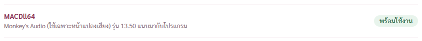
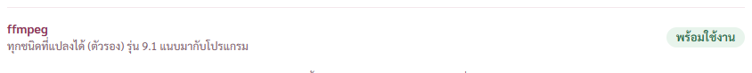
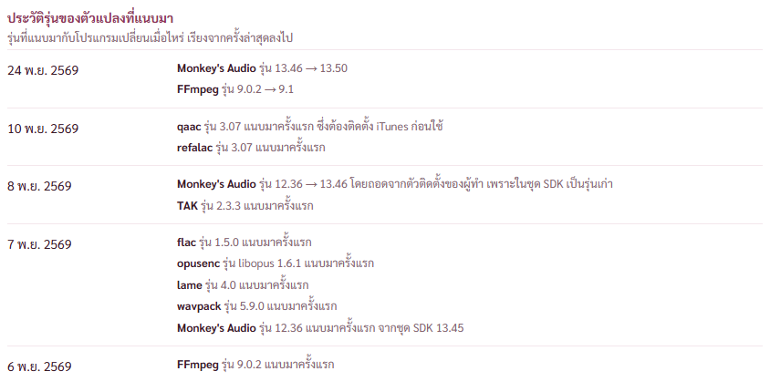

# รายงานอัปเดตตัวแปลง แก้ตัวดูซับรูป และประวัติรุ่น (BUGS ข้อ 156 158 159) · 24 พ.ย. 2569

## คำสั่งของพี่กัน
- *"อัปเดต เเละแก้ 156 เลย"* ตอบรายงานเทสใหญ่ขั้น 15 ที่ยกข้อ 156 ตัวดูซับรูป กับข้อ 158 ตัวแปลงที่มีรุ่นใหม่
- *"การอัปเดตเวอร์ชั่นของไฟล์ต่างๆ สร้างเเละใส่ประวัติที่หน้านี้ด้วยหน่อย"* พร้อมภาพหน้าตั้งค่าหัวข้อตัวแปลงเสียง (ข้อ 159)
- *"ทำไปเลย เราไม่ว่างมาสั่งตลอดนะ เราทำงานอื่นอยู่"* หลังแคลร์จบรอบเพื่อรองานเบื้องหลังหลายครั้ง

## ข้อ 156 ตัวดูซับรูป
- **อาการ** check-av ตก 4 ข้อ ดูภาพเต็มกดภาพถัดไปภาพก่อนไม่ได้ภาพที่รอ กับแถบความคืบหน้าตอนถอดซับรูปครั้งแรก
- **ต้นเหตุ** อยู่ที่ตัวตรวจทั้งสองเรื่อง ปุ่มในโปรแกรมทำงานถูก
  - ภาพเต็มมีภาพจากหนังวางไว้ข้างหลังซับ (`img data-bigsub-frame` ไม่มีชื่อภาพ) อยู่ก่อนภาพซับ ตัวตรวจหยิบ `img` ตัวแรกจึงได้ชื่อภาพว่าง
  - ตัวเก็บภาพซับรูปจำผลด้วยที่อยู่ ขนาด และเวลาแก้ไฟล์ (`cache_key` ใน subtitle/subs/picture.rs) ตัวตรวจคัดลอกหนังไปที่เดิมทุกรอบ และ Windows คงเวลาแก้ไฟล์เดิมของสำเนา รอบที่สองจึงได้ผลที่จำไว้ ไม่มีความคืบหน้า แถบที่ตัวตรวจสั่งค้างไว้จึงอยู่ที่ 0%
- **แก้** scripts/check-av.mjs หยิบภาพซับด้วย `img:not([data-bigsub-frame])` · ตั้งเวลาแก้ไฟล์ของสำเนาเป็นตอนนี้ทุกรอบ ตัวเก็บภาพจึงถอดใหม่ · รอเมนูขึ้นก่อนกดตอนเริ่ม (รอบแรกหลังเปิดโปรแกรมหน้าโหลดนานกว่า 1.5 วินาทีที่เคยรอตายตัว)
- **ผล** check-av รอบรันซ้ำผ่าน 88 จาก 88 ซึ่งเป็นรอบที่เคยตก

## ข้อ 158 อัปเดตตัวแปลง
| ตัวแปลง | เดิม | ใหม่ | ที่มา |
|---|---|---|---|
| Monkey's Audio (MACDll64.dll) | 13.46 | 13.50 | ตัวติดตั้ง MAC_1350_x64.exe ของผู้ทำ ลายเซ็น Matthew Ashland ถูกต้อง ถอดด้วย nsis-extract.py ได้ DLL 757,048 ไบต์ |
| FFmpeg (ffmpeg.exe ffprobe.exe) | 9.0.2 | 9.1 | ชุด full ของ gyan.dev ขนาด 75,452,955 ไบต์ ค่า SHA-256 ตรงกันทั้งจาก gyan.dev และที่เก็บ GitHub ของผู้ทำ |

- ffmpeg 9.1 เปิดความสามารถ 105 รายการ ครบทุกรายการของ 9.0.2 (99) และเพิ่ม libastcenc libcurl liblcevc-dec libopencolorio librabbitmq vapoursynth · ไฟล์บีบอัดเล็กลงครึ่งหนึ่งเพราะบีบอัดแน่นขึ้น ffmpeg.exe ขนาดใกล้เดิม
- สัญญาอนุญาตของ Monkey's Audio ต่างจากเดิมแค่ปีลิขสิทธิ์ 2000–2027
- แก้ที่ตามมา fetch-tools.ps1 · vendor/README.md · src-tauri/tools/licenses · การ์ดขอบคุณ settings/data.tsx · README.md · ข้อมูลจำลอง mock.ts · ระบบจำลอง theme-live-app.html · มอคอัปสี่ไฟล์ · ตัวตรวจ check-convert check-install check-latest check-av (ปุ่ม ffmpeg ในแผงตั้งค่าเสียงหาด้วยคำขึ้นต้น ไม่ผูกเลขรุ่น) · เทส Rust tools_tests ที่เช็กรุ่นที่แนบ
- การ์ดในหน้าตั้งค่าหัวข้อตัวแปลงเสียงหลังอัปเดต (ภาพที่พี่กันส่งมายังขึ้น 13.46)

- ffprobe 9.1 ยังอ่านแพ็กเก็ตของซับทดสอบ Subpictures_20.sup ไม่ได้เหมือน 9.0.2 (0 แพ็กเก็ต) หมายเหตุใน test-media/README.md ยังถูก

## ข้อ 159 ประวัติรุ่นของตัวแปลงที่แนบมา
- ต่อท้ายหัวข้อตัวแปลงเสียงในหน้าตั้งค่า เรียงจากครั้งล่าสุด ใช้แถวแบบหัวข้อชนิดไฟล์ วันที่ช่องซ้าย สิ่งที่เปลี่ยนช่องขวาบรรทัดละตัวแปลง
- วันที่และรุ่นเช็กจากประวัติ git ของ fetch-tools.ps1 กับ vendor/README.md ไม่ได้เดา
  - 6 พ.ย. 2569 FFmpeg 9.0.2 แนบครั้งแรก
  - 7 พ.ย. 2569 flac 1.5.0 opusenc (libopus 1.6.1) lame 4.0 wavpack 5.9.0 และ Monkey's Audio 12.36 จากชุด SDK 13.45
  - 8 พ.ย. 2569 Monkey's Audio 12.36 → 13.46 จากตัวติดตั้ง และ TAK 2.3.3
  - 10 พ.ย. 2569 qaac กับ refalac 3.07
  - 24 พ.ย. 2569 Monkey's Audio 13.46 → 13.50 และ FFmpeg 9.0.2 → 9.1
- ไฟล์ src/pages/settings/EncHistory.tsx (ส่วนแสดง) กับ encHistoryData.ts (ข้อมูล) · อัปเดตตัวแปลงครั้งหน้าเติมแถวบนสุด (จดใน CLAUDE.md แล้ว)
- check-settings เพิ่มสามข้อ ครั้งล่าสุดอยู่บนสุดพร้อมรุ่นที่ถูก เรียงจากล่าสุดครบ 5 ครั้ง ทุกบรรทัดอยู่บรรทัดเดียวที่หน้าต่าง 1280 และไม่มีจุดกลางคั่น

## ตรวจผล
| ชุด | ผล |
|---|---|
| cargo test ชุดเต็มกับ ffmpeg 9.1 ตั้งไฟล์ ACCA กับ Godzilla | 408 ผ่าน ตก 1 ข้อที่จดรุ่น 9.0.2 ไว้ (ตกถูกต้องหลังอัปเดต) แก้เป็น 9.1 แล้วผ่าน · ACCA อ่านถูก 438 จาก 439 ภาพ · Godzilla ญี่ปุ่นถูกทั้งภาพ 81.1% เท่ารอบก่อน · อ่าน VobSub ครบ 1,875 ภาพใน 0.35 วินาที |
| ตัวตรวจในโปรแกรมทดสอบ 28 ตัว | ผ่านครบทุกตัว check-av 88/88 check-settings 83/83 check-convert 41/41 check-pgs 108/108 check-mpvplay 29/29 check-sizes 69/69 |
| check-latest ออกเน็ตเช็กรุ่นล่าสุดจริง | 11 จาก 11 ตัวแปลงทุกตัวเป็นรุ่นล่าสุดแล้ว (ขั้น 15 ได้ 8 จาก 11) |
| ระบบจำลอง | check-shelf-count 4/4 check-keepdom 5/5 |
| tsc · ตัวเฝ้าขนาดไฟล์ | ผ่าน · 472 ไฟล์ ตก 0 |

- เครื่อง Windows ของพี่กัน โปรแกรมทดสอบ 1280 × 800 อยู่หลังสุด
- ที่ตรวจอัตโนมัติไม่ได้ เสียงที่ได้ยินจากไฟล์ APE ที่แปลงด้วย Monkey's Audio 13.50 พี่กันลองฟังเองได้ (ตัวตรวจเช็กว่าแปลงได้และถอดกลับตรง)

## ยังไม่ได้ทำ
- ตัวติดตั้งยังเป็นรุ่น 0.10.5 ที่แนบ ffmpeg 9.0.2 กับ Monkey's Audio 13.46 ถ้าจะให้ผู้ใช้ได้ตัวแปลงใหม่ต้องขยับรุ่นแล้วสร้างตัวติดตั้งใหม่ ซึ่งขยับได้เมื่อพี่กันสั่งเลขรุ่นเท่านั้น
- ยังไม่ push
